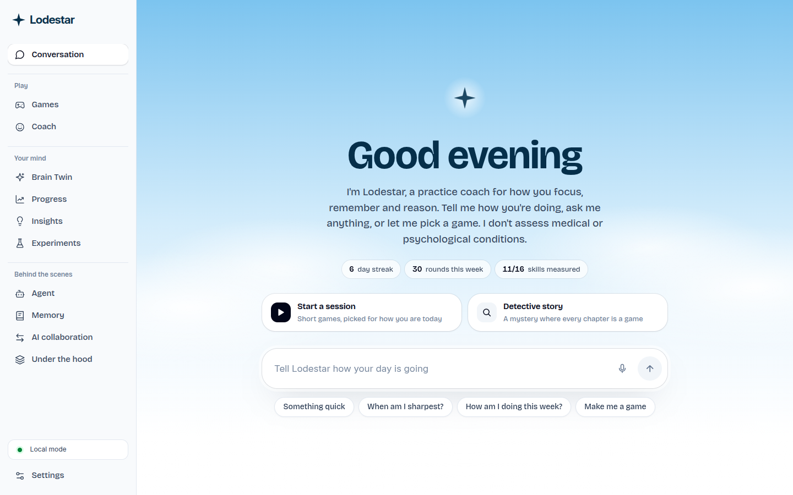
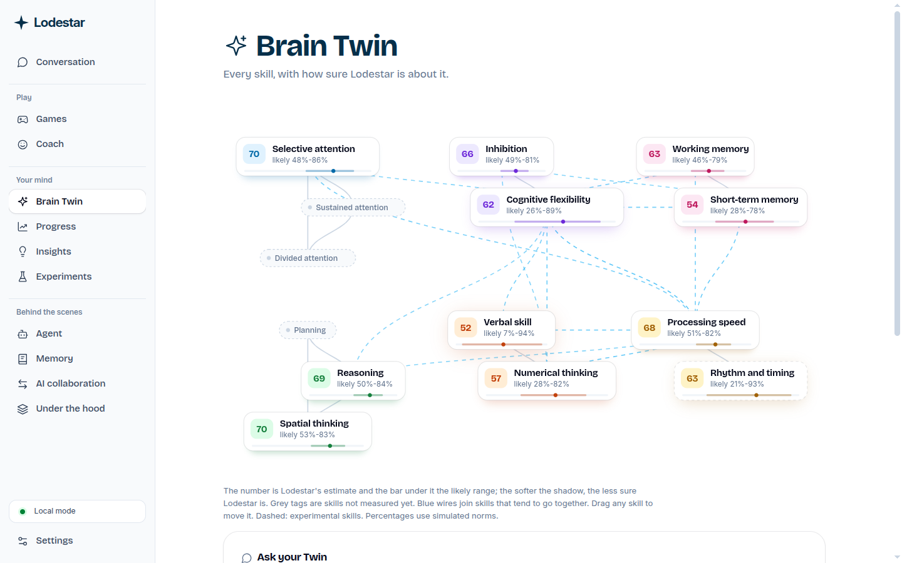
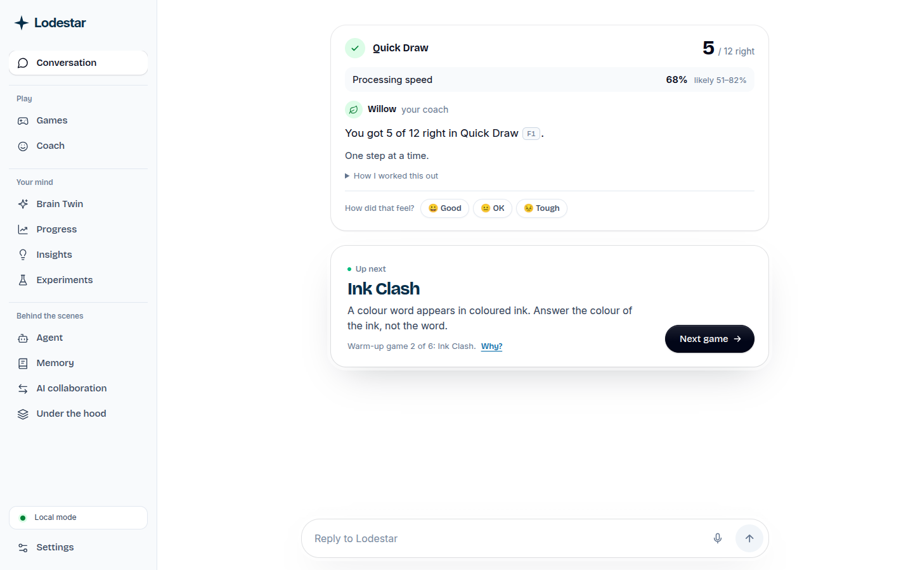
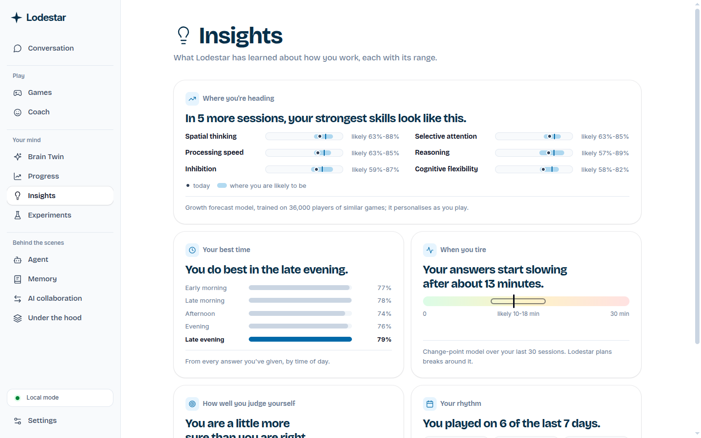
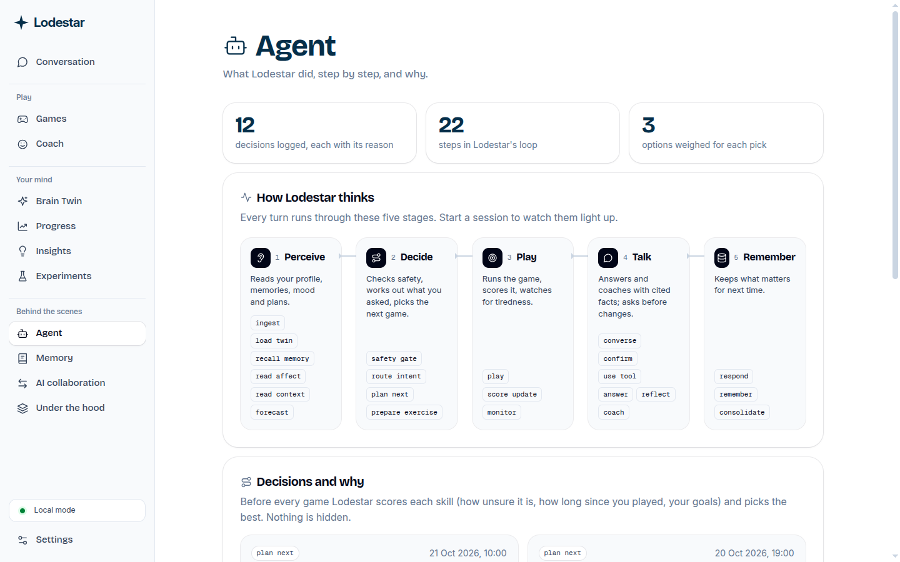
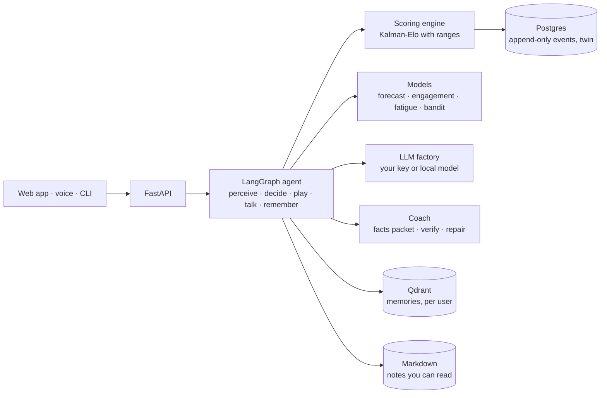

# Lodestar: a cognitive growth agent

**AI4Brain · CISTAC 1.0.** Lodestar measures how you think with short games, keeps an honest, changing profile of you (the **Brain Twin**), explains every choice it makes, and coaches you at the right level. Every estimate comes with a range, and every number the coach says is cited.

Lodestar is a practice coach. It doesn't assess medical or psychological conditions.



| | |
|---|---|
|  |  |
|  |  |

## What it does

| The brief asks | Lodestar |
|---|---|
| **Assess** across cognitive dimensions, non-clinically | 43 games (classic paradigms rebuilt, plus originals) over **16 skills**, each documented with definition, tasks, scoring, uncertainty and biases ([docs/generated/dimensions](docs/generated/dimensions)). Every answer records score, response time, errors, hints and confidence. |
| **Understand**: an uncertainty-aware percentage profile | A Kalman-Elo estimate per skill: a percentage **and an 80% range** that narrows with play and widens with time away. Shown as the Brain Twin map, a radar chart, curves and per-skill pages. |
| **Coach**: explainable, personalised feedback | A LangGraph agent with four coach voices (Willow, Spark, Sage, Buddy). Every sentence with a number cites a fact (`[F1]`), a verifier rejects uncited numbers and clinical words, and "Why?" opens the options the agent weighed. |
| **Improve**: adaptive exercises and learning paths | Difficulty targets your chosen success rate, a bandit learns which game moves each skill for you, goals ("pin working memory down to ±15") and personal experiments ("am I sharper in the evening?"). |
| **Brain Twin** with history and projections | Full history in Postgres (append-only events), growth forecasts as 80% ranges from a model trained on 36,297 real players. |
| **Dashboard**: radar, progress curves, heatmaps, goals | All four, every estimate with its range. |
| **AI Collaboration Score** (0–100, documented formula) | Five parts measured inside games (verification via planted mistakes, autonomy, iteration, clarification, responsible use), formula and weights in [docs/generated/acs.md](docs/generated/acs.md). |
| **Ethics & data** | Seven consent switches, export, delete with a receipt, a retention job; camera and voice never change the profile ([docs/generated/data-policy.md](docs/generated/data-policy.md)). |
| **Bonus**: voice, emotion-aware, predictive growth | Voice in and out with a wake word, optional on-device camera and voice-tone cues used only to suggest breaks, and the growth forecast. |

## Try it

You need Docker (with Compose), `make`, and [uv](https://docs.astral.sh/uv/). Node 24 only for frontend development.

```bash
make up      # creates .env with a fresh encryption key, builds and starts everything
make seed    # a demo user (Alex) with eight weeks of practice; prints a sign-in link
```

Open the link (http://localhost:5173/?signin=…). To start fresh as a new user, open http://localhost:5173.

- **AI model.** Lodestar runs without any key, using a local [Ollama](https://ollama.com) model if one is running (`make up-ollama` starts one in Docker) and fixed templates otherwise. To use a hosted model, add your own key in **Settings → AI provider** (Anthropic, OpenAI, Gemini, DeepSeek, Grok, Mistral, Groq or OpenRouter). Keys are encrypted at rest and shown only as their last 4 characters.
- **The two trained models** (growth forecast, engagement risk) need their public datasets: `make ml-data` (about 3.1 GB), then `make ml-train ml-engagement`. Without them the app works and says forecasts aren't available yet.
- **Terminal.** `bin/lodestar login --code <token>`, then `bin/lodestar chat` or `bin/lodestar play`.

## A tour

| Page | What you see |
|---|---|
| **Conversation** | The app itself: talk to Lodestar, play the game it picks, see your score, the skill it moved (with its range) and the coach's comment. |
| **Games** | The Detective story, "Make me a game", and every game by skill family. |
| **Coach** | Pick the voice; the facts stay the same. |
| **Brain Twin** | Skill cards on a map you can rearrange, the radar, and "Ask your Twin" answered on the page. |
| **Progress** | Goals with rings and target ranges, curves with forecast bands, heatmaps by week and time of day. |
| **Insights** | Where you're heading, your best time, when you tire, how well you judge yourself, your rhythm. |
| **Experiments** | Morning vs evening tests with a plain verdict and how sure Lodestar is. |
| **Agent** | The five stages lighting up live, and every decision with the options it weighed. |
| **Memory** | What Lodestar remembers, with Forget on every line. |
| **AI collaboration** | The score, its five parts and their ranges. |
| **Under the hood** | Architecture, model evaluations, simulator results, the rules the code enforces. |

## How it works



- **Agent**: 22 nodes in LangGraph with a Postgres checkpointer, so a crash mid-game resumes where it stopped. Every decision is stored with its candidates, score parts and reason.
- **Scoring**: one transaction per round (events, trials, profile, history) under a per-user lock. The profile can be rebuilt from the event log at any time.
- **Coach**: the agent builds a facts packet; the LLM drafts; a verifier checks every number against the facts and every word against the banned list; failures are repaired or replaced by a template.
- **Memory**: Qdrant search is always filtered by user; Markdown notes are the only files Lodestar writes.

Design documents: [docs/plan](docs/plan/README.md). Technical report: [docs/report/report.pdf](docs/report/report.pdf).

## Evaluation

200 simulated people with known true skills, 10 sessions each (`make sim`, `make eval`; full table in [docs/figures/eval_summary.md](docs/figures/eval_summary.md)):

| Check | Result | Target |
|---|---|---|
| Recovers true skill after 3 sessions (correlation) | 0.82 (0.91 after 10) | > 0.80 |
| 80% ranges containing the true skill | 79.9% | 75–85% |
| Success rate in Balanced mode | 77.7% | 80 ± 5% |
| Bad data caught (precision / recall) | 1.00 / 1.00 | > 0.9 / > 0.8 |
| Forecast ranges holding on held-out real players | 79.7% | 80% |
| Engagement model AUC on held-out students | 0.857 (simple rule: 0.828) | report |
| Sessions completed with every model down, Qdrant down, or both | 18/18 each | 100% |

## Development

```bash
make test        # backend (pytest) and frontend (vitest) unit tests
make lint        # ruff, mypy --strict, eslint, prettier, banned-word check
cd frontend && npx playwright test   # end-to-end, against the running stack
make docs        # regenerate skill pages, ACS, data policy and model cards
```

Rules every contributor follows are in [AGENTS.md](AGENTS.md). Third-party code and licences: [THIRD_PARTY.md](THIRD_PARTY.md). Datasets: NCPT (CC BY 4.0), OULAD (CC BY 4.0), Steyvers & Schafer 2020 Lumosity data (OSF).

## Licence

[MIT](LICENSE)
