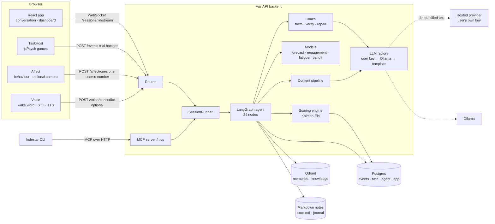
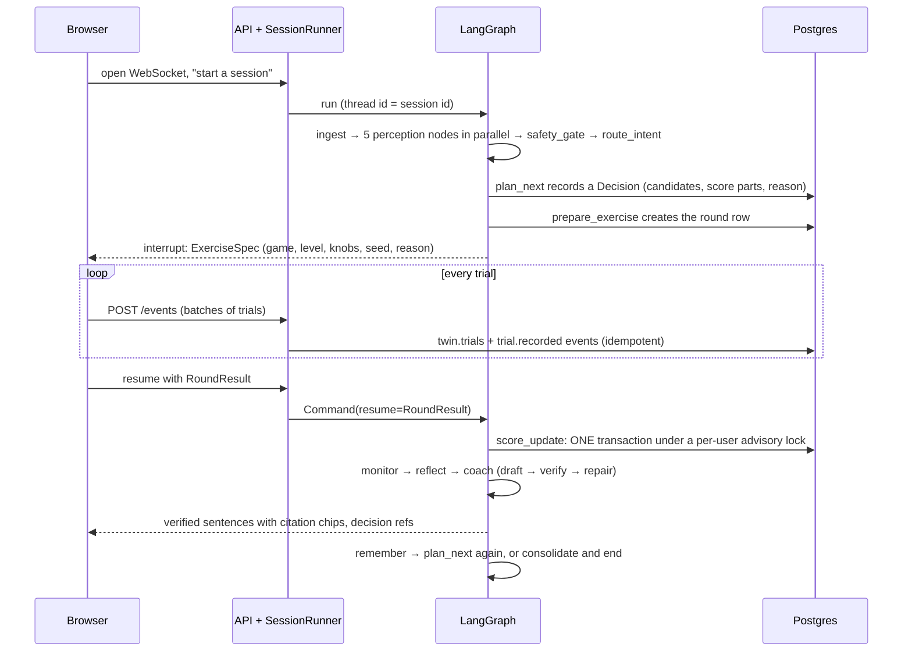
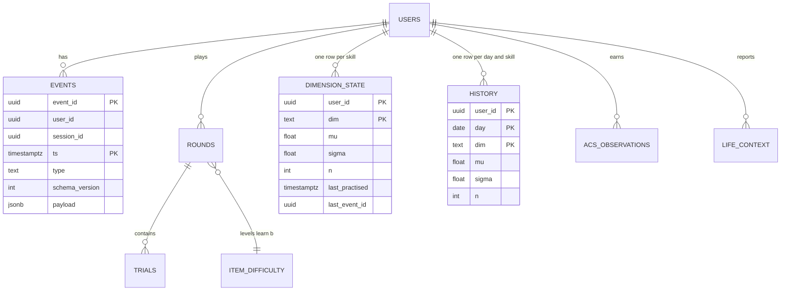
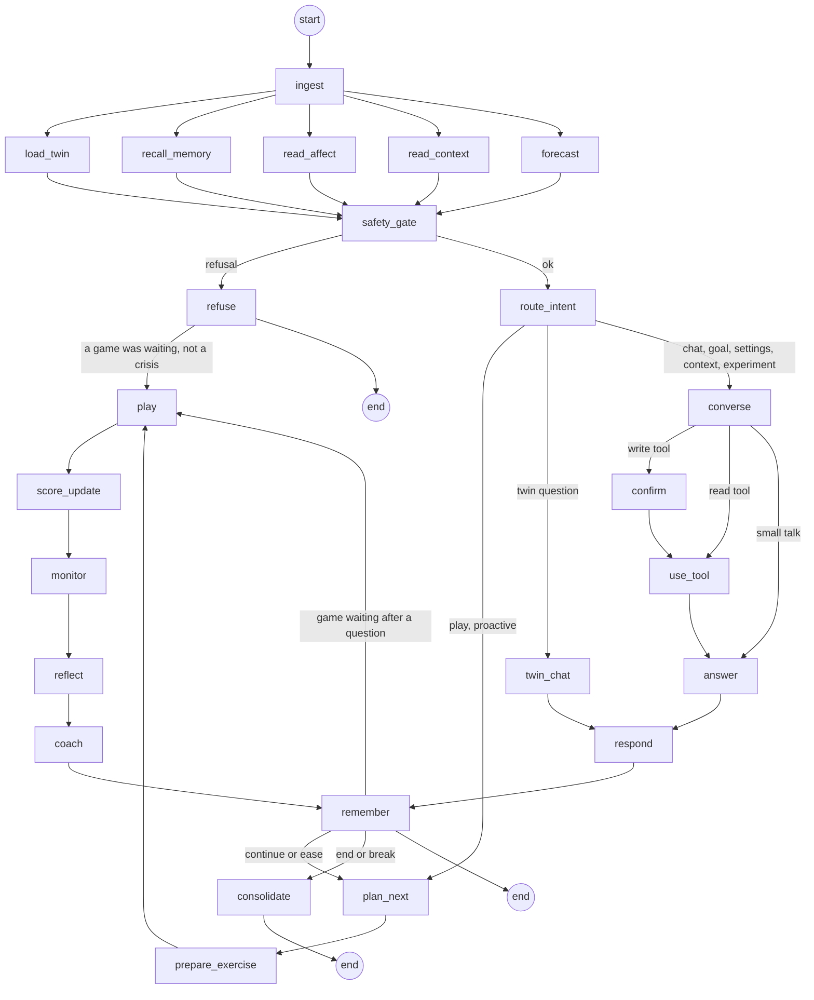
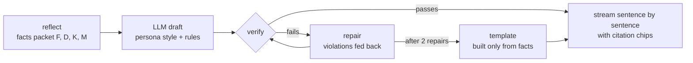

# Lodestar technical guide

**AI4Brain · CISTAC 1.0 · team We are soo back**

This is the long-form technical companion to the [README](../README.md). The README tells you what Lodestar does and how to run it; this guide explains how it is built: the architecture, how assessment and profiling work, how the Brain Twin is implemented down to the formulas and the database transaction, how the agent decides, and how the AI coach is kept honest. Every constant, threshold and formula quoted here is copied from the code, with the file it lives in, so you can check it.

Lodestar is a practice coach. It does not assess medical or psychological conditions, and nothing in this guide should be read as a claim that it does.

---

## Contents

1. [Lodestar in one page](#1-lodestar-in-one-page)
2. [Repository map](#2-repository-map)
3. [System architecture](#3-system-architecture)
4. [The registry: one source of truth](#4-the-registry-one-source-of-truth)
5. [Assessment and profiling](#5-assessment-and-profiling)
6. [The Brain Twin: how it is implemented](#6-the-brain-twin-how-it-is-implemented)
7. [The agent: LangGraph loop, node by node](#7-the-agent-langgraph-loop-node-by-node)
8. [The AI coach](#8-the-ai-coach)
9. [The LLM layer](#9-the-llm-layer)
10. [Memory: Postgres, Qdrant and Markdown](#10-memory-postgres-qdrant-and-markdown)
11. [Adaptive learning and plans](#11-adaptive-learning-and-plans)
12. [Content generation and games made to order](#12-content-generation-and-games-made-to-order)
13. [Predictive models](#13-predictive-models)
14. [AI Collaboration Score](#14-ai-collaboration-score)
15. [Emotion-aware coaching and voice](#15-emotion-aware-coaching-and-voice)
16. [Ethics, privacy and data rights](#16-ethics-privacy-and-data-rights)
17. [HTTP API reference](#17-http-api-reference)
18. [Frontend architecture](#18-frontend-architecture)
19. [Terminal client and MCP server](#19-terminal-client-and-mcp-server)
20. [Evaluation and the simulator](#20-evaluation-and-the-simulator)
21. [Testing and quality gates](#21-testing-and-quality-gates)
22. [Running and configuring](#22-running-and-configuring)
23. [Extending Lodestar](#23-extending-lodestar)
24. [Known limitations](#24-known-limitations)
25. [Glossary](#25-glossary)

Appendices: [A. Constants](#appendix-a-constants-reference) · [B. A session, end to end](#appendix-b-a-session-end-to-end) · [C. Backend file index](#appendix-c-backend-file-index) · [D. Database tables](#appendix-d-database-tables) · [E. Contracts](#appendix-e-contracts) · [F. User workflows](#appendix-f-user-workflows-and-their-acceptance-tests) · [G. The Twin's numbers, computed](#appendix-g-the-twins-numbers-computed) · [H. Checking the claims](#appendix-h-checking-the-claims-yourself)

---

## 1. Lodestar in one page

Lodestar ("the guiding star") is an AI agent that runs a person's thinking-skills practice. In one sentence: it measures you with short games, keeps an honest, changing profile of you, explains what it sees, and adapts your training, without ever pretending to diagnose anything.

The CISTAC brief asks for four capabilities and three layers. This table maps each to the part of the system that delivers it and to the section of this guide that explains it.

| The brief asks | What Lodestar does | Where it lives | Section |
|---|---|---|---|
| **Assess**: profile the user across cognitive dimensions, non-clinically | 43 browser games over 16 skills and one thinking style; every trial records correctness, response time, hints, practice flag and optional confidence | `registry/`, `frontend/src/games/`, `frontend/src/taskhost/` | [5](#5-assessment-and-profiling) |
| **Understand**: an uncertainty-aware percentage profile | A Kalman-Elo belief per skill: a percentage and an 80% range that narrows with play and widens with time away | `backend/scoring/` | [6](#6-the-brain-twin-how-it-is-implemented) |
| **Brain Twin**: dynamic, historised; projections with uncertainty | Append-only event log, per-skill state, daily history, rebuild from events, growth forecast as an 80% range | `backend/db/twin_store.py`, `backend/ml/serve.py` | [6](#6-the-brain-twin-how-it-is-implemented), [13](#13-predictive-models) |
| **Coach**: explainable, personalised feedback and motivation | Facts packet, LLM draft in one of four voices, verifier, repair, template fallback; "Why?" cards for every decision | `backend/agent/nodes/talk.py`, `backend/coach/` | [8](#8-the-ai-coach) |
| **Improve**: adaptive exercises and measurable learning paths | Difficulty targeting, a Thompson-sampling bandit, range goals, personal experiments, generated content | `backend/agent/nodes/play.py`, `backend/ml/bandit.py`, `backend/generation/` | [11](#11-adaptive-learning-and-plans), [12](#12-content-generation-and-games-made-to-order) |
| Layer B: free but justified architecture | A LangGraph graph whose decisions are code; the LLM only phrases | `backend/agent/graph.py` | [3](#3-system-architecture), [7](#7-the-agent-langgraph-loop-node-by-node) |
| Layer C: radar, progress curves, heatmaps, goal tracking | All four in the dashboard, each estimate with its range | `frontend/src/dashboard/` | [18](#18-frontend-architecture) |
| AI Collaboration Score, 0 to 100, documented formula | Five components measured inside games, Beta(2,2) shares, Monte Carlo range | `backend/acs/` | [14](#14-ai-collaboration-score) |
| Ethics: consent, retention, deletion; no decision on face or voice alone | Seven consent switches, daily retention job, export, delete with receipt, row-level security, no code path from camera cues to the profile | `backend/ethics/`, `registry/consent.yaml` | [16](#16-ethics-privacy-and-data-rights) |
| Bonus: voice, emotion-aware, predictive | Wake word, speech in and out, behaviour-first strain detection with optional on-device camera, growth forecast | `frontend/src/voice/`, `frontend/src/affect/`, `backend/ml/` | [13](#13-predictive-models), [15](#15-emotion-aware-coaching-and-voice) |

Three ideas run through the whole design:

1. **Honest uncertainty everywhere.** Every skill estimate, forecast, ACS value and fatigue point carries a range. The forecast contract cannot even express a single number (`tests/backend/test_contracts.py::test_forecast_is_a_range`).
2. **Code decides, the language model phrases.** Which skill, which game, which difficulty, whether to stop: all decided by deterministic code that records its options and reasons. The LLM only turns facts into sentences, and a verifier checks those sentences.
3. **The event log is the truth.** Every answer is an event that is never updated. The profile is a projection of the log and can be rebuilt from it at any time.

---

## 2. Repository map

```
ai4brain-plan/
├── AGENTS.md                 rules every contributor follows (storage, language, safety, keys)
├── README.md                 overview, how to run, evaluation summary
├── Makefile                  every command: up, seed, test, lint, eval, sim, ml-*, docs, retention
├── docker-compose.yml        postgres 18.6, qdrant 1.19.2, backend, frontend, optional ollama
├── alembic.ini               migrations config (backend/db/migrations)
├── pyproject.toml            Python 3.14 dependencies, ruff, mypy --strict, pytest
├── registry/                 YAML that drives the UI, the scorer and the agent
│   ├── dimensions.yaml       the 16 skills and 1 thinking style
│   ├── games/*.yaml          one file per game: loadings, knobs, scoring rule, duration
│   ├── batteries.yaml        onboarding warm-up and the check-up after a long break
│   ├── priors.yaml           skill correlations from NCPT (generated)
│   ├── practice.yaml         average practice gain per round from Lumosity (generated)
│   ├── consent.yaml          the seven consent switches and the notice version
│   ├── llm_providers.yaml    eight hosted providers, Ollama and a stub
│   ├── knowledge.yaml        team-written tips the coach may cite
│   └── content/themes.yaml   themes for themed games ("a memory game about football")
├── backend/
│   ├── api/                  FastAPI routes (sessions, twin, events, me, llm, voice, affect...)
│   ├── agent/                the LangGraph agent: graph, state, nodes, tools, intents, runner
│   ├── scoring/              Kalman-Elo, HSHS, loadings, levels, norms, priors, quality, goals
│   ├── coach/                verifier, banned-word lexicon, personas, language lint, red team
│   ├── memory/               Qdrant store, consolidation, Markdown notes, embeddings
│   ├── llm/                  the LLM factory, providers, key vault, de-identification, redaction
│   ├── ml/                   growth forecast, engagement risk, fatigue point, bandit, priors
│   ├── acs/                  AI Collaboration Score: observations, score, sensitivity
│   ├── generation/           generated content pipeline, generators, custom block games
│   ├── ethics/               export, delete, retention job
│   ├── contracts/            Pydantic contracts shared by API, agent and frontend
│   ├── db/                   tables, migrations, twin store, seed, rebuild
│   ├── registry/             typed loader for registry/*.yaml
│   ├── mcp_server/           MCP tool server used by the terminal client
│   └── docs_gen.py           generates docs/generated/ from the registry and code
├── frontend/
│   ├── src/app/              shell, conversation, onboarding, settings, decision cards
│   ├── src/dashboard/        Brain Twin, progress, insights, experiments, agent, memory, ACS
│   ├── src/games/<id>/       one folder per game: plugin.ts, config.yaml, README.md
│   ├── src/taskhost/         runs a game's jsPsych timeline and streams trials
│   ├── src/voice/            wake word, speech to text, text to speech, spoken answers
│   ├── src/affect/           behaviour signals, optional camera and voice-tone cues
│   ├── src/api/              typed client, WebSocket session
│   ├── src/contracts/api.ts  TypeScript types generated from the OpenAPI schema
│   └── e2e/                  Playwright suites against the running stack
├── cli/                      the `lodestar` terminal client (login, chat, play)
├── simulator/                simulated people, the 12 evaluation experiments
├── models/                   trained models shipped with the repo (growth, engagement)
├── data/                     public datasets after `make ml-data` (not committed)
├── tests/backend/            pytest suites, one folder per backend package
└── docs/
    ├── plan/                 the 18 design documents
    ├── generated/            skill pages, ACS, data policy, model cards (from `make docs`)
    ├── figures/              evaluation figures and eval_summary.md
    ├── report/               the 8-page technical report
    ├── screens/              screenshots
    ├── EVIDENCE.md           every claim mapped to a number, a file and a test
    └── TECHNICAL.md          this guide
```

The backend is about 17,500 lines of Python across these packages. The heaviest modules are the play loop (`backend/agent/nodes/play.py`, 857 lines), the converse tools (`backend/agent/tools.py`, 716 lines), the twin store (`backend/db/twin_store.py`, 647 lines) and the MCP server (`backend/mcp_server/server.py`, 576 lines).

---

## 3. System architecture

### 3.1 Services

Lodestar runs as five containers defined in `docker-compose.yml`. Four start with `make up`; the fifth (Ollama) is optional.

| Service | Image or build | Role | Host port (default) |
|---|---|---|---|
| `postgres` | `postgres:18.6` | System of record: users, consent, the event log, trials, rounds, the twin's state and history, decisions, traces, LangGraph checkpoints, experiments, content pool, model registry | `LODESTAR_PG_PORT=5442` |
| `qdrant` | `qdrant/qdrant:v1.19.2` | Searchable memory: episodic moments, distilled facts, served exercises (novelty), and a shared knowledge collection | `LODESTAR_QDRANT_PORT=6333` |
| `backend` | built from the repo | FastAPI app: REST, WebSocket streams, the LangGraph agent, the scorer, the models, the MCP server at `/mcp` | `LODESTAR_API_PORT=8000` |
| `frontend` | built from `frontend/` | Vite + React 19 single-page app | `LODESTAR_WEB_PORT=5173` |
| `ollama` | `ollama/ollama:0.40.6`, profile `ollama` | Local language model when no hosted key is used | 11434 |

Named volumes keep data across restarts: `pgdata`, `qdrant_data`, `lodestar_memory` (the Markdown notes), and `ollama_models`.

### 3.2 The big picture



### 3.3 Main data flow of one round

The single most important flow is a round of play, because it is where assessment, the Brain Twin and the coach meet.



Two properties fall out of this design:

- **Crash safety.** Trials are written as they happen, not at the end of the round. The graph's state is checkpointed in Postgres after every node, and the pause at `play` is a LangGraph `interrupt`. A refresh, a dropped connection or a backend restart resumes the same session on the same trial (`frontend/e2e/uw6.spec.ts`).
- **Exactly-once scoring.** The round row carries `scored_at`; the scoring transaction locks the round `FOR UPDATE` and returns early if it was already scored. Resuming twice changes nothing.

### 3.4 Technology stack

All versions are pinned (`docs/plan/02`, AGENTS.md "Use exactly the versions pinned").

| Layer | Technology | Version | Why |
|---|---|---|---|
| Language | Python | 3.14 | Typed, async, the ML ecosystem |
| Web | FastAPI, Uvicorn | 0.156.2, 0.54.0 | Async routes, WebSockets, OpenAPI for generated TS types |
| Contracts | Pydantic | 2.14.1 | One set of models for API, agent state, events and checkpoints |
| Agent | LangGraph, langgraph-checkpoint-postgres | 1.2.16, 3.2.0 | Explicit graph, interrupts, Postgres checkpoints, streaming |
| LLM adapters | langchain-core and provider packages | 1.6.12 | One chat interface for 8 hosted providers and Ollama |
| Database | PostgreSQL, SQLAlchemy (async), psycopg, Alembic | 18.6, 2.1.5, 3.3.6, 1.20.0 | Transactions, advisory locks, JSONB, range types, partitions, row-level security |
| Vector search | Qdrant, qdrant-client, fastembed | 1.19.2, 1.19.1, 0.9.0 | Dense + sparse hybrid search with tenant-indexed payload filters |
| Embeddings | BAAI/bge-small-en-v1.5 (384-d), Qdrant/bm25 | | Small, CPU-friendly; BM25 catches exact words |
| ML | LightGBM, scikit-learn, MAPIE, NumPy, pandas | 4.7.0, 1.9.1, 1.6.0, 2.5.4, 3.0.6 | Quantile boosting, calibration, conformal intervals |
| Crypto | cryptography (AES-256-GCM) | 50.0.2 | API keys encrypted at rest |
| MCP | mcp | 2.3.0 | The terminal client talks to the same agent |
| Frontend | React, TypeScript, Vite, Tailwind | 19.3.1, 6.0.3, 8.3.4, 4.3.3 | Strict typing, fast builds, CSS-first config |
| Games | jsPsych | 8.3.0 | Millisecond timing, timeline model used in research |
| Voice | Porcupine Web, Transformers.js (Whisper), kokoro-js | 4.0.1, 4.3.1, 1.2.1 | Wake word, on-device speech to text, on-device voices |
| Camera | MediaPipe Tasks Vision | 1.1.1 | Face blendshapes in the browser |
| Local LLM | Ollama, default model `qwen3.5:4b` | 0.40.6 | Works with no key and no internet |

### 3.5 Design decisions and their trade-offs

The brief asks for a "free but justified" architecture. These are the decisions that shape everything else, with the alternative each one rejected.

| Decision | Instead of | Why |
|---|---|---|
| A LangGraph graph whose decisions are plain code | A free LLM tool-calling loop | Decisions must be explainable, testable and resumable. Each decision is a row with its candidates and score parts. The LLM never chooses a game or a difficulty. |
| Kalman-Elo per skill | Fixed tests, or batch IRT fits | Updates after every answer, carries its own uncertainty, grows uncertain with time away, cheap enough to run per trial inside a transaction. |
| Facts packet + verifier | Prompting the model to "be careful" | Only checking can guarantee every number is real. A 4-billion-parameter local model passes after repair. |
| Postgres + Qdrant + Markdown | One vector database, or JSON files | An append-only event log makes the profile rebuildable and auditable; memory search stays per user; notes stay readable by the person. AGENTS.md rule 1 bans JSON/JSONL storage and SQLite. |
| Bring your own key, local fallback, templates | One hosted provider | No running cost, no data to a provider without consent, works offline, and the coach never goes silent. |
| Behaviour first for affect | Camera-first emotion AI | Works for everyone and needs no biometrics. The camera only adds a weak cue and never touches the profile. |
| Registry in YAML | Games and skills hard-coded | A new game added in YAML is scored, chosen and explained with no change to the scorer. |
| Simulated norms, labelled | Borrowed norms on another scale | Showing a percentile we can't back would overstate accuracy; a linking study comes first. |

### 3.6 The five Postgres schemas

| Schema | Holds | Written by |
|---|---|---|
| `app` | users, consent, goals, skill pauses, deletion receipts, encrypted LLM credentials, LLM selection, user tokens | API routes, converse tools |
| `twin` | the event log (`twin.events`, partitioned by month), rounds, trials, dimension state, history, item difficulty, ACS observations, life context | the twin store (scored-round transaction) |
| `agent` | sessions, decisions, traces, experiments, content pool, content served, ML model registry | the agent, the content pipeline, the trainers |
| LangGraph checkpoint tables | graph state after every node, per thread (= session) | the LangGraph Postgres checkpointer (migration 0002) |
| roles | `lodestar_app` (row-level security), `lodestar_jobs` (retention and deletion), `lodestar_readonly` (analytics) | migration 0007 |

Migrations are in `backend/db/migrations/versions/`:

| Revision | What it adds |
|---|---|
| 0001 | The schema: every table above, `uuidv7()` primary keys, the monthly-partitioned `twin.events` with `twin.ensure_event_partitions()` |
| 0002 | LangGraph checkpoint tables |
| 0003 | Bearer tokens for API access; only a SHA-256 hash of each is stored |
| 0004 | A sequence for trace ordering |
| 0005 | The user's time zone ("today" means their day) and paused skill suggestions |
| 0006 | Per-round loadings (custom games count for the skills their recipe names) |
| 0007 | Row-level security on every table with a `user_id` |

### 3.7 AGENTS.md: the rules the code enforces

These nine rules are the backbone of the architecture. Most are enforced by a test, not just by convention.

1. **Postgres for structured data, Qdrant for memory search, Markdown for notes.** No JSON or JSONL storage, no SQLite. Flexible payloads go in `jsonb`. Every schema change is an Alembic migration.
2. **Clinical words are banned in user-facing text.** `make lint-language` scans UI strings, prompts, templates and generated docs; the verifier checks every coach reply at runtime.
3. **Camera and voice-tone signals never write to the Brain Twin.** There is no code path from `affect.biometric.*` to `profile.*`. `test_profile_code_never_imports_affect` checks it.
4. **Every number the coach says must come from a facts packet.** The verifier rejects any number not found in a cited fact.
5. **Every prediction is shown as a range.**
6. **A scored round is one transaction** (events, trials, round, profile, history) with a per-user advisory lock. `twin.events` is append-only: the app role has no `UPDATE`, `DELETE` or `TRUNCATE` on it.
7. **Every Qdrant query on user data filters by `user_id`.** A helper enforces it; `test_search_without_a_user_is_impossible`.
8. **English only** in UI, docs and repo.
9. **User API keys are secrets.** Encrypted in `app.llm_credentials`, decrypted only inside the LLM factory, never in state, checkpoints, traces, logs, events, exports or errors; the UI shows the last 4 characters.

---

## 4. The registry: one source of truth

Everything the system knows about skills and games is declared in YAML under `registry/` and validated by Pydantic models in `backend/registry/models.py`. The registry drives three consumers at once:

- **The UI**: the games page, skill cards, the night-sky groups, game instructions, consent-gated games.
- **The scorer**: which skills a game loads on and how strongly, the scoring rule, the difficulty knobs.
- **The agent**: which games are eligible for which skill, durations ("something quick"), the onboarding battery, story chapters.

AGENTS.md requires that every new dimension or game is registered in YAML before any code.

### 4.1 Dimensions

`registry/dimensions.yaml` lists 17 entries: 16 skills and one thinking style. Each entry has:

| Field | Meaning | Example (`working_memory`) |
|---|---|---|
| `id` | stable identifier used everywhere | `working_memory` |
| `name` | display name | Working memory |
| `plain` | one-line plain description | Holding information in mind and using it |
| `badge` | strength of evidence: `established`, `moderate`, `experimental` | established |
| `in_overall` | counted in overall summaries | true |
| `group` | constellation in the night sky | memory |
| `framework` | links to CHC, NIH Toolbox, NCPT, Miyake | CHC:Gwm, Miyake:updating, NIH:list_sorting, NCPT:working_memory |
| `main_metric` | what the games report | d-prime by n, span |
| `forecast_family` | which Lumosity game family the growth model uses | 10 |
| `biases` | known confounds, shown on the skill page | chunking strategy, practice gains on n-back |
| `style` | true for a thinking style (shown as a style, never better or worse) | false |
| `sources` | references | NCPT, Nature Scientific Data |

The full list:

| Skill | Plain words | Evidence | Group | Main metric | Known biases |
|---|---|---|---|---|---|
| Selective attention | Focusing on what matters | established | attention | Flanker RT cost; search slope | screen size, device lag, speed vs accuracy trade-off |
| Sustained attention | Staying alert over time | established | attention | Hits, false alarms, d-prime, RT variability | boredom, noisy room |
| Divided attention | Doing two things at once | moderate | attention | Dual-task cost | strategy learning |
| Inhibition | Holding back an automatic response | established | control | Stroop effect, commission errors, SSRT | reading fluency with English colour words |
| Cognitive flexibility | Switching between rules | established | control | Switch cost, perseverative errors | card sort loses meaning once the trick is known |
| Working memory | Holding information in mind and using it | established | memory | d-prime by n, span | chunking strategy, practice gains on n-back |
| Short-term memory | Remembering what you just saw | established | memory | Items recalled, recognition d-prime | language, repeated lists |
| Processing speed | Speed on simple tasks | established | speed | Median RT, items per minute | device latency, motor speed |
| Rhythm and timing | Feeling a steady beat | experimental | speed | Telling on-beat from off-beat | musical training, sound off, device jitter |
| Reasoning | Logic and patterns | established | reasoning | Accuracy by item difficulty | item memorisation (fresh, solver-checked items) |
| Spatial thinking | Imagining shapes and places | established | reasoning | Angle-RT slope, accuracy, span | prior gaming experience |
| Planning | Thinking ahead | moderate | reasoning | Percent optimal solutions, extra moves | trial-and-error strategies |
| Numerical thinking | Feel for numbers | established | language | Percent absolute error, RT | maths worry, schooling |
| Verbal skill | Working with words | moderate | language | Words per minute, solutions | the English-only rule disadvantages Arabic and French speakers |
| Self-awareness of accuracy | Knowing when you're right | experimental | style | Calibration error, Brier score | needs many answers |
| Creativity | Coming up with ideas | experimental | style | Fluency, originality (AI-rated) | AI rater bias, validity unproven |
| Decision style under risk | Cautious or bold | moderate | style (a style) | Adjusted pumps, advantageous choices | learning the task vs risk preference |

`make docs` turns each entry, plus the games that load on it and the scoring constants, into a page in `docs/generated/dimensions/`. Each page has the five things the brief requires: definition, tasks, scoring, uncertainty and biases, plus the evidence level and sources.

### 4.2 Games

Each game has its own file in `registry/games/`. Here is Echo, the n-back game:

```yaml
id: echo
name: Echo
kind: game
phase: P1
dims:
  working_memory: 1.0
origin: classic
paradigm: N-back
code_source: Experiment Factory / jspsych-timelines spatial n-back (MIT)
does: Does this match the one n steps back?
scoring: binary
duration_s: 90
metrics:
- d_prime_by_n
knobs:
  n:
    easy: 1
    hard: 4
  pace_ms:
    easy: 3000
    hard: 1500
    unit: ms
level_map: linear
content: code
modalities:
- keyboard
- touch
acs_hooks: []
practice_trials: 3
available: true
```

| Field | Meaning |
|---|---|
| `kind` | `game`, `probe` (How sure are you?) or `story` (Detective) |
| `dims` | loadings: how strongly each answer counts for each skill (0 to 1) |
| `origin` | `classic` (a published paradigm rebuilt from its description), `original`, or `custom` (block games) |
| `paradigm`, `code_source` | the research task it is based on, and any code it borrows ideas from (licences in `THIRD_PARTY.md`) |
| `scoring` | `binary`, `hshs`, `span`, `continuous`, `rubric`, `style`, `calibration` or `none` (see [5.5](#55-scoring-rules)) |
| `knobs` | difficulty parameters with their values at level 0 (easy) and level 1 (hard) |
| `level_map` | how a level in 0..1 maps onto knob values (linear here) |
| `content` | `code` (built by code) or a generator name for generated content |
| `practice_trials` | shown the first time a person plays the game; never scored |
| `consent` | a switch the game needs (Spot the AI's Mistake needs `deliberate_mistakes`) |
| `available` | true once the browser plugin works; the agent never offers an unavailable game |
| `themable` | can take a theme ("about football") |

### 4.3 The game catalogue

43 playable games plus the How-sure probe and the Detective story wrapper. Loadings in brackets are secondary.

| Game | Paradigm | Scoring | Skills (loading) | Seconds |
|---|---|---|---|---|
| Arrow Storm | Eriksen flanker | hshs | selective attention 1.0, inhibition 0.3 | 60 |
| Look Here | Posner cueing | hshs | selective attention 1.0 | 90 |
| Odd One Out | Visual search | hshs | selective attention 1.0 | 60 |
| Night Guard | Continuous performance (vigilance) | binary | sustained attention 1.0 | 180 |
| Control Tower | Multi-tasking with rule changes (original) | binary | divided attention 1.0, cognitive flexibility 0.3 | 120 |
| Two Screens | Dual task (tracking + questions) | binary | divided attention 1.0 | 120 |
| Ink Clash | Stroop | hshs | inhibition 1.0, selective attention 0.3 | 60 |
| Hold It | Go/no-go | binary | inhibition 1.0 | 60 |
| Brake | Stop-signal | binary | inhibition 1.0 | 120 |
| Switch | Task switching | hshs | cognitive flexibility 1.0 | 90 |
| Zigzag | Trail making B | continuous | cognitive flexibility 1.0, processing speed 0.3 | 90 |
| Secret Rules | Card sorting (WCST idea, original theme) | binary | cognitive flexibility 1.0 | 120 |
| Echo | N-back | binary | working memory 1.0 | 90 |
| Digits Back | Backward digit span | span | working memory 1.0 | 90 |
| Sum & Keep | Operation span | span | working memory 1.0, numerical thinking 0.3 | 150 |
| Market Rush | Updating with interference (original) | binary | working memory 1.0, short-term memory 0.5 | 120 |
| Seen It? | Picture recognition | binary | short-term memory 1.0 | 90 |
| Market List | Free word recall | binary | short-term memory 1.0, verbal skill 0.3 | 90 |
| Name Tags | Face-name association (drawn characters only) | binary | short-term memory 1.0 | 90 |
| Callback | Delayed recall of this session's Market List | binary | short-term memory 1.0 | 60 |
| Quick Draw | Simple and choice reaction time | hshs | processing speed 1.0 | 50 |
| Symbol Code | Digit-symbol substitution | hshs | processing speed 1.0 | 90 |
| Twins | Pattern comparison | hshs | processing speed 1.0 | 60 |
| Connect | Trail making A | continuous | processing speed 1.0 | 90 |
| Off Beat | Anisochrony detection (Ehrlé & Samson, 2005) | binary | rhythm and timing 1.0 | 90 |
| Pattern Gap | Matrix reasoning | binary | reasoning 1.0 | 120 |
| Logic Lock | Conditional reasoning | binary | reasoning 1.0 | 120 |
| Spot the AI's Mistake | Verifying worked solutions (original) | binary | reasoning 1.0 | 120 |
| Turn It | Mental rotation | hshs | spatial thinking 1.0 | 90 |
| Fold & Punch | Paper folding | binary | spatial thinking 1.0 | 120 |
| Light Path | Corsi blocks | span | spatial thinking 1.0, working memory 0.3 | 90 |
| Tower | Tower of London | binary | planning 1.0 | 150 |
| Maze Escape | Maze planning | continuous | planning 1.0, spatial thinking 0.3 | 120 |
| Guide the Robot | Instruction planning with ambiguity (original) | binary | planning 1.0, verbal skill 0.3 | 150 |
| Number Line | Number-line estimation | continuous | numerical thinking 1.0 | 60 |
| Quick Maths | Arithmetic fluency | hshs | numerical thinking 1.0, processing speed 0.3 | 60 |
| Which Jar? | Approximate number comparison | hshs | numerical thinking 1.0 | 60 |
| Word Burst | Letter fluency | continuous | verbal skill 1.0 | 60 |
| Scramble | Anagrams | hshs | verbal skill 1.0 | 90 |
| Teach Me | Explaining to a learner (original) | rubric | verbal skill 1.0, reasoning 0.3 | 180 |
| Unusual Uses | Alternative uses task | rubric | creativity 1.0 | 120 |
| Balloon Pump | Balloon analogue risk task | style | decision style 1.0 | 120 |
| Card Gamble | Gambling task (IGT idea) | style | decision style 1.0 | 150 |
| Custom Game | Recipe of known blocks | binary | from the recipe (default working memory) | 180 |
| How sure are you? | Confidence ratings (a probe after about one answer in ten) | calibration | self-awareness of accuracy | — |
| Detective | Story wrapper whose chapters are games | none | — | 600 |

Classic paradigms are rebuilt from their published descriptions (with ideas from PEBL and PsyToolkit, never their code). Every game folder in `frontend/src/games/<id>/` has a `README.md` with the paradigm source, the metrics and the difficulty knobs.

### 4.4 Batteries

`registry/batteries.yaml` defines two fixed sequences:

```yaml
onboarding:
  seconds_each: 50
  mode: assess
  games: [quick_draw, ink_clash, arrow_storm, echo, turn_it, pattern_gap]

checkup:
  seconds_each: 45
  mode: assess
  games: [quick_draw, arrow_storm, echo, market_list, switch, turn_it, number_line]
```

The onboarding battery defines the **core skills**: every dimension that one of these games loads on with a primary loading. It is about five minutes of play. The check-up is used after a long break (see [11.7](#117-check-ups-after-a-long-break)).

### 4.5 Generated registry files

Two files are generated from public data and must not be edited by hand:

- **`registry/priors.yaml`** (`make ncpt-priors`, `backend/ml/ncpt.py`): Spearman correlations between skills, computed from NCPT test runs (Jaffe et al., 2022, CC BY 4.0) over batteries 17 and 32. It maps NCPT subtests to Lodestar skills, for example `working_memory: Reverse memory span`, `processing_speed: Digit symbol coding`, `cognitive_flexibility: Trail making part B`. No demographic field is read. Used for cold-start priors ([6.6](#66-cold-start-priors-from-real-people)) and the simulator's population.
- **`registry/practice.yaml`** (`make practice-prior`, `backend/ml/practice.py`): the average improvement per round of practice, fitted to Lumosity learning curves (Steyvers & Schafer, 2020) over 30 sessions as `gain(k) = a · k^(-b)` with `a = 0.2082`, `b = 0.7691` in population standard deviations. Used by the Brain Twin's prediction step ([6.5](#65-the-prediction-step-practice-makes-a-difference)).

### 4.6 Other registry files

| File | Contents |
|---|---|
| `consent.yaml` | The seven consent switches, their defaults, whether required, and the notice version (2026-10-22) |
| `llm_providers.yaml` | Anthropic, OpenAI, Gemini, DeepSeek, xAI Grok, Mistral, Groq, OpenRouter, plus Ollama and a stub for tests |
| `knowledge.yaml` | Team-written tips with a source and an evidence level, loaded into the shared Qdrant `knowledge` collection |
| `content/themes.yaml` | Themes a themable game can take |

---

## 5. Assessment and profiling

Assessment is layer A of the brief: tasks per cognitive dimension that collect score, response time, error rate and behaviour, with every dimension documented. This section follows one answer from the moment a stimulus is painted in the browser to the moment it becomes an observation the Brain Twin can use.

### 5.1 The measurement chain

```mermaid
flowchart LR
  R[Registry entry<br/>knobs, scoring, loadings] --> L[Level 0..1<br/>from the twin]
  L --> K[Knob values<br/>easy·(1−level) + hard·level]
  K --> P[jsPsych plugin<br/>seeded items]
  P --> T[Trial record<br/>correct, rt_ms, hints, confidence]
  T --> B[TrialBatcher<br/>POST /events]
  B --> DB[(twin.trials<br/>trial.recorded)]
  DB --> S[Observed score S<br/>binary · hshs · continuous]
  S --> Q[Quality check<br/>trust 0 or 1]
  Q --> U[Kalman-Elo update<br/>weight = loading·reliability·context·trust]
```

### 5.2 Games in the browser: the TaskHost

Games run in the browser on jsPsych 8.3 with Lodestar's own UI. `frontend/src/taskhost/TaskHost.tsx` mounts one game's jsPsych timeline and:

1. Builds the items from the `ExerciseSpec` the agent sent: the knob values for the chosen level, the content (if the game uses generated content) and a **seed**. Every random choice in a game comes from a seeded generator (`frontend/src/lib/rng.ts`), so a round can be replayed exactly and a test can predict it.
2. Streams every trial to `POST /events` in small batches with `TrialBatcher` (`frontend/src/taskhost/batcher.ts`): a batch is sent when 10 trials are queued or every 2 seconds, failed batches are retried up to 3 times, and the rest is flushed when the round closes.
3. Reports a `RoundResult` when the round ends (finished, eased or stopped), with metrics and a summary of behaviour signals. The agent resumes the paused graph with that result.

`GameFrame.tsx` wraps every game in the same frame: the game name, its skill chips, a progress bar, and **Pause**, **Too hard?** and **Quit** buttons. "Too hard?" and quitting are behaviour signals for the frustration detector ([15.1](#151-frustration-and-fatigue-from-behaviour)).

A game plugin (`frontend/src/games/<id>/plugin.ts`) builds its items from the knobs with the seeded generator, makes a jsPsych plugin with `makePlugin` from `taskhost/plugin.ts`, and exports a `GameModule`: the timeline, a `metrics` function, the instructions and a keys hint. In end-to-end mode a plugin writes the expected answer into `stage.dataset.answer` (as `key:<key>`, `click:<testid>`, `type:<words>` and so on), so Playwright can play every game for real.

### 5.3 What every trial records

The `TrialEvent` contract (`backend/contracts/trial.py`) is what the brief calls "score, response time, error rate, behaviour":

| Field | Meaning |
|---|---|
| `trial_id` | UUID created in the browser; makes ingestion idempotent |
| `round_id`, `session_id`, `game_id`, `level` | where the trial belongs |
| `trial_index` | position in the round |
| `practice` | practice trials are stored but never scored |
| `stimulus` | what was shown (JSONB), e.g. the n-back letter, the deadline, a word and its position |
| `response` | what the person did (JSONB), e.g. the key, a recalled word, a continuous score, `asked_first` |
| `correct` | true, false, or null when the task has no right answer |
| `rt_ms` | response time in milliseconds, measured from the moment the stimulus was painted (`performance.now()`) |
| `hint_level` | 0 when no hint was used; hints matter for the autonomy part of the ACS |
| `confidence` | the "How sure?" rating, when the probe asked |
| `ts` | when it happened |

On the server, `record_trials` in `backend/db/twin_store.py`:

1. checks that every round in the batch exists and belongs to this user (`RoundNotFound`, `ForeignRound`);
2. inserts each trial into `twin.trials` with `ON CONFLICT (trial_id) DO NOTHING`, so a retried batch is harmless;
3. appends a `trial.recorded` event to `twin.events` for every trial that was new;
4. returns how many were accepted and how many were duplicates.

The **round-level behaviour summary** arrives with the `RoundResult` as `BehaviourSignals`: the longest error streak, response time against the person's own baseline (`rt_z`), variability (`rt_variability_z`), rapid repeated taps, a burst of hints, quitting mid-game, pressing "Too hard?", and an optional mood ("good", "ok", "tough").

### 5.4 Difficulty: levels, knobs and item difficulty

Every game has a **level** between 0 and 1. The level means two things at once:

- **For the browser**, it sets the knobs by linear interpolation, exact at both ends: `value = easy · (1 − level) + hard · level`, rounded half-up for integer knobs to match JavaScript's `Math.round` (`backend/registry/models.py`, `Knob.at`). For Echo at level 0.5: `n = 1·0.5 + 4·0.5 = 2.5 → 3`, `pace_ms = 3000·0.5 + 1500·0.5 = 2250`.
- **For the scorer**, it sets the item difficulty `b` on the logit scale: `b = −2.5 · (1 − level) + 2.5 · level` (`backend/scoring/levels.py`). Level 0 is `b = −2.5`, level 1 is `b = +2.5`.

The designed `b` is only a starting point. As people play, each game level learns its real difficulty in `twin.item_difficulty` ([6.4](#64-learning-item-difficulty)).

### 5.5 Scoring rules

`observed_score` in `backend/scoring/rounds.py` turns one trial into an observation `S` in [0, 1], or `None` when the trial doesn't count.

| Scoring rule | Used by | Observation `S` |
|---|---|---|
| `binary` | most accuracy games (Echo, Hold It, Pattern Gap...) | 1 if correct, 0 if wrong |
| `hshs` | timed games (Arrow Storm, Ink Clash, Quick Draw, Switch, Turn It...) | 1 if correct **and** within the reference pace, else 0 ([5.6](#56-high-speed-high-stakes-scoring)) |
| `span` | Digits Back, Sum & Keep, Light Path | 1 if the span item was recalled correctly, else 0 |
| `continuous` | Number Line, Connect, Zigzag, Word Burst, Maze Escape | the browser's score in [0, 1] from `response.score` |
| `rubric` | Teach Me, Unusual Uses | the rubric score in [0, 1] from `response.score` |
| `style` | Balloon Pump, Card Gamble | not an ability: never updates a skill |
| `calibration` | How sure are you? | not an ability: feeds self-awareness of accuracy |
| `none` | Detective (a wrapper) | — |

A trial returns `None` (doesn't count) when it is a practice trial, when the game's rule isn't an ability rule, when the response time after removing device lag is under 150 ms (an anticipation, not a response), or when there is nothing to score.

`loading_matrix(registry)` skips style dimensions and games scored as `style`, `calibration` or `none`, so a decision-style game can never move an ability estimate.

### 5.6 High-speed, high-stakes scoring

Timed games use the high-speed high-stakes rule from Math Garden (Klinkenberg et al., 2011), in `backend/scoring/hshs.py`. The raw rule rewards fast right answers, punishes fast wrong ones, and counts slow answers little either way, which discourages guessing:

```
S_raw = ((2x − 1) · (1 − t/d) + 1) / 2        x = 1 if correct, t = response time, d = deadline
```

Example: right in 400 ms with a 1000 ms deadline gives `((1)(0.6) + 1)/2 = 0.8`; wrong in 400 ms gives `0.2`.

The raw score is **reported but not used to update the profile**. Shrinking a score toward 0.5 for slowness can't be fed into a model of P(correct): the estimate would be pulled toward the item, and difficulty targeting would slide until people succeed almost always. Partial credit had the same problem in a milder form (simulator coverage fell to 0.65). So for the Kalman-Elo update a timed answer is a **success when it is right within the reference pace**, half the deadline:

```
S = 1  if correct and rt ≤ 0.5 · deadline
S = 0  otherwise
```

The deadline knob sets the pace, so the pace a level asks for is part of that level's difficulty.

### 5.7 Data quality: when a round shouldn't count

Every round is checked before it can touch the profile (`backend/scoring/quality.py`). The result is a `trust` of 1 or 0 and a verdict:

| Verdict | Rule | Trust |
|---|---|---|
| `too_few` | fewer than 8 scored trials: not enough to judge | 1 |
| `impossible_speed` | median response time under 200 ms **and** accuracy at least 90% | 0 |
| `impossible_speed` | more than 40% of responses under 150 ms (anticipations) | 0 |
| `random_clicking` | accuracy indistinguishable from chance (binomial tail P(X ≥ hits) > 0.2) **and** median response time under 450 ms | 0 |
| `ok` | none of the above | 1 |

Example: 11 right out of 20 on a two-choice task, median 300 ms. `P(X ≥ 11 | n = 20, p = 0.5) ≈ 0.41 > 0.2` and 300 < 450, so the round is `random_clicking`, trust 0.

A round with trust 0 leaves every belief exactly as it was (no process noise either). It still writes its `round.completed` and `twin.updated` events, with `trust: 0` and the verdict in `ScoringInputs`, so the decision is auditable. The coach tells the person: "This round didn't count toward your profile because the answers looked rushed."

On the simulator this catches random clickers and "too fast, always right" players with precision 1.00 and recall 1.00 (experiment 5).

### 5.8 Device lag

A slow screen or input adds a constant delay to every response time. At onboarding and check-ups Quick Draw starts with **tap in time**: the person taps along with a flashing star, and each tap's offset from its flash is the device delay plus a little human timing noise. Like a rhythm game's calibration, the median offset estimates the lag:

```
lag = clamp(median(offsets of the latest 16 taps), 0, 250 ms)      (0 with fewer than 5 taps)
```

`calibrated_lag` reads it at scoring time and `score_round` subtracts it from every response time before the anticipation check and the HSHS pace check. On the simulator, 50 to 150 ms of lag raises the profile's error after 10 sessions from 0.449 to 0.535 (experiment 6), a small degradation rather than a failure.

### 5.9 The warm-up and the core skills

A new person's first session is the onboarding battery: Quick Draw, Ink Clash, Arrow Storm, Echo, Turn It and Pattern Gap, about 50 seconds each, in **assess** mode. `read_profile_facts` in `backend/agent/nodes/perceive.py` puts the battery in the state when the person has no scored rounds, leaving out any game whose consent switch is off, and sets the session budget to the battery's length. `plan_next` then plays the battery in order and says "Warm-up game 2 of 6: Ink Clash."

After the warm-up, the worst core skill's uncertainty is σ 0.65 on average over 200 simulated people, under the 0.8 target (experiment 4).

### 5.10 Assess mode and train mode

`choose_mode` in `backend/scoring/levels.py` decides how a round is used:

- While a skill's σ is above **0.8** (`ASSESS_SIGMA`), Lodestar **measures**: the target success rate is 0.65, where each answer is most informative.
- Below it, Lodestar **trains** at the success rate the person chose:

| Mode | Target success | Source |
|---|---|---|
| assess | 65% | most informative zone |
| Chill | 90% | |
| Balanced | 80% | Wilson et al. (2019); Math Garden used 75% |
| Push | 65% | |

The same 0.8 threshold labels a skill "still learning" in the UI (`STILL_LEARNING_SIGMA`).

### 5.11 In-game staircases

For continuous knobs that should adapt within a round, `backend/scoring/staircase.py` provides an up-down staircase: 2-down/1-up converges on 70.7% correct, 3-down/1-up on 79.4%. It tracks the streak, the direction of the last move and the number of reversals, and respects bounds and whether "harder" means a lower value (a shorter deadline).

### 5.12 Documented dimensions

`make docs` (`backend/docs_gen.py`) writes one page per skill to `docs/generated/dimensions/`. The working memory page, for example, lists:

- **Definition**: holding information in mind and using it. Evidence: established. Frameworks: CHC:Gwm, Miyake:updating, NIH:list_sorting, NCPT:working_memory.
- **Tasks**: a table of every game that loads on it (Digits Back, Echo, Market Rush, Sum & Keep, Light Path at 0.3, Custom Game), with paradigm, loading, origin, reliability, scoring rule and metrics.
- **Scoring**: the main metric; answers under 150 ms dropped; random-clicking rounds get trust 0; the update weight formula; the Kalman-Elo estimate shown as a percentage of a simulated population with its 80% range.
- **Uncertainty**: starts at σ = 1.5 (an 80% range of about ±47 points) unless correlated skills give a narrower start; variance grows by 0.035 before each round and 0.002 per day without practice; about 7 rounds bring it within ±20 points; practice can't narrow it below about ±19 points in the middle of the scale, because each round also adds noise.
- **Biases and confounds**: chunking strategy, practice gains on n-back.
- **Evidence**: badge and sources.

Because the page is generated from the registry and the scoring constants, it can't drift away from what the code does.

---

## 6. The Brain Twin: how it is implemented

The Brain Twin is the person's dynamic, historised profile. It has four layers:

1. **The record**: `twin.events`, append-only, never updated. Every trial, round, scoring change, consent change and memory write is an event.
2. **The state**: `twin.dimension_state`, one row per (user, skill) with the current belief `(μ, σ, n, last_practised)` and the id of the event that produced it.
3. **The history**: `twin.history`, one row per (user, day, skill) with that day's closing belief.
4. **The views**: percentages with ranges, curves, forecasts, and the night-sky map in the browser.

The state and the history are **projections** of the record. They can be deleted and rebuilt from the events at any time (`make rebuild-twin USER=<uuid>`).

### 6.1 The belief: Kalman-Elo

Each skill `d` has a belief `θ_d ~ Normal(μ, σ²)` on a logit scale (`backend/scoring/kalman_elo.py`). A new skill starts at `μ = 0`, `σ = 1.5`, unless a cold-start prior says otherwise.

The method combines Elo (fast, per-answer updates, as in Math Garden) with a Kalman filter's uncertainty: each answer is an observation that both moves the mean and shrinks the variance, and time and practice add process noise. Glicko and dynamic-K Elo variants follow the same idea.

**Prediction.** The chance of success on an item of difficulty `b`, widened for uncertainty:

```
p = logistic( (μ − b) / sqrt(1 + π σ² / 8) )
```

The `sqrt(1 + πσ²/8)` factor is the probit approximation to integrating the logistic over the belief: when Lodestar is unsure about someone, it predicts closer to 50%.

**Update.** One Laplace step for a logistic observation with weight `w`:

```
info = p (1 − p)
σ'² = ( 1/σ² + w · info )⁻¹
μ'  = μ + σ'² · w · (S − p)
n'  = n + 1
```

An answer never increases uncertainty. A surprising answer (S far from p) moves the mean more; a confident belief (small σ²) moves less. With `w = 0` nothing changes.

**Staleness drift.** Uncertainty grows with time away, capped at the starting uncertainty:

```
σ² ← min( σ₀², σ² + q · days )        q = 0.002 per day, σ₀ = 1.5
```

Drift is applied at **read time** (`read_twin`, `read_twin_snapshot`) and before scoring a round, never written back on its own. A skill not practised for three weeks visibly widens.

**Process noise per round.** Answers within a session aren't independent, so before each round:

```
σ² ← min( σ₀², σ² + 0.035 )
```

This is also why a range can't shrink forever: each round's new evidence eventually just balances its process noise.

**Interval.** The 80% interval is `μ ± 1.2816 σ`.

### 6.2 A worked update

A brand-new skill, `μ = 0`, `σ = 1.5`, meets a level-0.5 item (`b = 0`) and the person answers correctly (`S = 1`) with weight `w = 0.8`:

| Step | Value |
|---|---|
| Uncertainty scale `sqrt(1 + π·2.25/8)` | 1.372 |
| Predicted success `p = logistic(0 / 1.372)` | 0.50 |
| Information `p(1 − p)` | 0.25 |
| New variance `1 / (1/2.25 + 0.8·0.25)` | 1.552 → σ' = 1.246 |
| New mean `0 + 1.552 · 0.8 · (1 − 0.5)` | 0.621 |

As a percentage of a simulated population with mean 0 and sd 1, the estimate moves from **50% (likely 3–97%)** to **73% (likely 16–99%)**: one answer moves the estimate a lot and the range a little, as it should.

### 6.3 Update weights

How much one answer counts for one skill (`backend/scoring/loadings.py`):

```
w = loading × reliability × context_weight × trust
```

| Factor | Source | Typical values |
|---|---|---|
| loading | the game's `dims` in the registry (or the custom recipe's) | 1.0 primary, 0.3 or 0.5 secondary |
| reliability | the game's `reliability`, else a default by origin | classic 1.0, original 0.8, custom 0.4 |
| context_weight | the smallest weight of any life-context window covering the round's start | 1.0 normally, 0.5 for "exam week", "slept badly" |
| trust | the round's data-quality verdict | 1 or 0 |

Each factor must lie in [0, 1]; anything else raises an error. Life context is how "I slept badly" keeps a bad night from counting fully against someone: the person says it, a converse tool records a `life_context` window with a weight, and every round inside that window updates with less weight. The coach says so: "Life context: slept badly; today's results count less."

### 6.4 Learning item difficulty

Designed difficulties are guesses. After a round with trust > 0, `_learn_item_difficulty` updates each level's `b` from the observations of that round:

```
b' = b − 0.02 · (S − p)          only when the learner's σ < 0.6
```

Only people whose skill is already well known teach the items, so an unknown person's lucky streak can't make a level look easy. Learned difficulties live in `twin.item_difficulty` (game, level key such as `"0.40"`, `b`, `n`) and are used by every later round at that level.

### 6.5 The prediction step: practice makes a difference

People improve with practice, so after the answers are applied the round ends with a prediction step (`score_round`, when a practice prior is configured):

```
rounds_so_far = 1 + n / 12
credit = loading × trust × a · rounds_so_far^(−b)        a = 0.2082, b = 0.7691
μ ← μ + credit
```

The gain curve is fitted to 1.08 million Lumosity learning curves (`registry/practice.yaml`). After a skill's first round the expected gain is about 0.21 population SD; by the third round, about 0.09. The next round's answers correct the prediction if this person learns faster or slower.

### 6.6 Cold-start priors from real people

A skill never played yet shouldn't start at the population middle when Lodestar already knows correlated skills. `cold_start` in `backend/scoring/priors.py` treats skills as jointly normal with the NCPT correlations and each measured estimate as a noisy reading of its skill:

```
r      = correlations between the new skill and each measured skill
R_mm   = correlations among the measured skills (repaired to a valid correlation matrix)
N      = diag(σ_i²)                         a vague estimate moves the prior less
weights = (R_mm + N)⁻¹ r
μ₀     = weights · μ_measured
σ₀     = 1.5 · sqrt( max(1 − weights · r, 0.05) )
```

`nearest_correlation` clips negative eigenvalues, because a matrix filled in from pairs isn't always positive definite. The prior's spread stays wide on purpose (1.5 times the conditional standard deviation).

Example: one measured skill with `μ = 1.0`, `σ = 0.5` and an NCPT correlation of 0.4. Weight `0.4 / (1 + 0.25) = 0.32`, so the new skill starts at `μ₀ = 0.32` with `σ₀ = 1.5 · sqrt(1 − 0.128) = 1.40`: a nudge, not a verdict.

Cold start happens inside the scoring transaction: `before = drift(stored or cold_start(dim, stored, priors), round.started_at)`.

### 6.7 From beliefs to percentages

`backend/scoring/norms.py` turns a belief into what people see:

```
percent = 100 · Φ( (μ − mean) / sd )
low     = 100 · Φ( (μ − 1.2816 σ − mean) / sd )
high    = 100 · Φ( (μ + 1.2816 σ − mean) / sd )
```

The norm is currently "simulated" (mean 0, sd 1 on our own scale) and the UI says so ("Percentages use simulated norms"). NCPT norms are in raw subtest units, so applying them needs a linking study first; until then NCPT is used for correlations and priors only. `PercentRange.label()` formats the result as "73% (likely 16-99%)".

### 6.8 The storage model



**`twin.events`** is partitioned by month on `ts` (`PARTITION BY RANGE (ts)`, with a default partition and `twin.ensure_event_partitions()` creating the upcoming months). Its primary key includes the partition column. Event ids are `uuidv7()`, so they sort by time. The application role can insert and select but has no `UPDATE`, `DELETE` or `TRUNCATE` on it.

The event types (`backend/contracts/events.py`), each a typed Pydantic envelope with a payload:

| Event | Payload | Written when |
|---|---|---|
| `session.started` | trigger, persona | a session is created |
| `trial.recorded` | the full `TrialEvent` | every new trial |
| `round.completed` | the `RoundResult` | a round is scored |
| `twin.updated` | the changes per skill (μ, σ before and after, n, last practised) and the scoring inputs (context weight, item difficulties used, device lag, trust, quality verdict, practice parameters) | every scored round |
| `twin.snapshot` | the full state and remaining history | before old event partitions are dropped by retention |
| `acs.observed` | component, success, source, round | an ACS opportunity happened |
| `affect.estimated` | frustration and fatigue probabilities, sources, behaviour weight | after every round (monitor) |
| `affect.labelled` | a mood check or a "Was I right?" answer | the person answers |
| `affect.biometric.cue` | one coarse camera or voice-tone number | only with that switch on |
| `context.added` | a life-context window | "exam week", "slept badly" |
| `goal.set` | dim, kind, target, due | a goal is confirmed |
| `experiment.started`, `.session_logged`, `.completed` | hypothesis, condition, result | personal experiments |
| `consent.changed` | switch, granted, notice version | any consent change |
| `memory.written` | point id, collection, kind, importance | defined in the contract; not emitted yet (memories themselves live in Qdrant) |
| `settings.changed` | persona, success mode, paused skill | settings change |
| `session.ended` | reason, rounds, minutes | a session ends |
| `data.exported` | counts | an export is built |
| `llm.selection_changed` | mode, provider, model (never a key) | the AI provider changes |
| `story.chapter_completed` | story, chapter, chapters, round | a Detective chapter is finished |

Because every `twin.updated` event records its inputs, any change to someone's profile can be explained after the fact: which items, at which difficulty, with what lag, trust and context weight.

### 6.9 The scored-round transaction

`score_round_tx` in `backend/db/twin_store.py` is the heart of the Twin. It runs in **one database transaction** (AGENTS.md rule 6):

1. **Lock the user.** `SELECT pg_advisory_xact_lock(hashtext(user_id))`. Two rounds for the same person can never interleave; the lock is released at commit.
2. **Scope the user.** `SET LOCAL ROLE lodestar_app` and `set_config('app.user_id', ...)`. For the rest of the transaction, row-level security shows and accepts only this user's rows ([6.13](#613-row-level-security)).
3. **Load the round `FOR UPDATE`.** If `scored_at` is already set, return `None`: a duplicate resume changes nothing.
4. **Choose the loadings.** The round's own `loadings` (a custom game's recipe) or the registry's.
5. **Load the trials, latest per index.** A refresh mid-game replays the round from the start; for each `trial_index` the latest answer wins, so the unfinished attempt isn't counted twice.
6. **Load the beliefs.** For each skill the game loads on: the stored belief, or the cold-start prior, then staleness drift up to the round's start.
7. **Life context.** The minimum weight of any `twin.life_context` window whose period contains the round's start (`period @> started_at`), else 1.0.
8. **Learned item difficulties** for the levels played.
9. **Device lag** from the latest tap-in-time taps.
10. **Score.** The pure function `score_round` (`backend/scoring/rounds.py`): quality check, process noise, one update per counting trial per loaded skill, `last_practised`, the practice prediction step. If nothing counted, the beliefs are returned unchanged.
11. **Append `round.completed`** and **`twin.updated`** (with the changes and every scoring input).
12. **Apply the changes.** Upsert `twin.dimension_state` (with `last_event_id` pointing at the `twin.updated` event) and upsert today's row in `twin.history`.
13. **Close the round**: status, mean score, `ended_at`, `scored_at`.
14. **ACS observations** from this round's trials, plus an iteration observation if the previous round of this game failed ([14](#14-ai-collaboration-score)). Each is a typed row in `twin.acs_observations` and an `acs.observed` event.
15. **Learn item difficulty** for the levels played, from the primary skill's prior σ.
16. **Notify.** `pg_notify('twin_updated', user_id)`: the `/twin/stream` WebSocket pushes the change to any open dashboard.

Either all of this commits or none of it does.

`score_round` itself is pure (no database access), which is what lets the simulator run the exact same scoring code on 200 simulated people.

### 6.10 History and rebuild

`twin.history` keeps one row per person, day and skill. When several rounds of a skill happen on the same day, the last one wins (upsert on `(user_id, day, dim)`). The history is what progress curves, the growth forecast and goal tracking read.

`rebuild_twin(engine, user_id)` proves that the event log is the truth:

1. lock the user;
2. delete their `dimension_state` and `history`;
3. replay every `twin.snapshot` and `twin.updated` event in order (`ts`, then `event_id`): a snapshot resets the state and history to its contents, an update overwrites the changed skills and that day's history row;
4. insert the rebuilt state and history in one go.

`make rebuild-twin USER=<uuid>` runs it from the command line and prints how many events were applied.

### 6.11 Snapshots and retention

Trial data is kept for 12 months (`docs/generated/data-policy.md`). The daily retention job (`backend/ethics/retention.py`) drops whole monthly partitions of `twin.events` past that age. Before it drops one, every affected user gets a `twin.snapshot` event holding their current skill state and remaining history, so `rebuild_twin` still produces the same profile after old events are gone. The job also creates upcoming partitions ahead of time and logs counts only.

### 6.12 Reading the Twin

`read_twin` builds the `TwinView` the dashboard shows:

- For each skill: the belief with drift applied at read time, the percentage and its 80% range, the norm source, and `still_learning` (σ > 0.8).
- The full daily history.
- A curve point per history row with its percentage and range.

The agent reads the same state through `read_twin_snapshot` at the start of every turn (the `load_twin` perception node), also with drift applied.

### 6.13 Row-level security

Migration 0007 enables row-level security on every table in `app`, `twin` and `agent` that has a `user_id` column (found by querying `pg_attribute`, parents only, so monthly partitions inherit their parent's policies):

```sql
CREATE POLICY own_rows ON <table> TO lodestar_app
  USING      (user_id = nullif(current_setting('app.user_id', true), '')::uuid)
  WITH CHECK (user_id = nullif(current_setting('app.user_id', true), '')::uuid);
CREATE POLICY all_rows ON <table> TO lodestar_jobs, lodestar_readonly USING (true);
```

Per-user transactions switch to `lodestar_app` with `user_scope()`. Even if a query in the code forgot its `user_id` filter, Postgres would only return that person's rows. The table owner (migrations, sign-in by token) isn't subject to RLS; `lodestar_jobs` (retention, deletion) and `lodestar_readonly` (analytics) see every row by design.

### 6.14 Range goals

A goal in Lodestar is about **certainty**, not a score to beat: "know my working memory to within ±15 points by Friday" (`backend/scoring/goals.py`). The 80% range shrinks as Lodestar sees more rounds of that skill.

- **Half range**: half the width of the 80% percentile range, in percentage points.
- **Rounds to target**: simulate rounds of 10 trials at weight 0.8 and Balanced success (p = 0.8), each adding process noise 0.035, until the half range reaches the target; give up after 60 rounds.
- **Range floor**: where each round's evidence just balances its process noise (200 simulated rounds). No goal can go below it.
- **Suggested target**: about 40% narrower than now, never below the floor plus 2 points; near the floor, the goal is to keep the range where it is.

A goal makes its skill weigh more in `plan_next` (`goal_weight`), the Progress page shows rings with the target range and the rounds left, and the coach says "Working memory is part of your goal, and it's the skill I'd learn most from now."

### 6.15 Talking to your Twin

"When am I sharpest?" is answered by the Twin in first person, only from facts built for the question (`backend/agent/twin.py`, node `twin_chat`):

1. Group every scored trial by the hour of day **in the person's own time zone** into windows (morning 5–12, evening 18–24; the same windows as experiments).
2. Count right answers, answers and distinct sessions per window.
3. Compare only windows with at least 30 answers. With two usable windows, draw 20,000 samples from `Beta(right + 1, wrong + 1)` for the best and the worst window (with a fixed seed, so the same data gives the same answer) and compute `P(best > worst)`.
4. The Twin is "sure" only when that probability is at least 0.9 **and** it has at least 15 sessions.
5. Build a facts packet: one fact per window ("In the evening my games go 84% right (96 answers over 9 sessions)"), the probability, the session count.
6. Draft with the coach and verify; the template fallback is built only from those facts.
7. When it isn't sure, it says so and offers an experiment; a "yes" on the next turn starts one ([11.5](#115-personal-experiments)).

Questions about causes the data can't see (coffee, caffeine, music, tea, sleep, exercise, breakfast) are caught by a rule before anything else, and answered honestly: "I don't know that yet: Lodestar doesn't record coffee. For now I can test mornings against evenings for you, if you'd like."

### 6.16 Forecasts on the Twin

The `forecast` perception node asks the growth model ([13.1](#131-growth-forecast)) for a band per skill with at least three practice days: the 10th, 50th and 90th percentile five sessions ahead, on the same scale as μ. The coach may mention it only with its range ("Forecast for spatial thinking after 5 more sessions: 76% (80% range 63-88%)"), and the Insights page shows "where you're heading" as today's point and a likely band. If no model is trained or its files are missing, there is no forecast rather than a made-up one.

### 6.17 The Twin in the browser

`frontend/src/dashboard/NightSky.tsx` draws the Brain Twin as a map of skill cards:

- Each card shows the estimate, a bar for the 80% range, and a shadow that softens as uncertainty grows.
- Cards are wired to skills of the same family and to the skills they correlate with most (blue dashed wires, from the NCPT correlations).
- Skills not measured yet are grey tags; experimental skills are dashed.
- Cards can be dragged and rearranged.
- "Ask your Twin" sits under the map and answers on the page.
- The page listens on `/twin/stream`, so a round finished in another tab updates the map live.

`SkillPage.tsx` opens one skill: its estimate and range, a "Measured by" section listing the games that load on it, and a "What can bias it" section with the known confounds from the registry.

---

## 7. The agent: LangGraph loop, node by node

### 7.1 Why a graph, and why decisions are code

Lodestar's agent is a LangGraph `StateGraph` (`backend/agent/graph.py`), not a free-form loop where a language model calls tools until it decides to stop. The difference matters for every evaluation criterion:

- **Explainability.** Each step is a named node. Each decision (which skill, which game, continue or stop) is a `Decision` row with the candidates it weighed, the named parts of each candidate's score, the choice and a plain-words reason. The Agent page and the "Why?" cards read those rows.
- **Testability.** Decisions are deterministic given the state and the seed, so they can be unit-tested and replayed on simulated people.
- **Resumability.** State is checkpointed in Postgres after every node. The game pause is a LangGraph `interrupt`, so a session can wait for minutes, survive a refresh or a restart, and resume exactly where it was.
- **Robustness.** Code decisions don't depend on a model answering. Lodestar runs with a small local model or no model at all.

The rule written at the top of `play.py` sums it up: "Code decides; nothing here asks an LLM what to do." The model is used for three narrow jobs: phrasing a reply from facts, classifying an ambiguous message (intent, or a health-related safety check), and rewording generated content that code has already built and will validate.

### 7.2 The graph

The compiled graph registers 24 nodes. The Agent page groups the 22 on the main paths into five stages (Perceive, Decide, Play, Talk, Remember); `refuse` and `twin_chat` are the two side paths.



| Stage | Node | What it does | Model used? |
|---|---|---|---|
| Perceive | `ingest` | stamps `started_at` on the first turn | no |
| | `load_twin` | reads the Brain Twin with drift applied, active goals, days since the last session, and the warm-up battery for a new person | no |
| | `recall_memory` | hybrid search over the person's memories for the message (or for "exams, goals, plans, preferences and how I feel lately") | no (embeddings only) |
| | `read_affect` | placeholder at session start; affect is estimated after each round in `monitor` | no |
| | `read_context` | life-context windows covering now | no |
| | `forecast` | growth bands per skill; at session start, the engagement risk and the fatigue point | no (trained models) |
| Decide | `safety_gate` | rules for diagnosis, medical and crisis requests; a model check only when health words appear and no rule fired; the model can add a refusal, never lift one | sometimes |
| | `refuse` | a fixed, kind reply; no free text | no |
| | `route_intent` | rules first, a structured model call when the rules aren't sure; fills slots (game, skill, theme, avoid, quick) | sometimes |
| | `plan_next` | scores every eligible skill, picks skill and game, records the decision | no |
| | `prepare_exercise` | sets the level, the knobs, the seed, the content; creates the round row; builds the `ExerciseSpec` | content rewording only |
| Play | `play` | `interrupt`: the browser runs the game and resumes with a `RoundResult` | no |
| | `score_update` | the scored-round transaction; experiment and story bookkeeping | no |
| | `monitor` | continue, ease off, break or end; logs the affect estimate | no |
| Talk | `converse` | picks a converse tool | sometimes |
| | `confirm` | `interrupt`: shows a write and its facts, waits for yes | no |
| | `use_tool` | runs the tool | no |
| | `answer` | fixed text or a verified coach draft from the tool's facts | phrasing |
| | `twin_chat` | "Ask your Twin": facts for the question, verified draft | phrasing |
| | `reflect` | builds the facts packet for the round | no |
| | `coach` | draft → verify → repair → template | phrasing |
| Remember | `respond` | joins the chat paths | no |
| | `remember` | keeps salient moments in memory | no |
| | `consolidate` | ends the session; journal, dedupe, promote, rewrite `core.md`, decay | no |

### 7.3 The state

`LodestarState` (`backend/agent/state.py`) is a Pydantic model checkpointed after every node. Fields that parallel nodes write to use reducers (`operator.add` for lists, `add_messages` for the chat).

| Group | Fields |
|---|---|
| identity and trigger | `user_id`, `session_id`, `trigger` (voice, ui, cli, schedule, proactive), `persona`, `messages`, `said` |
| perception | `twin`, `memories`, `affect`, `context`, `forecast` |
| routing and planning | `intent`, `decisions` (appended), `plan`, `exercise`, `declined_dims` (appended) |
| conversation | `tool_call`, `confirmed`, `tool_outcome` |
| results | `rounds` (appended), `acs_events` (appended), `facts`, `reply`, `last_round`, `verdict` |
| journey | `onboarding` (warm-up games left), `story_id`, `story_chapter`, `goal_dims`, `away_days`, `engagement`, `fatigue_point` |
| control | `started_at`, `success_mode`, `budget` (default 3 rounds, 15 minutes), `degraded` (appended) |

`game_waiting()` is true when a suggested game hasn't been played yet; chat turns in the middle of a session come back to it.

**What is not in the state.** Run-scoped settings live in the runtime context (`LodestarContext`, `backend/agent/context.py`), which is rebuilt by the runner on every run and never checkpointed: the LLM selection (provider, model, credential id, **never a key**), the consent switches that are on, the seed, and the services (database engine, registry, LLM factory, norms, memory store, notes, content service, forecaster, engagement model). A missing service is `None` and the nodes degrade around it.

**Checkpoint safety.** The Postgres checkpointer uses a `JsonPlusSerializer` with an explicit allowlist of every Pydantic contract class (`_contract_types`), so a checkpoint can't deserialise arbitrary types. The connection pool checks each connection before handing it out, so sessions carry on after Postgres restarts.

### 7.4 Perception in parallel

`ingest` fans out with `Send` to the five perception nodes, which run in parallel and join at `safety_gate`. Each is wrapped in `_guarded`: a 3-second timeout, and on any failure an empty input plus a `degraded` entry such as `recall_memory:ConnectError->empty`. The session continues; the Agent page and the trace show what was missing.

### 7.5 The safety gate

`safety_gate` (`backend/agent/nodes/gate.py`) runs before anything else, on every turn that carries a message.

**Rules first**, checked in this order:

| Kind | Examples the rules catch | Reply |
|---|---|---|
| crisis | talk of wanting to die or self-harm | Lodestar pauses the games, says it is glad they told it, and points to a person they trust, a doctor, and the emergency medical service (SAMU, 190 in Tunisia) |
| diagnosis | naming a condition, or asking "do I have…", "what's wrong with me", "is my memory normal for my age" | "I can't tell you that. I only measure practice in these games, not health. If you're worried, a doctor or psychologist is the right person to ask." |
| medical | medicines, supplements, doses | "I can't give advice about medicines or supplements… A doctor or pharmacist is the right person to ask." |

**A model check on top.** When no rule fired but the message contains health-adjacent words ("worried", "hopeless", "doctor", "coffee"…), a small structured call classifies it as `none`, `diagnosis`, `medical` or `crisis`. The prompt tells the model that exam stress, tiredness or joking about a hard game is `none`. The model can only add a refusal, never lift one. Without a model, the rules decide and `safety:llm->rules` is recorded.

**The reply is fixed text** (`refuse` node), never a model draft. After a non-crisis refusal, a game that was waiting resumes; after a crisis reply the session ends (`verdict = "end"`).

The rules and the model check are tested against `tests/backend/agent/safety.yaml`, and the coach's language filter against a 200-line red-team list (`backend/coach/redteam.yaml`).

### 7.6 Routing intent

`route_intent` uses `backend/agent/intents.py`: keyword rules first, a structured model call only when the rules aren't sure, and the rules again as the fallback when no model answers in time. The model only fills in the `Intent`; code still decides what happens next.

| Intent | Goes to | Example |
|---|---|---|
| `play`, `proactive` | `plan_next` | "let's play", the Start button, a scheduled nudge |
| `twin_chat` | `twin_chat` | "when am I sharpest?" |
| `chat`, `goal`, `life_context`, `settings`, `experiment` | `converse` | "set a goal for memory", "exam week", "switch to Sage" |
| `refuse` | set by the safety gate | |

The intent also carries **slots**: a game or skill the person named, a theme ("about football"), skills turned down for today (`avoid_dims`), "something quick", "not that one" (`replace_current`), and the converse tool when already known. Two context rules adjust it: a "yes" right after the Twin offered an experiment becomes an experiment intent; "stop suggesting it" right after a nudge about a skill becomes a pause for that skill. Routing is tested on a labelled set and a held-out set (`tests/backend/agent/intents.yaml`, `intents_heldout.yaml`).

### 7.7 plan_next: how the next skill and game are chosen

`plan_next` (`backend/agent/nodes/play.py`) scores every eligible skill with a utility whose parts are all shown to the person.

**Eligible games** are core games the browser can run (`phase P1`, `kind game`, not custom, `available`), by primary skill, leaving out games whose consent switch is off. Skills the person turned down, paused or declined this session are removed; "something quick" keeps games of 60 seconds or less; "not that one" removes the waiting game.

**The utility** for each skill:

| Part | Weight | Value |
|---|---|---|
| uncertainty | +0.35 | `σ / 1.5` |
| staleness | +0.20 | days since last practised / 21, capped at 1; 1 if never practised |
| goal weight | +0.20 | 1 if the skill has an active goal |
| plan priority | +0.15 | reserved for experiment plans |
| bandit gain | +0.10 | the best Thompson sample among the skill's games, scaled 0–1 across skills ([11.2](#112-the-bandit-which-game-helps-this-person)) |
| fatigue penalty | −0.25 | current fatigue probability (×1 if the skill's games are longer than 90 s, ×0.5 otherwise) |
| repetition | −0.15 | 1 if the skill was the last round's primary skill |

The top three candidates, each with its `breakdown`, are stored in the decision. This is exactly what the "Why?" card shows: "uncertainty 0.31, staleness 0.20, goal 0.00…".

**Branches, in order of precedence.** The utility is the default, but some situations come first. Each produces its own plain reason:

1. A requested game whose consent switch is off: "Spot the AI's Mistake is switched off in your privacy settings, so here's Pattern Gap instead."
2. Callback requested with no Market List yet: Market List first.
3. A custom game ("make me a game where…"): built from blocks, counted at low weight, and Lodestar says so.
4. A game the person asked for by name.
5. A themed request: a themable game from the requested skill's group.
6. A skill the person asked for.
7. A story in progress: the next Detective chapter, with its title and text.
8. A running personal experiment: the experiment's fixed games, so morning and evening can be compared fairly.
9. A request that narrowed the pool ("not memory today", "something quick"): the best remaining skill.
10. The warm-up battery, in order, in assess mode.
11. Callback, once its delay since this session's Market List has passed.
12. **Otherwise the utility's top skill**, and the bandit's best game for it (or a seeded random pick before the bandit has data). The reason depends on why: a skill never measured, part of a goal, or "the skill I'm least sure about right now, and you last practised it 9 days ago."

Two adjustments apply to the default branch:

- **Drifting away.** When the engagement model says high risk at the start of a session ([13.2](#132-engagement-risk)), the session is cut to 2 rounds of short games in Chill mode: "A short, easy session today… Two rounds and we're done."
- **Welcome back.** After 14 or more days away (and not easing), the first 3 rounds are a check-up in assess mode: "Welcome back. It's been 18 days, so I'm less sure about you than before."

**Mode.** Assess when forced (warm-up, check-up) or when the skill's σ > 0.8; otherwise the person's success mode, or Chill when the monitor said "ease".

**Fatigue point.** At the start of a session, the person's fatigue point becomes `budget.fatigue_point_min`, which the monitor uses to end the session in time.

**Nudges.** When a skill has been turned down in 3 sessions in a row, Lodestar asks once: "You've skipped working memory for a while. Want a short round, or should I stop suggesting it this week?" The nudge is a decision too, and the pattern is remembered as a preference.

**What the decision row looks like:**

```json
{
  "node": "plan_next",
  "question": "Which skill and game next?",
  "candidates": [
    {"option": "working_memory", "score": 0.4123,
     "breakdown": {"uncertainty": 0.62, "staleness": 0.43, "goal_weight": 0.0,
                   "plan_priority": 0.0, "bandit_gain": 0.0,
                   "fatigue_penalty": 0.0, "repetition": 0.0}},
    {"option": "planning", "score": 0.39, "breakdown": {"...": 0}},
    {"option": "inhibition", "score": 0.31, "breakdown": {"...": 0}}
  ],
  "chosen": "working_memory:echo",
  "reason": "Working memory is the skill I'm least sure about right now, and you last practised it 9 days ago.",
  "evidence": []
}
```

### 7.8 prepare_exercise

1. Take the plan's game and the primary skill's belief.
2. **Level**: `next_level(belief, target_p)`, from `b_next = μ − logit(p*) · sqrt(1 + πσ²/8)`, the uncertainty-corrected target so the predicted success is exactly `p*`, then mapped back to a level in [0, 1].
3. **Knobs** for that level from the registry.
4. **Seed**: derived from the run seed and the round id, so the round is reproducible.
5. **Content**: when the game needs generated content, the content service prepares it ([12](#12-content-generation-and-games-made-to-order)); a custom game's recipe also sets the round's loadings.
6. **Round row**: `start_round` creates it now, so trials can reference it as they stream in.
7. **Practice trials** only the first time this person plays this game.
8. The `ExerciseSpec`: round id, game, mode, target success, level, `difficulty_b`, knobs, content, theme, seed, practice trials, duration and the plain reason.

Example: a working-memory belief of `μ = 0.5`, `σ = 0.6` in Balanced mode (`p* = 0.8`). The uncertainty scale is `sqrt(1 + π·0.36/8) = 1.068`, `logit(0.8) = 1.386`, so `b_next = 0.5 − 1.386 · 1.068 = −0.98`, which is level `(−0.98 + 2.5)/5 = 0.30`. For Echo that means `n = 2` and a pace of about 2550 ms.

### 7.9 play, score_update and monitor

`play` raises `interrupt({"type": "exercise", "spec": ...})`. The run stops, the checkpoint is saved, and the browser gets the spec. When the browser resumes the thread with a `RoundResult`, `play` returns it and the graph continues.

`score_update` runs the scored-round transaction ([6.9](#69-the-scored-round-transaction)), counts right and answered trials for the summary, refreshes the twin snapshot, logs the session toward a running experiment, and moves a story to its next chapter (writing a `story.chapter_completed` event; the last chapter ends the story).

`monitor` decides what happens next. Easing and stopping follow **behaviour alone**; optional camera and voice cues can only add a break suggestion ([15.3](#153-how-cues-are-fused-and-what-they-can-never-do)).

| Condition (checked in order) | Verdict | Says |
|---|---|---|
| behaviour frustration > 0.7, or 2 or more stopped rounds | `ease` if rounds remain and fewer than 2 stops, else `break` | "That one looked tough. Let's do something lighter." |
| fused frustration (with cues) > 0.7 and rounds remain | `break` | "A short break could help." |
| fatigue ≥ 0.8 | `end` | "Your answers are slowing down compared with the start. Good place to stop." |
| past the person's fatigue point | `end` | "Your answers usually start to slow down 10 to 18 minutes into a session." |
| round budget reached | `end` | "That's 3 rounds. Nice session." |
| minute budget reached | `end` | "That's enough for today." |
| otherwise | `continue` | "Ready for the next round." |

**In-session fatigue** (`session_fatigue`): with at least 24 timed trials this session, compare the last third's mean response time with the first third's mean and standard deviation. A z above 1.5 together with more errors gives 0.8; otherwise `min(0.5, z/4)`.

Every monitor verdict is a decision row, and every affect estimate is an `affect.estimated` event that nothing reads into the profile.

### 7.10 reflect, coach, remember, consolidate

`reflect` builds the facts packet for the round; `coach` drafts and verifies the message ([8](#8-the-ai-coach)).

`remember` keeps only what's worth remembering. Routine rounds stay in `twin.events`, not in Qdrant. Salient moments are:

| Moment | Kind | Importance |
|---|---|---|
| something personal the person said about themselves (a goal, life context, settings or chat turn longer than 12 characters with "I", "my", "me") | `self_statement` | 0.9 |
| stopping a game early, with the reason | `struggle` | 0.6 |
| a skill moving 10 or more percentage points in one round | `milestone` | 0.6 |

`after_remember` routes: `end` or `break` → `consolidate`; a question asked while a game was waiting → back to `play`; a play session with `continue` or `ease` → `plan_next`; otherwise the run ends and waits for the next message.

`consolidate` closes the session row, writes `session.ended` (reason, rounds, minutes), and runs memory consolidation ([10.5](#105-consolidation-the-end-of-session-sleep)) with a one-line summary of the session.

### 7.11 The converse subgraph and tools

Chat turns that ask for something go through four nodes, each its own step so a pause or a crash never repeats a model call or a write:

```
converse ──(read tool)──────────────► use_tool ─► answer
    │ └──(write tool)─► confirm (pause) ─┘
    └──(small talk, free chat)──────────────────► answer
```

The tools (`backend/agent/tools.py`) are typed, validated, and the same functions the MCP server exposes to the terminal client:

| Tool | Writes? | Does |
|---|---|---|
| `read_profile` | no | current skill estimates with ranges, as facts |
| `get_history` | no | how a skill changed |
| `search_memory` | no | what Lodestar remembers |
| `start_game` | no | start a round (sets the intent) |
| `explain` | no | why Lodestar chose something (opens a decision) |
| `set_goal` | yes | a range goal for a skill, with the rounds-left estimate |
| `log_life_context` | yes | "exam week", "slept badly": a weighted window |
| `update_settings` | yes | coach, success mode, pausing a skill |
| `start_experiment` | yes | morning against evening |

**Read tools** turn data into facts; the answer is drafted only from those facts. **Write tools** first `propose`: a question with the facts behind any number in it. `confirm` raises an `interrupt` with the prompt and the facts, and nothing is written until the person says yes. The write then runs in one transaction that also writes its event.

### 7.12 Streaming, traces and decisions

`SessionRunner` (`backend/agent/runner.py`) runs the graph with the session id as the LangGraph **thread id**, so the next run on that thread resumes it. It streams two modes, `updates` and `custom`, and turns them into UI events.

`backend/agent/telemetry.py` provides:

- **`@traced(name)`** on every node: writes the node's start and end with its duration to `agent.traces` (ordered by a sequence) and streams the timing to the browser, which is what lights up the five stages on the Agent page.
- **`record_decision`**: writes every `Decision` to `agent.decisions` and streams it.
- **`emit`**: sends custom events (`say`, `intent`, `memory`, `coach`, `session`…), always passed through `scrub` first so a key or token can never reach the browser.

`GET /sessions/{id}/trace` returns a session's full step-by-step trace, and `GET /me/decisions` the person's decisions.

### 7.13 Degradation

Every component that can fail has a fallback, and every fallback is recorded in `degraded`:

| Failure | Fallback | Recorded as |
|---|---|---|
| a perception node times out (3 s) or throws | empty input | `load_twin:TimeoutError->empty` |
| Qdrant unreachable | no memories, no tips, no consolidation | `memory:ConnectError->skipped` |
| hosted model fails or times out (30 s) | Ollama | `llm:anthropic->ollama` |
| Ollama fails | template | `llm:ollama->template` |
| safety model unavailable | rules only | `safety:llm->rules` |
| no growth model | no forecast | (forecaster is `None`) |
| content generation fails | content pool, then code-built content | the content source |

With every model down, with Qdrant down, or both, 18 of 18 sessions per condition completed through the real graph (experiment 11).

---

## 8. The AI coach

The coach is layer B of the brief: explainable, personalised natural-language feedback and motivation, with no clinical terms. The design principle is simple: **the language model may only phrase facts the agent built, and nothing reaches the person until a verifier has checked it.**

### 8.1 The pipeline



### 8.2 The facts packet

A `FactsPacket` (`backend/contracts/facts.py`) holds numbered items, each with a unique id:

| Prefix | Kind | Example |
|---|---|---|
| `F` | a fact from the person's data | F1: "You got 5 of 12 right in Quick Draw" |
| `D` | a decision, with `ref` to its decision id | D5: "Working memory is the skill I'm least sure about right now…" |
| `K` | a knowledge tip from the team-written collection, with source and evidence level | K1: "Grouping items into small chunks, like reading a phone number as 3 parts, helps you hold longer lists in mind." (Cowan, 2001) |
| `M` | a memory | M1: "Said: exam week starts Monday" |

The packet validator rejects duplicate ids.

`reflect` (`backend/agent/nodes/talk.py`) builds the after-game packet:

1. "You got *c* of *n* right in *game*".
2. For each skill the round changed: "*Skill* estimate *v*% (80% range *low*-*high*%)".
3. If the percentage moved: "*Skill* moved from *a*% to *b*%".
4. If uncertainty shrank: "I'm more sure about your *skill* than before".
5. If the round didn't count: "This round didn't count toward your profile because the answers looked rushed".
6. For each active life-context window: "Life context: *label*; today's results count less".
7. If a forecast exists for the main skill: "Forecast for *skill* after 5 more sessions: *m*% (80% range *low*-*high*%)", always with its range.
8. The `plan_next` decision's reason, as `D`, linked to its decision id.
9. One knowledge tip for the main skill from Qdrant's `knowledge` collection, if reachable.
10. Up to two recalled memories.

### 8.3 Personas

Four coach voices (`backend/coach/personas.py`). They change **how** Lodestar talks, never what it decides or which facts it states; the verifier checks every persona the same way.

| Persona | Style prompt | Style rule the verifier enforces | Closing line | Voice (kokoro-js) |
|---|---|---|---|---|
| Willow | a calm mentor; patient and warm; growth metaphors welcome; one gentle suggestion | at most 4 sentences | "One step at a time." | `af_heart`, rate 0.95 |
| Spark | an energetic trainer; short punchy sentences; celebrates progress; a small challenge | average sentence at most 14 words | "Ready for the next one?" | `am_puck`, rate 1.12 |
| Sage | a factual analyst; numbers and ranges first; neutral | no exclamation marks | "That's the update." | `bm_george`, rate 1.0 |
| Buddy | a casual friend; light humour, plain English | at most 5 sentences | "Nice one." | `am_michael`, rate 1.05 |

The rules block every persona gets:

> Use only the facts listed below. After every sentence that states something about the user, cite the fact ids in square brackets, for example [F1]. Copy numbers exactly as they appear in the facts. Any prediction must give its range. You may add one tip, only from a K fact, cited. Never use medical or clinical words. Never call a result normal or abnormal. Do not mention IQ or brain age. At most four sentences.

### 8.4 The verifier

`verify` in `backend/coach/verify.py` checks a draft against its packet. It first normalises trailing citations ("Nice work! [F1]" cites the sentence before it), splits the text into sentences, and then checks:

1. **Known ids.** Every cited id exists in the packet.
2. **Cited claims.** A sentence that contains a number or names a skill must cite at least one id.
3. **Numbers in cited facts.** Every number in a sentence must appear, as a whole number token, in the text of the facts that sentence cites. "73%" citing a fact that says "71%" fails.
4. **Forecasts with ranges.** A sentence that sounds like a prediction ("will reach", "you'll be", "expected", "forecast", "on track to") and contains a number must also contain a range ("63-88", "between", "likely").
5. **Banned words.** The lexicon below, anywhere in the text.
6. **Length.** At most 6 sentences and 700 characters.
7. **Persona style.** The persona's rule from the table above.

The result is a `Verdict`: `ok`, the list of violations, and the ids actually cited.

### 8.5 Draft, verify, repair, template

`draft_verified` runs the loop:

1. Build the messages: the persona's style, the rules, and the facts listing (`F1: …`, `K1: …`, `M1: …`), then the instruction ("Write the short message shown after this game.").
2. Ask the LLM factory for a draft.
3. Verify. If it passes, keep it.
4. If it fails, append the draft and a repair message listing up to 8 violations ("That message broke these rules: … Rewrite it so every rule holds. Only the message."), and try again. Up to **2 repairs** (`MAX_REPAIRS = 2`).
5. If no draft passes, or no model is available, use the **template**: the first three non-decision facts as sentences with their citations, plus the persona's closing line. A template is built only from facts, so it always passes.
6. Verify the final text once more to collect the cited ids.

The `CoachReply` records whether the first draft passed, how many repairs it took and whether the template was used. These are streamed to the Agent page and counted in experiment 8.

**Measured faithfulness.** With the local `qwen3.5:4b` model, one reply per persona: 3 of 4 first drafts passed, all 4 after repair, 0 templates; 4 of 4 final replies faithful (experiment 8). The point of the loop is that the final reply is faithful whatever the model does.

### 8.6 Citations and "Why?"

`emit_reply` streams a verified reply sentence by sentence. Each sentence event carries the decision ids its `D` citations point to, so the browser can turn "[D5]" into a link that opens the decision card. `frontend/src/app/Cited.tsx` renders each citation as a small chip that opens its fact; `DecisionCard.tsx` shows the decision's question, the candidates, each candidate's score and its named parts, the choice and the reason.

### 8.7 The banned lexicon

`backend/coach/language.py` holds the patterns, matched case-insensitively on word boundaries, each with a suggested replacement:

| Never | Use instead |
|---|---|
| deficit, deficiency | growth area |
| impairment, impaired, disorder, dysfunction | practice area |
| diagnosis and its forms | profile |
| symptom | pattern |
| treatment, therapy | practice |
| condition names | (not mentioned; redirected if the person raises them) |
| IQ, brain age, mental age | skill estimate |
| abnormal | outside the typical range |
| normal | typical range |
| "your brain is…" | "your results show…" |
| "attention / memory / focus problems" | practice area |
| "something is wrong with you" | (don't judge the person) |
| patient, clinical, disability | (not mentioned) |

It is enforced in three places:

- **At runtime**, on every coach reply (the verifier) and on every generated exercise (the content pipeline).
- **In CI**, by `make lint-language` (`backend/coach/lint_language.py`), which scans `frontend/src`, the generation prompts, the coach templates and personas, and `docs/generated`, skipping test files; a line with `lint-language: allow` is exempt (used where a rule itself has to name a word).
- **Against a red-team list** of 200 lines (`backend/coach/redteam.yaml`): phrasings that must be caught and safe phrasings that must pass.

### 8.8 Other replies that go through the same loop

The same `draft_verified` function phrases every reply that contains data:

- converse tool answers (`answer` node), from the tool's facts;
- "Ask your Twin" answers, from the time-of-day facts, with a fixed fallback;
- experiment results, from the comparison's facts.

Replies with no data at all (the safety refusals, the nudge, the monitor's reasons, the plan's reasons) are fixed text written in code.

### 8.9 Motivation without comparison

The coach motivates with the person's own progress and goals: a skill moving, Lodestar becoming more sure, rounds left to a goal, a forecast range. It never ranks the person against others, and percentages are labelled as simulated norms until a linking study exists.

---

## 9. The LLM layer

### 9.1 One door

`backend/llm/factory.py` is the only place in the backend that talks to a language model. It exposes two calls:

- `generate(user_id, selection, messages)` returns text.
- `structured(user_id, selection, messages, Model)` returns a validated Pydantic object (intent, safety check, content).

Both walk the **reliability ladder**: the person's hosted provider with their key → local Ollama → `NoModelAvailable`, at which point the caller uses a template. Every step down is recorded in `degraded`. Each call has a 30-second timeout; a slow provider falls to the next rung.

### 9.2 Providers

`registry/llm_providers.yaml` lists Anthropic, OpenAI, Google Gemini, DeepSeek, xAI Grok, Mistral, Groq and OpenRouter, plus `ollama` and a `stub` used by tests. Each entry describes its API base, how it does structured output (JSON schema or function calling) and its models. `backend/llm/providers.py` builds the LangChain chat model for an entry. The person picks a provider and model in **Settings → AI provider** (`PUT /llm/selection`); the choice is logged as `llm.selection_changed` without any key.

### 9.3 Keys

User API keys are secrets (AGENTS.md rule 9). `backend/llm/vault.py`:

- encrypts each key with **AES-256-GCM** under a server master key (`LODESTAR_MASTER_KEY`, 32 bytes, base64);
- binds the user id and provider as **associated data**, so a ciphertext can't be moved to another account;
- stores ciphertext, nonce, master key version and the last 4 characters in `app.llm_credentials`;
- decrypts only inside the factory, in memory, for one call;
- registers every key it sees with the redaction filter.

When a provider answers 401 or 403, the credential is marked `rejected`; 402 marks it `out_of_credit`. The Settings page shows the status and the last 4 characters only.

`backend/llm/redaction.py` is the second line of defence: it scrubs registered keys exactly, and well-known key shapes and bearer tokens by pattern, from every log record and every streamed event. Tests check that an export never contains a key (`test_export_has_everything_and_never_a_key`) and that redaction masks both registered and unregistered shapes.

### 9.4 De-identification

Before a message leaves for a hosted provider, `backend/llm/deidentify.py` replaces the person's display name, email addresses, phone numbers and ids. Facts packets already hold no raw events; this also covers what people type into chat and memories. The local model sees the original text, since nothing leaves the server. `test_cloud_ai_gets_deidentified_text` checks it.

### 9.5 Running with no key

With no key and no hosted selection, every call goes to Ollama (`LODESTAR_LOCAL_MODEL`, default `qwen3.5:4b`). With Ollama down too, the coach uses templates, the router and the safety gate use their rules, and content comes from the pool or code. The sidebar shows "Local mode".

---

## 10. Memory: Postgres, Qdrant and Markdown

Lodestar has three kinds of memory, each in the store that suits it (AGENTS.md rule 1):

| Store | What | Why there |
|---|---|---|
| Postgres | the event log, the twin, decisions, traces, goals, experiments, checkpoints | transactions, audit, rebuild |
| Qdrant | episodic moments, distilled facts, served exercises, team knowledge | semantic + keyword search |
| Markdown | `core.md` (a short profile the person can read and edit) and a daily journal | readable, editable, exportable |

### 10.1 Qdrant collections

`MemoryStore.ensure_collections` (`backend/memory/store.py`) creates:

| Collection | Holds | Vectors | Payload indexes |
|---|---|---|---|
| `episodic` | moments: self-statements, struggles, milestones, session summaries | dense (384, cosine) + sparse (BM25, IDF) | `user_id` (tenant), kind, dims, created_at, importance, game_id, served_at |
| `facts` | distilled facts with a confidence and a validity period | dense + sparse | same |
| `exercises` | items served to the person (novelty checks) | dense | same |
| `knowledge` | team-written tips, no user data | dense + sparse | dim |

The `user_id` index is created with `is_tenant=True`, Qdrant's multi-tenant optimisation. Embeddings come from fastembed: `BAAI/bge-small-en-v1.5` (dense, 384 dimensions) and `Qdrant/bm25` (sparse).

### 10.2 Every query is filtered by user

Every public method that touches user data takes `user_id` as a required argument, and `user_filter` raises `MissingUser` if it is empty. So a search without a user can't be written (`test_search_without_a_user_is_impossible`, `test_users_never_see_each_other`). The `knowledge` collection is the only exception; it has its own read-only helper, `search_knowledge`.

### 10.3 Writing a memory

`write` embeds the text and stores it with `user_id`, `text`, `kind`, `importance` (clamped to [0, 1]), `dims`, `source_event_ids`, `created_at` and an optional `expires_at`. A fact also gets a `confidence`, `valid_from` and `valid_to`. The `memory.written` event type exists in the contracts but no code emits it yet, so the memory record lives in Qdrant and the Markdown notes only.

The agent writes through LangGraph's store interface: `backend/memory/langgraph_store.py` adapts namespaces such as `("users", <user_id>, "episodic")` to the right collection and user, with a deterministic point id from the namespace and key.

### 10.4 Recall

`recall(user_id, query)` is a hybrid search with a relevance gate, importance, time decay and diversity:

1. **Hybrid candidates.** One `query_points` call per collection: dense top 30 and sparse top 30, both filtered by user, fused with Reciprocal Rank Fusion.
2. **Skip** superseded points and expired ones.
3. **Relevance gate.** RRF ranks carry no absolute relevance (dense search returns every point), so the cosine between the query and the memory gates it: `gate = clamp((cos − 0.55) / 0.45, 0, 1)`. With bge-small, unrelated short texts sit around 0.47–0.57, so 0.55 drops them.
4. **Time decay.** `decay = 0.25 + 0.75 · exp(−age_days / 30)`: an old but relevant memory still counts a quarter.
5. **Score** = fused score × gate × weight × decay, where weight is the fact's confidence or the moment's importance.
6. **MMR.** Maximal marginal relevance with λ = 0.7 over the dense vectors picks the top 5, and skips near-copies (cosine > 0.92) of anything already picked.

### 10.5 Consolidation: the end-of-session "sleep"

`consolidate_user` (`backend/memory/consolidate.py`) runs at the end of every session:

1. **Journal.** Append the session summary to the day's Markdown journal and store it as one episodic point.
2. **Merge near-duplicates.** Within the person's points, anything with cosine > 0.92 to a newer point is merged into it: the importance is the larger of the two, the counts add up, the source events are combined.
3. **Promote facts.** A self-statement or preference mentioned at least twice becomes a fact, with a confidence.
4. **Rewrite `core.md`** from the top facts: at most 10 lines, each with confidence at least 0.6, plus header lines such as "Prefers the Willow coach".
5. **Decay and expire.** Memories older than 30 days lose 10% of their importance; expired ones are deleted.

### 10.6 Notes the person can read

`backend/memory/notes.py` keeps a folder per user with `core.md` ("# Core memory" and its lines) and dated journal files. Writes are atomic (write to a temporary file, then rename). The Memory page shows `core.md`, the life context and every memory, each with **Forget**; `POST /me/core/forget` removes a line and `DELETE /me/memories/{collection}/{point_id}` a memory.

### 10.7 The knowledge collection

`registry/knowledge.yaml` holds tips written by the team, each with a skill, a source and an evidence level. `load_knowledge` loads them into Qdrant, and `reflect` fetches one tip for the round's main skill. The coach may add it as a `K` fact, cited, and nowhere else.

---

## 11. Adaptive learning and plans

Layer C of the brief asks for difficulty and exercise adaptation, evolving plans and goal tracking. Lodestar adapts at five time scales:

| Time scale | What adapts | Mechanism |
|---|---|---|
| within a round | knob values | in-game staircases ([5.11](#511-in-game-staircases)) |
| the next round | level | difficulty targeting from the Twin ([11.1](#111-difficulty-targeting)) |
| the next pick | skill and game | the `plan_next` utility and the bandit ([7.7](#77-plan_next-how-the-next-skill-and-game-are-chosen), [11.2](#112-the-bandit-which-game-helps-this-person)) |
| this session | length, mode, breaks | monitor, fatigue point, engagement risk ([11.3](#113-sessions-that-fit-the-person)) |
| weeks | goals, experiments, check-ups | range goals, personal experiments, check-ups after a long break |

### 11.1 Difficulty targeting

The next level is chosen so that the predicted success equals the target for the current mode:

```
b_next = μ − logit(p*) · sqrt(1 + π σ² / 8)
level  = clamp( (b_next + 2.5) / 5, 0, 1 )
```

Because the prediction already widens for uncertainty, the correction factor makes `predict(belief, b_next)` hit `p*` exactly. Without it, an uncertain belief would get items that are too hard.

On 200 simulated people with known skills, Balanced mode (target 80%) achieved **77.7%** success, inside the 80 ± 5 target (experiment 3). The small shortfall is expected: the simulator's people tire within a session and forget between sessions, which the target can't anticipate.

### 11.2 The bandit: which game helps this person

Several games measure the same skill. Which one should Lodestar pick for *this* person? `backend/ml/bandit.py` answers with Thompson sampling.

**An arm** is a (person, game) pair: the expected change in the estimate of the game's main skill from one more round of it. Rewards come from the existing `twin.updated` events, so nothing new is stored.

**The problem.** One round's change is mostly measurement noise (about 0.3 logits against a learning step of 0.02–0.05), and a round measures what the person could do when it started, so its change was learned earlier. A person's own rounds alone can't tell games apart for months.

**The solution, in three layers:**

1. **Everyone's prior.** For each skill, a least-squares fit across people of how much the estimate moved after their first round of the skill, against how many rounds of each game came before their last one. Learning adds up over rounds while the noise doesn't, so this recovers each game's gain per round with its standard error. A skill's games get a prior once at least 30 people have 3 or more rounds of it. The fit reads up to 50,000 recent rounds and is cached for 10 minutes.
2. **The person's own rounds** then move each arm's posterior away from that prior: each change is credited to the game played before it on the same skill. The prior on how far one person strays from everyone is tight (SD 0.01); one round's noise is wide (SD 0.30); a game with no population estimate gets a wide prior around zero (SD 0.10).
3. **Thompson sampling.** One sample from every posterior; the best sample wins. Games Lodestar knows little about still get tried, and games that help get favoured.

The bandit acts once there is a population prior, or once the person has 10 rounds of their own. `plan_next` gets `bandit_gain` per skill (the best sample among the skill's games, scaled 0–1 across the skills on offer) and plays the game with the best sample.

On 200 paired simulated people (priors from 600 others), the bandit raised true skill by **+0.17 to +0.30** over random game choice (95% interval); 74% of people gained more (experiment 10).

### 11.3 Sessions that fit the person

- **Budget.** A session defaults to 3 rounds or 15 minutes, whichever comes first; the warm-up sets it to the battery's length, and a story makes room for every chapter.
- **Easing.** Frustration from behaviour above 0.7 makes the next round easier (Chill mode) and lighter.
- **Breaks.** Two stopped rounds, or frustration with no rounds left, suggest a break. Taking it counts toward the ACS "responsible use" component if no new session starts within 10 minutes.
- **Fatigue point.** Sessions end around the person's own fatigue point ([13.3](#133-fatigue-point)).
- **Drifting away.** High engagement risk gives a 2-round session of short games in Chill mode ([13.2](#132-engagement-risk)).

### 11.4 Range goals

Covered in [6.14](#614-range-goals). In short: a goal is "know this skill to within ±N points by a date"; Lodestar estimates the rounds left, refuses targets below the floor practice can reach, suggests a reachable one, and weights the skill higher in `plan_next` until the goal is met.

The `set_goal` tool proposes the goal with its facts (the current range, the target and the estimated rounds left; see [Appendix G.5](#g5-range-goals) for real values), waits for a yes, then writes the goal and a `goal.set` event in one transaction. `GET /goals` returns each goal with its current range, the target and the rounds left; the Progress page draws them as rings.

### 11.5 Personal experiments

"Am I sharper in the morning or in the evening?" is a question a person can test with Lodestar (`backend/agent/experiments.py`):

1. **Design.** Morning is 5:00–12:00 and evening 18:00–24:00 in the person's own time zone; 3 sessions per window; the same games every time, so the windows can be compared fairly.
2. **Running.** While an experiment runs, `plan_next` plays its games first in sessions that fall in a window that still needs sessions: "Experiment session (evening), game 2 of 3: Ink Clash. Same games every time, so morning and evening can be compared fairly."
3. **Logging.** When a session has played every experiment game, its score (the mean round score of those games) is logged with an `experiment.session_logged` event.
4. **Comparing.** When both windows are full, a Bayesian difference in means gives the evening-minus-morning difference, its 80% credible interval, the probability that evening is better, and how many session pairs evening won.
5. **Verdict.** A winner only when `P(one window is better) ≥ 0.8`; otherwise "inconclusive". The result is phrased by the coach from its facts and, when there is a winner, remembered as a preference fact.

The Experiments page shows progress and the result card ("Evening wins") with how sure Lodestar is. `POST /experiments/{id}/cancel` stops one.

### 11.6 Life context

"Exam week", "I slept badly", "I'm sick": the person says it, `log_life_context` proposes a window ("from today until Sunday, results count less"), and after a yes it writes a `twin.life_context` row (label, period as a timestamp range, weight 0.5 by default) and a `context.added` event. Rounds inside the window update the Twin with that weight ([6.3](#63-update-weights)), the coach mentions it, and the Progress page draws it as a strip under the curves. The person can delete a window from the Memory page.

### 11.7 Check-ups after a long break

After 14 or more days away, the first 3 rounds of the next session are in assess mode: Lodestar is less sure (drift has widened every σ) and measures before it trains. The check-up battery in the registry lists the games it prefers; the policy picks the drifted skills.

### 11.8 Stories, themes and callbacks

- **The Detective story** (`registry/games/detective.yaml`) wraps games in chapters with a title and text. Each finished chapter writes `story.chapter_completed`; the last one plays the story's ending.
- **Themes.** "A memory game about football" picks a themable game from the requested skill's group, and the content generator uses the theme.
- **Callback.** Market List teaches a list of words; once its delay has passed in the same session, Callback asks which words are still remembered (delayed recall).

---

## 12. Content generation and games made to order

### 12.1 The pipeline

Items that could be memorised (word lists, matrices, worked solutions) are generated fresh. `backend/generation/pipeline.py`:

```
build (code) → LLM rewords → validate → repair (max 2) → else content pool → else code-built version
```

The validators run in order:

| Validator | Checks |
|---|---|
| schema | the content matches the game's Pydantic schema (`backend/generation/schemas.py`) |
| rules + solver | game-specific rules, and a solver that checks there is exactly one right answer |
| language | the banned-word filter |
| novelty | similarity to what this person was served in the last 30 days stays under 0.9 (Qdrant `exercises` collection) |

**Play never waits on a failing model.** The code-built version is always valid by construction, so it is the last resort. A pre-filled pool (`agent.content_pool`, filled by `make pool`) is tried before it. Every item records its validator report, prompt version and model; every item served to a person is recorded in `agent.content_served` and in Qdrant for the novelty check.

### 12.2 Generators

| Generator | How it keeps the answer right |
|---|---|
| Pattern Gap | 3×3 matrices are built from rules by code, never by an LLM. The LLM may only reword the hint ladder. A solver infers the rules from the eight visible cells and must find exactly one matching option. |
| Spot the AI's Mistake | Code builds a puzzle and its worked solution as structured steps, plants at most one error (in about 70% of puzzles), and a solver re-runs every step to confirm the error is real, or that there is none. The LLM may only reword the steps; the numbers must survive unchanged. The consent screen discloses that Lodestar is sometimes wrong on purpose. |
| Market List | word lists, themed when asked |
| Market Rush | updating sequences with interference |
| Custom blocks | recipes ([12.3](#123-games-made-to-order)) |

### 12.3 Games made to order

"Make me a game where I remember a phone number while doing maths": the LLM writes a **recipe** using only known blocks (`backend/generation/blocks.py`): show items, distractor, recall, choice, timer, rule, react and feedback. It never writes code.

`check_recipe` validates the recipe: the blocks and their order, the item kinds and how many the pools can supply (10 digits, 20 letters, 40 words, 8 shapes), the skills it names (ability skills only, loadings in (0, 1]). The language filter runs on its text. The browser's block engine (`frontend/src/games/custom_blocks/`) runs any recipe that passes, drawing items from the round's seed.

A custom game counts for the skills its recipe names (stored as the round's loadings), with reliability 0.4 until it has been tested more, and Lodestar says so: "Fun idea. I'll build it from my game blocks. I'm only counting it a little until it's been tested more."

---

## 13. Predictive models

Four models feed the agent. Every one that touches people was trained on one set of real people and evaluated on **other real people it never saw**. The trained models ship in `models/` and load into a fresh database at start-up (`backend/ml/bundle.py`, `models/registry.yaml`), so a clone works without downloading the 3.1 GB of training data.

| Model | Data | Method | Held-out result | Used for |
|---|---|---|---|---|
| Growth forecast | Lumosity, 36,297 users (Steyvers & Schafer, 2020) | LightGBM quantile regression + conformal calibration per horizon | 80% ranges held 79.6–80.0% for 1 to 20 sessions ahead | "Where you're heading", coach forecast facts |
| Engagement risk | OULAD, 25,273 students (Kuzilek et al., 2017) | logistic regression + inductive Venn–Abers | AUC 0.857 (LightGBM 0.863, rule 0.828), ECE 0.006 | shorter, easier sessions |
| Fatigue point | the person's own sessions | change points + Kaplan–Meier | (personal) | ending sessions in time |
| Best next game | everyone's rounds + the person's | Thompson sampling | +0.17 to +0.30 skill over random | picking the game |

Model cards are generated into `backend/ml/model_cards/` and `docs/generated/model-cards.md`; the "Under the hood" page shows them (`GET /about/models`).

### 13.1 Growth forecast

**Task** (`backend/ml/train_growth.py`): from a person's first *n* sessions with a game family (n = 3, 5, 8, 10), predict their score *k* sessions later (k = 1, 3, 5, 10, 20), as an 80% range.

**Data.** Lumosity learning curves (`backend/ml/curves.py`), up to 60 sessions per curve, clipped to [−6, 8]. People, not sessions, are split by a hash of their id: 60% train, 20% calibration, 20% test; up to 90,000 / 30,000 / 30,000 examples per (n, k) cell.

**Features** (`backend/ml/features.py`): n, k, last score, first, mean, SD, min, max, slope, curvature, mean of the last three, last step, mean and max gap between sessions, the gain and exponent of a power-law fit `a − b·t^(−c)` (exponents 0.2 to 1.5 tried), and the game family.

**Models compared** on held-out people: persistence (no change), a per-person power-law fit (each with split-conformal intervals), and LightGBM quantile regression (10th, 50th and 90th percentiles of the change from the last score; 400 rounds, learning rate 0.05, 63 leaves, at least 200 examples per leaf) with **conformalised quantile regression calibrated separately for each k**, so each horizon gets its own coverage guarantee.

**Serving** (`backend/ml/serve.py`): for each skill with at least 3 practice days, use the last 10 daily estimates from the Twin's history (one day of practice counts as one session), the skill's forecast family, and k = 5. The band is `[lo − q̂_k, hi + q̂_k]` around the median, with the calibration of the nearest trained horizon at or above k (wider is the safe side). If LightGBM's native library or the model files are missing, there is no forecast.

### 13.2 Engagement risk

**Task**: the chance a person has no activity at all in the next 7 days (`backend/ml/engagement.py`).

**Features**, behaviour only, the ones that exist both in OULAD and in Lodestar, **no demographics**: days since last activity, active days in the last 7, the 7 before, the last 28, the trend in activity per active day, the current streak, failures in the last 28 days, days since starting. The same `feature_row` function builds a training row from OULAD's daily clicks and a serving row from Lodestar's daily rounds, so the two can't drift apart. In Lodestar, a "failure" is a round that was stopped or eased.

**Data.** 25,273 students in 22 course presentations; 512,871 training, 169,603 calibration and 171,912 test examples, split by student. A week off happens in 36% of examples.

**Range.** An inductive Venn–Abers predictor gives `[p0, p1]`: two isotonic calibrations on held-out students, one assuming the new case is a 0 and one assuming it's a 1. The range is well calibrated by construction (9 of 10 risk deciles observed inside their mean range).

**Use.** Lodestar acts only when even the low end says likely (`low ≥ 0.5`), and then only by offering a shorter, easier session. The score is never shown to the person.

### 13.3 Fatigue point

**Task**: the minute into a session when this person's answers usually start to slow down (`backend/ml/fatigue.py`). Behaviour only: response times and errors.

1. Each answer's response time is compared with the person's usual time **for that game** (log scale, z-score over all their answers to it), so a session that mixes fast and slow games still reads as one series.
2. In each past session with at least 30 trials, look for a single change to slower answers: the split that best explains the series as "before" and "after" (least squares, segments of at least 10 trials), kept only if it beats no split by a BIC-style penalty (log n per extra parameter), the "after" part is at least half a standard deviation slower, and accuracy didn't improve (that would be care, not fatigue).
3. Sessions without a change still count: they say "not before minute m" (censored). A Kaplan–Meier curve across the last 30 sessions gives the median minute and its middle half.
4. With fewer than 3 sessions that show a change, there is no fatigue point at all.

The Insights page shows "Your answers start slowing after about 13 minutes", with the likely range (10–18 for the demo person); the monitor ends sessions there.

### 13.4 Practice prior and NCPT priors

Two smaller models are fitted once and written into the registry: the practice gain curve from Lumosity ([6.5](#65-the-prediction-step-practice-makes-a-difference)) and the skill correlations from NCPT ([6.6](#66-cold-start-priors-from-real-people)).

### 13.5 Retraining

```bash
make ml-data          # download the public datasets into data/ (about 3.1 GB)
make ml-train         # growth forecast: train, write its model card, make it active
make ml-engagement    # engagement risk: same
make practice-prior   # refit registry/practice.yaml
make ncpt-priors      # recompute registry/priors.yaml
make models-export    # write the active models to models/ so a fresh clone ships them
```

Active models are rows in `agent.ml_models` (name, version, metrics including the conformal calibration, artefact path, active flag).

---

## 14. AI Collaboration Score

The brief asks for a 0–100 score of how well the person works with AI, with a documented formula. Lodestar measures it **from behaviour inside games**, not from a questionnaire.

### 14.1 Components

| Code | Component | Weight | Brief's proposal | Measured by |
|---|---|---|---|---|
| V | Critical verification | 0.30 | 0.25 | every Spot the AI's Mistake item: flag a wrong worked solution or accept a right one (balanced, so blanket distrust doesn't win) |
| A | Autonomy | 0.20 | 0.20 | every Pattern Gap item, where hints are available: a success is solving it without asking for a hint first |
| I | Iteration | 0.20 | 0.20 | a game played again after a failed round (score under 0.5): a success is a better score; also every Guide the Robot item whose first try failed: a success is a changed retry that works |
| C | Clarification | 0.15 | 0.20 | every Guide the Robot and Teach Me item: a success is asking Lodestar first when the request is ambiguous **and not asking when it is clear** |
| R | Responsible use | 0.15 | 0.15 | a suggested break: a success is not starting a new session within 10 minutes |

Observations are produced inside the scored-round transaction (`backend/acs/events.py`), except responsible use, which the runner judges when the next session is created. Each is a row in `twin.acs_observations` and an `acs.observed` event.

### 14.2 Formula

```
s_k = (successes_k + 2) / (opportunities_k + 4)          a Beta(2, 2) prior
ACS = 100 × Σ_k w_k · s_k
```

- A new person starts every component at 0.5 with a wide range.
- A component with fewer than 5 opportunities shows "not enough data", and its weight is spread proportionally over the others.
- The 80% range comes from 1,000 Monte Carlo draws from the component posteriors (10th to 90th percentile).
- Until some component has enough data, there is no score.

### 14.3 Why these weights

The weights are a design hypothesis, documented in `docs/generated/acs.md`. **Verification is raised** from the brief's 25% to 30% because over-reliance on AI is the main failure mode of AI assistance (Buçinca et al., 2021; Lee et al., CHI 2025). **Clarification is lowered** from 20% to 15% because its opportunities are the rarest, so its estimate is the noisiest.

**Sensitivity** (`backend/acs/sensitivity.py`, experiment 7): simulated people get hidden per-component success rates and realistic opportunity counts; every weight is moved by ±5 points (renormalised) and the ranking of 200 people is compared. The worst Spearman correlation is **0.997**: the ranking barely depends on the exact weights.

### 14.4 In the app

`GET /acs` returns the score, its range and each component's successes, opportunities, mean, range and effective weight. The AI collaboration page shows the score with its range and the five parts. Spot the AI's Mistake only runs with the `deliberate_mistakes` consent switch on.

---

## 15. Emotion-aware coaching and voice

### 15.1 Frustration and fatigue from behaviour

The mandatory non-biometric path reads behaviour (`backend/agent/affect.py`). Frustration:

| Signal | Probability |
|---|---|
| stopped for frustration, or the round was eased | 0.8 |
| mood check "tough" | at least 0.8 |
| "Too hard?" pressed, quit mid-game, or an error streak of 4+ | at least 0.75 |
| any other stop | 0.6 |
| rapid repeated taps (3+) | at least 0.6 |
| accuracy under 40% | at least 0.6 |
| error streak of 3 | at least 0.55 |
| a burst of hints, or response-time variability z > 2 | at least 0.5 |

Fatigue is the larger of the in-session fatigue ([7.9](#79-play-score_update-and-monitor)) and 0.6 when the round's response times are more than 1.5 SD slower than the person's own baseline.

What these signals can do: ease difficulty, switch to a lighter game, suggest a break, soften the coach's tone. After acting, Lodestar asks **"Was I right?"**; the answer is an `affect.labelled` event (`POST /affect/labels`), collected to fit a model later. What they can't do: change the profile or appear in any score.

### 15.2 Optional camera and voice tone

Both are off by default, each behind its own consent switch, and computed **in the browser**:

- **Camera** (`frontend/src/affect/camera.ts`): MediaPipe Face Landmarker runs on the camera frames and gives 52 blendshape scores. A few of them (brow furrow, eye squint, mouth press, eye closure) are sampled every 500 ms and become one coarse `strain_cue` per 10 seconds. Frames go from the camera to a detached video element and the detector, and nowhere else; they are never stored or sent. These are expression features, not emotion labels.
- **Voice tone** (`frontend/src/affect/voiceTone.ts`): speaking speed and pauses, worked out on the device, become one coarse number.

Only that one number per cue leaves the device (`POST /affect/cues`), logged as `affect.biometric.cue`. A browser test watches every network call while the camera runs and allows exactly one coarse number to leave (`frontend/src/affect/privacy.test.ts`, `e2e/affect.spec.ts`).

### 15.3 How cues are fused, and what they can never do

```
affect = 0.7 × behaviour + 0.3 × mean(cues)          behaviour weight ≥ 0.7 (BEHAVIOUR_WEIGHT_MIN)
```

The fused value can only add a break suggestion and soften the coach's tone. Easing and stopping follow behaviour alone (the monitor checks behaviour frustration first). **There is no code path from camera or voice cues to the profile**: `test_profile_code_never_imports_affect` checks that the scoring and twin code never import the affect modules, and `test_a_cue_suggests_a_break_but_never_reaches_the_profile` runs a cue through the agent and checks the Twin is unchanged. No decision rests on face or voice alone.

### 15.4 Voice

| Feature | How | Privacy |
|---|---|---|
| Wake word "Hey Lodestar" | Porcupine Web on the device, with the person's own Picovoice AccessKey and keyword file | key and keyword stay in the browser; never sent to Lodestar's server |
| Tap to talk | the orb in the composer | |
| Speech to text, "browser" | the browser's own recognition | may send audio to its maker (Chrome: Google); disclosed |
| Speech to text, "private" | records, converts to 16 kHz WAV, transcribes on Lodestar's server (`POST /voice/transcribe`) | audio held in memory during transcription, never stored |
| Speech to text, "device" | Whisper base (English) in the browser via Transformers.js | audio never leaves the device |
| Text to speech | kokoro-js voices on the device, one per coach | citations left out of speech; every spoken line also on screen |
| Voice-guided games | "Ready. Go!"; some games accept spoken answers | |

A turn started by the wake word ends by itself after 1.2 seconds of quiet once speech has begun. Without a wake-word setup, tap-to-talk works as always.

---

## 16. Ethics, privacy and data rights

### 16.1 Consent

Lodestar is for adults (18+). Nothing is stored before the first-visit screens finish. Seven switches (`registry/consent.yaml`, notice version 2026-10-22):

| Switch | Default | Required | Allows |
|---|---|---|---|
| Core practice data | on | yes | game results, the skill profile, the notes Lodestar keeps; to stop it, delete your data |
| Cloud AI | off | no | short, de-identified summaries to the provider you pick, with your own key |
| Microphone | off | no | voice commands |
| Camera | off | no | coarse strain cues worked out on this device only |
| Voice tone | off | no | speaking speed and pauses, on this device, to suggest a break |
| Games with planted mistakes | on | no | Spot the AI's Mistake; you're always told when a game does this |
| Research export | off | no | anonymised results in the team's evaluation |

Every change is a `consent.changed` event with the notice version, and turning a switch off stops that processing at once. Games that need a switch are filtered out of `plan_next` and the warm-up when it is off.

### 16.2 Retention

| Data | Kept for | Enforced by |
|---|---|---|
| Camera frames | never stored | browser only |
| Raw audio | in memory during transcription, never stored | `backend/api/voice.py` |
| Traces | 30 days | `make retention` |
| Chat checkpoints | 30 days | `make retention` |
| Trial events, trials, rounds, profile history | 12 months or until deletion; a `twin.snapshot` keeps the profile rebuildable | `make retention` |
| Memory notes (Qdrant and `core.md`) | until deleted; unused memories fade to 25% weight in recall over about 30 days | `backend/memory/store.py` |
| AI keys | until removed or the account is deleted; encrypted, never exported | `app.llm_credentials` |

The retention job runs daily and logs counts only.

### 16.3 See, export, delete

- **See and edit.** The Memory & data screen shows `core.md`, life context and every memory; any line can be corrected or deleted (`GET /me/data`).
- **Export.** `GET /me/export` builds a download on request from Postgres, Qdrant and the Markdown notes; nothing is saved on the server. Keys never leave: the export lists providers and last 4 characters only. A `data.exported` event records the counts.
- **Delete.** `DELETE /me` removes the Qdrant points, the notes folder and the LangGraph checkpoint threads first, then cascades every Postgres row from `app.users` in one transaction that also writes a receipt with the counts removed (`app.deletion_receipts`, holding a hash of the user id). If Qdrant is unreachable, nothing is deleted, so a retry can finish the job. `test_delete_leaves_nothing_behind` and `test_user_tables_cover_the_schema` check that no table with user data is missed.

### 16.4 Where the rules are enforced

| Rule | Enforced by |
|---|---|
| No clinical words in any user-facing text | `make lint-language` in CI; the verifier on every reply; the red-team list |
| Diagnosis, medical and crisis requests get fixed replies | the safety gate, before anything else runs; `tests/backend/agent/safety.yaml` |
| Camera and voice never change the profile | `test_profile_code_never_imports_affect`, `test_a_cue_suggests_a_break_but_never_reaches_the_profile` |
| Every memory query is filtered by user | `test_search_without_a_user_is_impossible`, `test_users_never_see_each_other` |
| Users only see their own rows | row-level security; `tests/backend/db/test_rls.py` |
| API keys never leak | vault, redaction; `test_export_has_everything_and_never_a_key`, `test_redaction_masks_registered_and_known_shapes` |
| Cloud AI gets de-identified text only | `test_cloud_ai_gets_deidentified_text` |
| Delete leaves nothing behind | `test_delete_leaves_nothing_behind`, `test_user_tables_cover_the_schema` |
| Every forecast is a range | `test_forecast_is_a_range` |

The legal background (Tunisian Organic Law 2004-63, the pending reform bill, the EU AI Act) is in `docs/plan/14`.

---

## 17. HTTP API reference

The browser reaches the backend under `/api`: the Vite server proxies it and strips the prefix (`frontend/vite.config.ts`), so the backend routes themselves have none. Every route except `POST /users`, `POST /demo`, `GET /registry` and `GET /health` needs the bearer token returned at sign-up (only its SHA-256 hash is stored, in `app.user_tokens`). OpenAPI is generated, and the TypeScript types in `frontend/src/contracts/api.ts` are generated from it (`make contracts`; a test checks they are up to date).

### 17.1 Sessions and the agent

| Method | Path | Does |
|---|---|---|
| POST | `/sessions` | start a session; runs the graph to its first pause and returns the events |
| WS | `/sessions/{id}/stream` | the browser's live session: messages in, events out (say, decision, node timings, exercise, confirm) |
| POST | `/sessions/{id}/messages` | send a message (CLI and tests); runs to the next pause |
| POST | `/sessions/{id}/resume` | resume a pause with a `RoundResult` or a confirm answer |
| GET | `/sessions/{id}/pending` | what the session is waiting for (a game or a confirmation) |
| GET | `/sessions/{id}/trace` | the session's step-by-step trace |
| GET | `/me/decisions` | recent decisions with their candidates |
| GET | `/decisions/{id}` | one decision (the "Why?" card) |

### 17.2 Users, trials and the Twin

| Method | Path | Does |
|---|---|---|
| POST | `/users` | create a user after the age check and consent; returns the bearer token |
| POST | `/demo` | sign in as the demo user (Alex), seeding them on first use; returns a bearer token. Off with `LODESTAR_DEMO=0` |
| POST | `/events` | a batch of 1 to 500 trials (idempotent by trial id) |
| GET | `/twin` | the Brain Twin view: every skill with drift, percentage and range; history; curves |
| WS | `/twin/stream` | "twin updated" pushes after each scored round |
| GET | `/acs` | AI Collaboration Score with range and components |
| GET | `/forecast` | growth bands per skill |
| GET | `/goals` | goals with current range, target and rounds left |
| GET | `/progress` | dashboard read model: stat pills, life-context strips, heatmaps |
| GET | `/me/insights` | where you're heading, best time, fatigue point, self-judgement, rhythm |
| GET | `/experiments` | experiments with progress and result |
| POST | `/experiments/{id}/cancel` | stop an experiment |

### 17.3 Settings, consent and data

| Method | Path | Does |
|---|---|---|
| GET | `/me` | profile and settings |
| PUT | `/me/persona` | switch coach |
| GET, PUT | `/consent`, `/consent/{switch}` | read and change consent |
| GET | `/me/data` | `core.md`, life context and memories |
| POST | `/me/core/forget` | remove a line from `core.md` |
| DELETE | `/me/memories/{collection}/{point_id}` | forget a memory |
| DELETE | `/me/life-context/{context_id}` | remove a life-context window |
| GET | `/me/export` | download everything |
| DELETE | `/me` | delete everything; returns the receipt |
| GET | `/llm/providers` | providers, saved keys (last 4 only) and their status, the selection |
| PUT, DELETE | `/llm/credentials/{provider_id}` | save or remove a key |
| PUT | `/llm/selection` | choose hosted, local or stub, provider and model |

### 17.4 Signals, voice, registry

| Method | Path | Does |
|---|---|---|
| POST | `/affect/labels` | a mood after a round, or "Was I right?" |
| POST | `/affect/cues` | one coarse camera or voice-tone number (only with the switch on) |
| POST | `/voice/transcribe` | private speech to text on the server |
| GET | `/registry` | skills, games and providers that drive the UI |
| GET | `/about/models` | model cards for the "Under the hood" page |
| GET | `/health` | liveness |
| — | `/mcp` | the MCP tool server ([19](#19-terminal-client-and-mcp-server)) |

---

## 18. Frontend architecture

The frontend is a React 19 single-page app in strict TypeScript 6.0, built with Vite 8 and styled with Tailwind 4 (CSS-first configuration). Fonts are Bricolage Grotesque for display, Inter for text and Geist Mono for data; the accent is `#0069a8`.

### 18.1 Pages

The sidebar groups pages by what they are for:

| Group | Page | Component | Shows |
|---|---|---|---|
| | Conversation | `app/Conversation.tsx` | the app itself: talk to Lodestar, the pick card with "Why?", the game, the result card with score, skill and range, and the coach's cited message |
| Play | Games | `dashboard/Games.tsx` | the Detective story, "Make me a game", every game by skill family |
| | Coach | `dashboard/Coach.tsx` | pick the voice; the facts stay the same |
| Your mind | Brain Twin | `dashboard/NightSky.tsx` | the skill map, the radar, Ask your Twin |
| | Progress | `dashboard/Goals.tsx`, `charts.tsx` | goal rings, curves with forecast bands and life-context strips, heatmaps by week and time of day |
| | Insights | `dashboard/Insights.tsx` | where you're heading, best time of day, fatigue point, how well you judge yourself, your rhythm |
| | Experiments | `dashboard/Experiments.tsx` | running and finished experiments |
| Behind the scenes | Agent | `dashboard/Agent.tsx` | the five stages lighting up live, every decision with its options |
| | Memory | `dashboard/Memory.tsx` | what Lodestar remembers, Forget on every line |
| | AI collaboration | `dashboard/AcsPanel.tsx` | the score, its range and five parts |
| | Under the hood | `dashboard/About.tsx` | architecture, model cards, simulator results, the rules the code enforces |
| | Settings | `app/Settings.tsx` | AI provider and keys, consent, voice, data |

First visit is `app/Onboarding.tsx`: get started, the age check, the consent screen (one line per switch, details folded), pick a coach. "Look around as Alex, a demo person" skips all of it. The "Demo person" switch in the sidebar (`app/DemoToggle.tsx`) flips between your own data and Alex's; your own sign-in is kept and comes back when you switch off.

### 18.2 The session hook

`app/useSession.ts` opens the session WebSocket, sends messages, and turns the event stream into what the conversation shows: verified sentences (with citation chips via `Cited.tsx`), decision cards (`DecisionCard.tsx`), the exercise to mount in `TaskHost`, confirmation cards for write tools, node timings for the Agent page, and the session end. When a game finishes, it resumes the session with the `RoundResult`.

### 18.3 Charts

`dashboard/charts.tsx` draws the radar, the progress curves with their 80% bands and forecast bands, and the heatmaps. Every estimate is drawn with its range.

### 18.4 Phone layout and focus mode

The app works at phone width, and a focus mode keeps the screen on the game while playing.

---

## 19. Terminal client and MCP server

`bin/lodestar` is a terminal client (`cli/`) for the same agent:

```bash
bin/lodestar login --code <code>              # sign in with the code from Settings > Terminal
bin/lodestar chat                             # talk to Lodestar
bin/lodestar play [game]                      # play a game in the terminal
bin/lodestar profile [skill]                  # the Brain Twin as a table
bin/lodestar goals                            # goals and their progress
bin/lodestar goal SKILL --within N --by DATE  # set a range goal (asks first)
bin/lodestar why                              # the latest decision and its reasons
```

Market List, Spot the AI's Mistake, Digits Back, Quick Maths and Logic Lock play in the terminal (registry `terminal: true`) with the browser plugins' rules and scoring; any other game opens in the browser at `/?session=<id>`, which picks up the same session.

It talks to the backend over **MCP** (`backend/mcp_server/server.py`, mounted at `/mcp`):

- `chat` runs the LangGraph session through the web app's `SessionRunner`, so the terminal and the browser always show the same profile and goals.
- The converse tools are the same functions as in `backend/agent/tools.py`.
- Calls are signed in with the bearer token in the `Authorization` header.
- Write tools ask first, like the confirm card: the first call returns an MCP input request (the multi-round flow) with Lodestar's question and the facts behind each number, and nothing is written until the client answers yes.
- API keys never pass through here.

`tests/backend/agent/test_mcp_cli.py` and `frontend/e2e/cli.spec.ts` test it.

---

## 20. Evaluation and the simulator

### 20.1 Simulated people

`simulator/` draws people with **known true skills** and plays sessions through the real scoring and selection code (and, for experiments 1–5 with `make sim-graph`, through the real graph).

- **True skills** are correlated as in NCPT; executive functions (inhibition, working memory, flexibility, selective attention) correlate more strongly with each other (0.45) than other pairs (0.30).
- **Answers** (`simulator/responses.py`): `P(correct) = logistic(θ − b)`, with a response time that falls as skill rises.
- **Not ideal on purpose.** Simulated people lapse, add trial noise, tire within a session, forget between sessions, learn at personal and per-game rates, and play on laggy devices.
- **User types**: normal, fast learner, inconsistent, long gaps, quitter, random clicker, cheater, frustration-prone.

### 20.2 The twelve experiments

`make eval` (`simulator/eval.py`, about 5–10 minutes, seed 2026) writes one figure per experiment to `docs/figures/` and the summary table `docs/figures/eval_summary.md`.

| # | Question | Result | Target | Status |
|---|---|---|---|---|
| 1 | Recovery of true skill (correlation, mean over 9 established skills) | 0.773 after 1 session, **0.820** after 3, 0.905 after 10 | > 0.8 at 3 | pass |
| 2 | 80% ranges containing the true skill | **79.9%** | 75–85% | pass |
| 3 | Success in Balanced mode | 77.7% | 80 ± 5% | pass |
| 4 | Worst core-skill σ after the warm-up | 0.649 | < 0.8 | pass |
| 5 | Bad-data detection precision / recall | 1.00 / 1.00 | > 0.9 / > 0.8 | pass |
| 6 | Error after 10 sessions: usual / long gaps / 50–150 ms lag | 0.449 / 0.479 / 0.535 | reported | reported |
| 7 | ACS rank stability under ±5-point weight shifts | 0.997 | > 0.9 | pass |
| 8 | Coach faithfulness (local 4B model, 4 personas) | first draft 3/4, after repair 4/4, final 4/4 | 100% final | pass |
| 9 | Forecast coverage on held-out real players | 79.7% (79.6–80.0% for k = 1 to 20) | 80% | reported |
| 10 | Bandit gain over random games | +0.167 to +0.297 (95%), 74% gained more | reported | reported |
| 11 | Sessions completed through the real graph with every model down / Qdrant down / both | 18/18 each | 100% | pass |
| 12 | Answers that break the scoring model (guessing floor, personal discrimination, heavy-tailed noise) | r 0.771 after 3 (0.820 when answers follow the model), 0.855 after 10; ranges hold 71% | ≥ 0.75; 70–90% | pass |

Experiment 12 matters most for generalisation: it tests the profile beyond its own assumptions. The scorer stays unchanged while the people break its model; recovery stays above target, and the ranges become somewhat overconfident (71%) rather than wrong.

`make sim` runs the core simulator on 200 people and fails if a target is missed; CI runs it on every push.

---

## 21. Testing and quality gates

| Suite | Tool | Size | Run |
|---|---|---|---|
| Backend unit and integration | pytest | more than 260 tests in `tests/backend/` | `make test-backend` |
| Frontend unit | vitest | 84 tests | `make test-frontend` |
| End-to-end in a real browser | Playwright | 14 suites in `frontend/e2e/` | `cd frontend && npx playwright test` (stack running) |
| Simulator gate | `make sim` | 200 simulated people | CI |
| Evaluation | `make eval` | 12 experiments | on demand |

**Backend test folders**: `acs`, `agent` (graph, policy, converse, intents, safety, affect, biometric cues, degradation, story, callback, MCP/CLI, memory flow, insights, progress, voice, extensibility, bundle), `coach`, `db` (schema, RLS, seed, twin store), `ethics` (data rights), `generation` (generators, pipeline, custom blocks), `llm` (providers with a fake provider), `memory`, `ml` (forecast, engagement training), plus contracts, docs generation, health, language and registry.

**End-to-end suites**: affect, callback, chat, cli, dashboard, data rights, games (every game played for real), pages, story, twin, uw6 (crash mid-game resumes on the same trial), voice, wave1, wave2.

**Static checks** (`make lint`): ruff (lint and format), `mypy --strict` on the agent and scoring code, ESLint 10 flat config, Prettier, TypeScript strict, and the banned-word check.

**Contracts**: OpenAPI and the registry JSON Schemas are generated (`make contracts`); `test_openapi_file_is_up_to_date` fails if they drift.

---

## 22. Running and configuring

### 22.1 Quick start

```bash
make up      # creates .env with a fresh encryption key, builds and starts everything, waits until healthy
make seed    # a demo user (Alex) with four months of practice and memory notes; prints a sign-in link (or press "Demo person" in the app)
```

Open the printed link (`http://localhost:5173/?signin=…`). For a fresh user, open `http://localhost:5173`.

Optional:

```bash
make up-ollama   # same, plus a containerised Ollama
make pool        # pre-fill the content pool so play never waits on a model
make docs        # regenerate docs/generated/
```

### 22.2 Environment

`.env` is created from `.env.example` by `make env` (called by `make up`), with a fresh master key.

| Variable | Default | Meaning |
|---|---|---|
| `POSTGRES_USER`, `POSTGRES_PASSWORD`, `POSTGRES_DB` | `lodestar` | database credentials inside Docker |
| `LODESTAR_PG_PORT` | 5442 | host port for Postgres (avoids a local 5432) |
| `LODESTAR_QDRANT_PORT` | 6333 | host port for Qdrant |
| `LODESTAR_API_PORT` | 8000 | host port for the backend |
| `LODESTAR_WEB_PORT` | 5173 | host port for the web app |
| `OLLAMA_URL` | `http://host.docker.internal:11434` | the local model server |
| `LODESTAR_LOCAL_MODEL` | `qwen3.5:4b` | the local model |
| `LODESTAR_MASTER_KEY` | generated | 32 bytes, base64; encrypts users' API keys. Keep it: saved keys need it |
| `LODESTAR_OPERATOR_LLM_PROVIDER`, `_KEY`, `_MODEL` | empty | optional provider for background jobs (the content pool filler) |

### 22.3 Useful commands

| Command | Does |
|---|---|
| `make logs`, `make ps`, `make down` | follow logs, status, stop (volumes kept) |
| `make migrate` | apply migrations |
| `make db-shell` | psql inside the Postgres container |
| `make rebuild-twin USER=<uuid>` | recompute a profile from the event log |
| `make retention` | run the daily retention job now |
| `make cli ARGS="chat"` | the terminal client |

### 22.4 Troubleshooting

| Symptom | Cause and fix |
|---|---|
| The sidebar says "Local mode" and replies are short | No hosted key selected; Lodestar is using Ollama or templates. Add a key in Settings → AI provider, or start Ollama. |
| Containers can't reach the host's Ollama | Ollama must listen on all interfaces (`OLLAMA_HOST=0.0.0.0`), or use `make up-ollama` with `OLLAMA_URL=http://ollama:11434`. |
| Saved API keys stopped working after recreating `.env` | The master key changed; keys encrypted with the old one can't be opened. Re-enter them. |
| No forecast on Insights | No active growth model; the shipped one loads at start-up from `models/`. Check `models/registry.yaml` or run `make ml-train`. |
| Memory page empty, coach without tips | Qdrant unreachable; sessions still complete, and the trace shows `memory:...->skipped`. |

---

## 23. Extending Lodestar

### 23.1 Add a game

1. **Register it first**: `registry/games/<game-id>.yaml` with its skills and loadings, knobs from easy to hard, scoring rule and duration. Leave `available: false`.
2. Create `frontend/src/games/<game-id>/` with `plugin.ts` (build items from the spec's knobs with the seeded `rng`, make the plugin with `makePlugin`, export `game: GameModule`, set `stage.dataset.answer` in e2e mode), `config.yaml` (browser-side settings) and `README.md` (paradigm source and citation, metrics, knobs).
3. Add it to `src/games/index.ts` and set `available: true`. `src/games/registry.test.ts` checks the two lists match.
4. Tests: a hand-calculated fixture for `metrics`, and a Playwright run in `e2e/games.spec.ts`.

Nothing in the scorer or the agent changes: the game is scored, chosen and explained from its YAML (`test_extensibility.py`).

### 23.2 Add a skill

1. Add it to `registry/dimensions.yaml` with its badge, group, framework, main metric, biases and sources.
2. Give at least one game a loading on it.
3. If NCPT measures it, map it in `backend/ml/ncpt.py` and run `make ncpt-priors`.
4. Run `make docs` to generate its page.

### 23.3 Add a persona

Add a style block and a closing line in `backend/coach/personas.py`, a style rule in `STYLE_RULES` (`backend/coach/verify.py`) if it has one, a voice in `frontend/src/voice/tts.ts`, and the name to the `Persona` type in the contracts.

### 23.4 Add an LLM provider

Add an entry to `registry/llm_providers.yaml` (API base, structured output method, models) and, if it needs its own LangChain package, its builder in `backend/llm/providers.py`. The factory, the vault and the Settings page pick it up from the registry.

### 23.5 Add a converse tool

Add a `ToolSpec` to `TOOLS` in `backend/agent/tools.py` with typed arguments, `writes`, a run function and a description; add its name to `ToolName`. A write tool must `propose` first (question plus facts) and write its event in the same transaction. It is exposed to the MCP server automatically.

---

## 24. Known limitations

From `docs/EVIDENCE.md`, "What is not done yet", and the report's limitations:

- **No pilot with real Lodestar users yet.** Validity rests on established paradigms, real-data model evaluations and the simulator. Planned: 5–10 consented people for usability, whether "Why?" cards are understood, and labels for the frustration cues.
- **Population norms on our own scale.** Percentiles are labelled "simulated" until a linking study maps our estimates onto NCPT.
- **The engagement model transfers** from online courses (OULAD) to games; its behaviour features exist in both, but the populations differ.
- **Experimental skills** (rhythm and timing, creativity, self-awareness of accuracy) are labelled as such.
- **English only**, which disadvantages Arabic and French speakers on verbal skill (listed as that skill's bias).
- **Affect is rule-based** for now; the "Was I right?" labels are collected to fit a model later.
- **Contradicted facts** in memory aren't detected yet (`superseded_by` is reserved for it).
- **The `memory.written` event** is defined but not emitted.

---

## 25. Glossary

| Term | Meaning |
|---|---|
| Belief | a skill estimate as a normal distribution: μ (mean) and σ (uncertainty) on a logit scale |
| Brain Twin | the person's dynamic, historised profile: event log, skill state, daily history, views |
| Check-up | assess-mode rounds after 14 or more days away |
| Cold start | the starting belief for a skill never played, from correlated skills (NCPT) |
| Context weight | how much a round counts during a life-context window (0.5 by default) |
| Decision | a recorded choice: question, candidates with score parts, choice, reason, evidence |
| Degraded | the list of fallbacks taken in a run (a model down, a timeout) |
| Drift | uncertainty growing with time away: +0.002 variance per day |
| Facts packet | the numbered facts (F), decisions (D), tips (K) and memories (M) the coach may use |
| HSHS | high-speed, high-stakes scoring for timed games |
| Item difficulty (b) | how hard a game level is, on the same logit scale as skill |
| Kalman-Elo | per-answer updates of a skill's mean and uncertainty |
| Level | a game's difficulty from 0 to 1; sets the knobs and the item difficulty |
| Loading | how strongly a game's answers count for a skill (0 to 1) |
| Process noise | +0.035 variance before each round |
| Range goal | a goal to know a skill to within ±N points by a date |
| Registry | the YAML files that describe skills, games, batteries and providers |
| Repair | a second (or third) draft after the verifier found violations |
| Snapshot | a `twin.snapshot` event that keeps the profile rebuildable after old events are dropped |
| Thompson sampling | picking the game whose sampled gain is highest, so uncertain games still get tried |
| Trust | 1 or 0 from the data-quality check; a round with trust 0 doesn't change the profile |
| Verifier | the check that every number is cited, forecasts have ranges, no banned word, persona style |

---

## Appendix A: Constants reference

Every number that shapes behaviour, where it lives, and what it does.

| Constant | Value | File | Meaning |
|---|---|---|---|
| `SIGMA_START` | 1.5 | `scoring/kalman_elo.py` | starting uncertainty of a skill |
| `MU_START` | 0.0 | `scoring/kalman_elo.py` | starting mean |
| `Q_PER_DAY` | 0.002 | `scoring/kalman_elo.py` | variance added per day without practice |
| `Q_ROUND` | 0.035 | `scoring/kalman_elo.py` | variance added before each round |
| `ITEM_LEARNING_SIGMA_MAX` | 0.6 | `scoring/kalman_elo.py` | only learners known this well teach item difficulty |
| `ITEM_LEARNING_RATE` | 0.02 | `scoring/kalman_elo.py` | step size for item difficulty |
| z for the 80% interval | 1.2816 | `scoring/kalman_elo.py` | μ ± 1.28σ |
| `B_EASY`, `B_HARD` | −2.5, +2.5 | `scoring/levels.py` | item difficulty at level 0 and 1 |
| `TARGET_P` | assess 0.65, chill 0.90, balanced 0.80, push 0.65 | `scoring/levels.py` | target success per mode |
| `ASSESS_SIGMA` | 0.8 | `scoring/levels.py` | above this, measure instead of train |
| `STILL_LEARNING_SIGMA` | 0.8 | `contracts/views.py` | "still learning" label |
| `REFERENCE_PACE` | 0.5 | `scoring/hshs.py` | fraction of the deadline that counts as on pace |
| `ANTICIPATION_MS` | 150 | `scoring/quality.py` | faster responses are anticipations |
| quality thresholds | 8 trials; median < 200 ms and ≥ 90%; > 40% anticipations; binomial tail > 0.2 and median < 450 ms | `scoring/quality.py` | trust 0 rules |
| `MIN_TAPS`, `MAX_LAG_MS` | 5, 250 | `scoring/quality.py` | device lag calibration |
| `LAG_TAPS` | 16 | `db/twin_store.py` | taps used for the latest lag |
| `ANSWERS_PER_ROUND` | 12 | `scoring/rounds.py` | to count rounds of practice from answers |
| practice gain | a = 0.2082, b = 0.7691 | `registry/practice.yaml` | gain per round = a · k^(−b) |
| `DEFAULT_RELIABILITY` | classic 1.0, original 0.8, custom 0.4 | `registry/models.py` | per-origin reliability |
| goal simulation | 10 trials per round, weight 0.8, p 0.8, max 60 rounds | `scoring/goals.py` | rounds-to-target |
| `WEIGHTS` (plan_next) | uncertainty 0.35, staleness 0.20, goal 0.20, plan 0.15, bandit 0.10, fatigue −0.25, repetition −0.15 | `agent/nodes/play.py` | skill utility |
| `STALENESS_CAP_DAYS` | 21 | `agent/nodes/play.py` | staleness reaches 1 |
| `QUICK_S` | 60 | `agent/nodes/play.py` | "something quick" |
| `EASED_ROUNDS` | 2 | `agent/nodes/play.py` | session for someone drifting away |
| `NUDGE_AFTER` | 3 | `agent/nodes/play.py` | sessions in a row a skill is declined before asking |
| `CHECKUP_AFTER_DAYS`, `CHECKUP_ROUNDS` | 14, 3 | `agent/nodes/play.py` | check-up after a long break |
| `FATIGUE_Z`, `FRUSTRATION_P` | 1.5, 0.7 | `agent/nodes/play.py` | monitor thresholds |
| `CUE_WINDOW` | 10 minutes | `agent/nodes/play.py` | camera and voice cues considered |
| `SessionBudget` | 3 rounds, 15 minutes | `contracts/session.py` | default session |
| `PERCEIVE_TIMEOUT_S` | 3.0 | `agent/nodes/perceive.py` | per perception node |
| `CALL_TIMEOUT_S` | 30.0 | `llm/factory.py` | per LLM call |
| `MAX_REPAIRS` (coach) | 2 | `agent/nodes/talk.py` | repairs before the template |
| `MAX_SENTENCES`, `MAX_CHARS` | 6, 700 | `coach/verify.py` | reply length |
| `BEHAVIOUR_WEIGHT_MIN` | 0.7 | `contracts/affect.py` | behaviour's minimum weight in fusion |
| recall | prefetch 30, relevance floor 0.55, decay 30 days to 0.25, MMR λ 0.7, near-duplicate 0.92 | `memory/store.py` | memory retrieval |
| consolidation | duplicate 0.92, promote at 2, old 30 days ×0.9, core ≥ 0.6, ≤ 10 lines | `memory/consolidate.py` | end-of-session |
| twin chat | 30 answers per window, sure at 0.9 with 15 sessions | `agent/twin.py` | "when am I sharpest?" |
| experiments | morning 5–12, evening 18–24, 3 sessions each, verdict at 0.8 | `agent/experiments.py` | personal experiments |
| bandit | unknown SD 0.10, personal SD 0.01, noise SD 0.30, 30 people, 10 rounds | `ml/bandit.py` | Thompson sampling |
| growth serving | min 3 points, max 10, 5 sessions ahead | `ml/serve.py` | forecast bands |
| engagement | horizon 7 days, act when low ≥ 0.5 | `ml/engagement.py` | risk |
| fatigue | 30 trials, segments ≥ 10, ≥ 3 events, shift ≥ 0.5 SD | `ml/fatigue.py` | fatigue point |
| ACS | weights V .30 A .20 I .20 C .15 R .15; prior 2; min 5; 1,000 draws | `acs/score.py` | collaboration score |
| ACS events | failed round < 0.5; break 10 minutes | `acs/events.py` | iteration and responsible use |
| content | 2 repairs, novelty 30 days and 0.9 | `generation/pipeline.py` | generated items |
| block pools | digits 10, letters 20, words 40, shapes 8 | `generation/blocks.py` | custom games |

---

## Appendix B: A session, end to end

Alex opens the app in the evening and says "I slept badly, something short".

1. **Ingest and perceive.** The five perception nodes run in parallel: the Twin (with drift since Alex's last session two days ago), memories matching the message, the life-context windows, growth bands for Alex's skills, the engagement risk (low) and Alex's fatigue point (median 13 minutes, middle half 10–18).
2. **Safety gate.** No rule fires and the message holds none of the health-adjacent words that would trigger the model check, so it passes straight through.
3. **Route intent.** The router reads a play request with `quick = true`.
4. **plan_next.** Games of 60 seconds or less only. Every skill is scored; processing speed wins on uncertainty and staleness. The bandit's best quick game for it is Quick Draw. The decision row records the top three skills and their parts; the pick card says why.
5. **prepare_exercise.** Processing speed's belief gives level 0.42 for Balanced mode. The knobs, the seed and the round row are created. The browser gets the spec.
6. **play.** The graph pauses. Quick Draw runs; each of its trials streams to `/events` in batches.
7. **score_update.** One transaction under Alex's advisory lock: 12 trials, quality `ok`, process noise, 12 Kalman-Elo updates on processing speed, the practice step, `round.completed` and `twin.updated` events, the new state and today's history row, the round closed, item difficulty nudged, `pg_notify`. The Twin page in another tab updates live.
8. **monitor.** Frustration from behaviour is low; minutes are under the fatigue point; one round of a short session. Verdict `continue`. The affect estimate is logged as an event that nothing reads into the profile.
9. **reflect.** The facts: "You got 5 of 12 right in Quick Draw" [F1], "Processing speed estimate 68% (80% range 51-82%)" [F2], the plan's reason [D3], a knowledge tip [K1].
10. **coach.** Willow drafts. The verifier finds every number cited and in its fact, no banned words, 3 sentences. The reply streams sentence by sentence with chips.
11. **remember.** Alex's statement about sleep is kept as a self-statement (importance 0.9).
12. **Next round or end.** `continue` goes back to `plan_next`; when the budget or the fatigue point is reached, `consolidate` writes `session.ended`, appends the journal, merges duplicates, promotes repeated statements to facts and rewrites `core.md`.

If the browser had crashed during step 6, reopening the session would resume the same thread at the `play` pause, the same round would replay from the start, and scoring would count the latest answer per trial index exactly once.

---

## Appendix C: Backend file index

Every backend module (migrations excluded), its size, and the first sentence of its own docstring.

| File | Lines | What it does (first sentence of its docstring) |
|---|---|---|
| `backend/acs/events.py` | 57 | Turn play into ACS observations (docs/plan/11, "Components and how we measure them"). |
| `backend/acs/score.py` | 87 | AI Collaboration Score (docs/plan/11). |
| `backend/acs/sensitivity.py` | 70 | Experiment 7 (docs/plan/15): are ACS rankings stable when the weights move by +/-5 points? Simulated users get hidden per-component success rates and realistic opportunity counts; we rank them under the chosen… |
| `backend/agent/affect.py` | 108 | Frustration and fatigue from behaviour (docs/plan/12, "the main path"). |
| `backend/agent/context.py` | 43 | Run-scoped context (docs/plan/03, State). |
| `backend/agent/experiments.py` | 228 | Personal experiments (docs/plan/09, "Personal experiments"; UW10). |
| `backend/agent/graph.py` | 142 | The Lodestar agent loop as a LangGraph graph (docs/plan/03, "The loop in one picture"). |
| `backend/agent/intents.py` | 335 | Intent routing (docs/plan/03, route_intent): keyword rules first, a structured LLM call only when the rules aren't sure. |
| `backend/agent/nodes/converse.py` | 251 | The converse subgraph (docs/plan/03): pick a tool, ask before writing, use it, answer. |
| `backend/agent/nodes/gate.py` | 214 | Ingest, the safety gate and intent routing (docs/plan/03, 09). |
| `backend/agent/nodes/perceive.py` | 178 | Perception: five nodes that run in parallel at the start of every run (docs/plan/03). |
| `backend/agent/nodes/play.py` | 857 | The play loop: plan_next -> prepare_exercise -> play (pause) -> score_update -> monitor (docs/plan/03). |
| `backend/agent/nodes/talk.py` | 333 | Reflect, coach, remember and consolidate (docs/plan/03, 09). |
| `backend/agent/nodes/twin.py` | 91 | Talk to your Twin (docs/plan/09; UW8): the user's practice data answers in first person, only from facts built for the question, and says how sure it is. |
| `backend/agent/runner.py` | 204 | Runs the graph for one session and turns LangGraph stream chunks into UI events (docs/plan/03, "Streaming and the agent timeline"). |
| `backend/agent/slots.py` | 210 | Filling tool arguments from what the user said (WP2.11): dates, periods, life-context labels, coach and mode names. |
| `backend/agent/state.py` | 98 | The graph state (docs/plan/03, State). |
| `backend/agent/telemetry.py` | 128 | Observability: every node writes to agent.traces, every decision to agent.decisions, and both stream to the UI's live agent timeline (docs/plan/03, "Streaming", "Observability"). |
| `backend/agent/tools.py` | 716 | Converse tools (docs/plan/03, converse subgraph). |
| `backend/agent/twin.py` | 137 | What the Twin knows about patterns (docs/plan/09, "Talk to your Twin"; UW8). |
| `backend/api/affect.py` | 99 | One-tap labels from the user (docs/plan/12): a mood after a round, and "Was I right?" when Lodestar acted on a frustration guess. |
| `backend/api/demo.py` | 39 | The "Demo" button: sign this browser in as the demo user, seeding them on first use. |
| `backend/api/deps.py` | 53 | Shared FastAPI dependencies: database access and the current user. |
| `backend/api/experiments.py` | 81 | Personal experiments (docs/plan/09, 13; UW10): the list with progress and result cards. |
| `backend/api/goals.py` | 125 | Goals, growth forecasts and "why" cards (docs/plan/09, 10, 13; UW7, UW11). |
| `backend/api/insights.py` | 208 | Insights, the coach switch and the "under the hood" page (docs/plan/10, 13). |
| `backend/api/llm.py` | 194 | Bring-your-own-key AI provider settings (docs/plan/02 API sketch; UW22). |
| `backend/api/main.py` | 126 | FastAPI entry point. |
| `backend/api/me.py` | 266 | Consent, and seeing, editing, exporting and deleting your data (docs/plan/14; UW1, UW14). |
| `backend/api/progress.py` | 258 | Dashboard read models (docs/plan/13): stat pills, life-context strips, heatmaps, recent decisions, a session's trace, and a live "twin updated" stream. |
| `backend/api/registry.py` | 15 | GET /registry: the skills, games and AI providers that drive the UI. |
| `backend/api/sessions.py` | 132 | Sessions: start, stream, resume (docs/plan/02 API sketch; 03 streaming). |
| `backend/api/twin.py` | 124 | Users, trial ingestion and the Brain Twin read model (docs/plan/02, API sketch). |
| `backend/api/voice.py` | 84 | Private voice: speech to text on this server (docs/plan/12, Voice stack). |
| `backend/coach/language.py` | 68 | Clinical-language lexicon for user-facing text (docs/plan/09, AGENTS.md rule 2). |
| `backend/coach/lint_language.py` | 66 | `make lint-language`: scan UI copy, prompts and templates for banned clinical words. |
| `backend/coach/personas.py` | 35 | Persona style blocks (docs/plan/09). |
| `backend/coach/verify.py` | 99 | Check a coach draft against its facts packet before anything is shown (docs/plan/09). |
| `backend/config.py` | 53 | Runtime settings, read once from the environment. |
| `backend/contracts/acs.py` | 28 | AI Collaboration Score observations (docs/plan/11). |
| `backend/contracts/affect.py` | 50 | Frustration and fatigue estimates (docs/plan/12). |
| `backend/contracts/common.py` | 46 | Shared building blocks for every contract model. |
| `backend/contracts/decision.py` | 26 | The explainability backbone: every decision leaves a reason (docs/plan/03). |
| `backend/contracts/events.py` | 305 | The append-only event log `twin.events` (docs/plan/04). |
| `backend/contracts/exercise.py` | 51 | What the agent asks the browser to play, and what comes back (docs/plan/02, 03, 08). |
| `backend/contracts/export.py` | 95 | `make contracts`: write the OpenAPI document (with every contract model) and the registry JSON Schemas. |
| `backend/contracts/facts.py` | 71 | Facts packets: the coach can only say what the data shows (docs/plan/09). |
| `backend/contracts/llm.py` | 27 | LLM selection. |
| `backend/contracts/memory.py` | 18 | Recall results from Qdrant (docs/plan/04). |
| `backend/contracts/session.py` | 121 | Session-level routing and planning (docs/plan/03). |
| `backend/contracts/trial.py` | 28 | One answer in one game (docs/plan/06, shared game rules). |
| `backend/contracts/twin.py` | 86 | The Brain Twin: per-skill beliefs, forecasts and life context (docs/plan/07, 10). |
| `backend/contracts/views.py` | 172 | Read models for the dashboard (docs/plan/13). |
| `backend/db/consent_store.py` | 71 | Consent switches (docs/plan/14). |
| `backend/db/engine.py` | 31 | Database URLs and engines. |
| `backend/db/llm_store.py` | 130 | Saved API keys (encrypted) and the active LLM selection (docs/plan/04; AGENTS.md rule 9). |
| `backend/db/rebuild.py` | 27 | `make rebuild-twin USER=<id>`: recompute a user's profile from the event log. |
| `backend/db/seed.py` | 331 | `make seed`: a demo user with four months of practice, goals, life notes, experiments and the agent's decisions, for building and showing the dashboard. |
| `backend/db/seed_memory.py` | 62 | Memory notes for the demo user (docs/plan/04): a few core.md lines and some remembered moments and facts in Qdrant, so the Memory page has something to show. |
| `backend/db/tables.py` | 368 | SQLAlchemy Core tables mirroring migration 0001. |
| `backend/db/twin_store.py` | 647 | The record and the profile: trial ingestion, the scored-round transaction, rebuild and reads (docs/plan/04, "How writes work"; AGENTS.md rule 6). |
| `backend/docs_gen.py` | 375 | Docs from code (docs/plan/16, WP4.3): `make docs` writes docs/generated/ from the registry and the code's own constants, so the pages can't drift from what the app does. |
| `backend/ethics/data_rights.py` | 165 | See, export and delete your data (docs/plan/14, "User rights in the app"; UW14). |
| `backend/ethics/retention.py` | 152 | The daily retention job (docs/plan/14, Retention; 04, "Retention"). |
| `backend/generation/blocks.py` | 232 | Custom games from blocks (docs/plan/08): the recipe schema and its validator. |
| `backend/generation/generators/base.py` | 52 | What every content generator provides (docs/plan/08, "Who does what"). |
| `backend/generation/generators/custom_blocks.py` | 96 | Custom games from blocks (docs/plan/08): the user asks for a game, the LLM writes a recipe from known blocks, code checks it, the browser's block engine runs it. |
| `backend/generation/generators/market_list.py` | 86 | Market List: words flash, then you recall them. |
| `backend/generation/generators/market_rush.py` | 120 | Market Rush: fill market orders from memory; customers change their minds. |
| `backend/generation/generators/pattern_gap.py` | 210 | Pattern Gap: 3x3 matrices built from rules by code, never by an LLM (docs/plan/08, "Pattern Gap (matrices) generation"). |
| `backend/generation/generators/registry.py` | 19 | Generators by game id. |
| `backend/generation/generators/spot_the_mistake.py` | 189 | Spot the AI's Mistake (docs/plan/08): code builds a puzzle and its worked solution as structured steps, plants at most one error, and a solver re-runs every step to confirm the error is real (or that there is none). |
| `backend/generation/pipeline.py` | 335 | Content for one exercise (docs/plan/08): build (code) -> LLM rewords -> validate -> repair (max 2) -> else pool -> else code Validators run in order: schema, content rules and solver, clinical-language filter,… |
| `backend/generation/pool.py` | 32 | `make pool`: keep agent.content_pool filled so play never waits on an LLM (docs/plan/08). |
| `backend/generation/recipe_samples.py` | 338 | WP3.7 "Done when": 50 LLM-written recipes; every valid one runs, every invalid one is rejected. |
| `backend/generation/schemas.py` | 107 | Content schemas, one per generated game (docs/plan/08, "Schemas"). |
| `backend/generation/vocab.py` | 34 | Content vocabulary from registry/content/themes.yaml. |
| `backend/llm/deidentify.py` | 39 | De-identified facts for cloud AI (docs/plan/14): before a message leaves for a hosted provider, the user's name, email addresses, phone numbers and ids are replaced. |
| `backend/llm/factory.py` | 213 | The one door to LLMs (docs/plan/03, "LLM providers" and the reliability ladder). |
| `backend/llm/providers.py` | 130 | Build LangChain chat models from the provider registry and check keys (docs/plan/03, "LLM providers"). |
| `backend/llm/redaction.py` | 92 | Second line of defence for AGENTS.md rule 9: scrub API keys and tokens from every log record. |
| `backend/llm/stub.py` | 47 | A deterministic chat model for tests and the simulator (docs/plan/03, principle 5). |
| `backend/llm/vault.py` | 74 | Encrypt users' API keys at rest (AGENTS.md rule 9; docs/plan/04, app.llm_credentials). |
| `backend/mcp_server/server.py` | 576 | MCP tool server (docs/plan/02 and 03, converse subgraph; UW19). |
| `backend/memory/consolidate.py` | 171 | End-of-session "sleep" (docs/plan/04, "Consolidation"): 1. |
| `backend/memory/embeddings.py` | 54 | Local embeddings with FastEmbed (docs/plan/02): bge-small dense (384) + BM25 sparse. |
| `backend/memory/langgraph_store.py` | 129 | LangGraph long-term store backed by Qdrant (docs/plan/03, "Persistence"). |
| `backend/memory/notes.py` | 84 | Lodestar's readable notes: `memory/<user_id>/core.md` and `journal/<date>.md` (docs/plan/04). |
| `backend/memory/store.py` | 439 | Searchable memory in Qdrant (docs/plan/04, "Qdrant"; AGENTS.md rule 7). |
| `backend/ml/bandit.py` | 196 | Best next game (docs/plan/10, section 4): Thompson sampling on each game's gain per round. |
| `backend/ml/bundle.py` | 122 | Ship the trained models with the repo (docs/plan/10). |
| `backend/ml/conformal.py` | 36 | Split-conformal calibration (docs/plan/10). |
| `backend/ml/curves.py` | 103 | Learning curves from the Lumosity data (docs/plan/10, Growth Forecast). |
| `backend/ml/download.py` | 98 | Fetch the public datasets the models train on (docs/plan/10). |
| `backend/ml/engagement.py` | 148 | Engagement risk (docs/plan/10, section 2): the chance someone takes a week off, as a range. |
| `backend/ml/fatigue.py` | 122 | Fatigue point, P2 (docs/plan/10, section 3): minutes into a session when this person's answers usually start to slow down. |
| `backend/ml/features.py` | 61 | Features for the growth forecast, shared by training and serving so they can't drift apart (docs/plan/10). |
| `backend/ml/ncpt.py` | 104 | Skill correlations from NCPT (Jaffe et al. |
| `backend/ml/practice.py` | 63 | How much people improve with practice, from the Lumosity curves (docs/plan/10, 07). |
| `backend/ml/serve.py` | 240 | Serving the active models listed in agent.ml_models (docs/plan/10, Files). |
| `backend/ml/train_engagement.py` | 334 | Train and evaluate the engagement-risk model on OULAD (docs/plan/10, section 2). |
| `backend/ml/train_growth.py` | 342 | Train and evaluate the growth forecast (docs/plan/10). |
| `backend/registry/loader.py` | 43 | Load and validate the YAML registry. |
| `backend/registry/models.py` | 292 | Typed registry entries (docs/plan/05, 06, 03). |
| `backend/scoring/goals.py` | 57 | Range goals (UW11, docs/plan/07): "your memory range within ±12 points by 3 Nov". |
| `backend/scoring/hshs.py` | 35 | High-speed, high-stakes scoring for timed games (docs/plan/07, after Math Garden). |
| `backend/scoring/kalman_elo.py` | 96 | Kalman-Elo: a score and an honest uncertainty per skill (docs/plan/07). |
| `backend/scoring/levels.py` | 55 | Difficulty: level (0..1) <-> item difficulty b <-> knobs, and target selection (docs/plan/07). |
| `backend/scoring/loadings.py` | 47 | From the registry to update weights: w = loading x reliability x context_weight x trust. |
| `backend/scoring/norms.py` | 51 | From skill estimates to percentages (docs/plan/07). |
| `backend/scoring/priors.py` | 55 | Cold-start priors (docs/plan/07, 10): a skill never played yet starts from what correlated, already measured skills suggest, instead of the population middle. |
| `backend/scoring/quality.py` | 79 | Data quality: trust = 0 for random clicking or impossible speed, else 1 (docs/plan/07, 15). |
| `backend/scoring/rounds.py` | 138 | Score one round: from trials to updated beliefs (docs/plan/07). |
| `backend/scoring/staircase.py` | 40 | In-game staircases for continuous knobs (docs/plan/07). |

---

## Appendix D: Database tables

Generated from `backend/db/tables.py`. Primary-key columns are marked PK. Every table with a `user_id` is under row-level security ([6.13](#613-row-level-security)); `twin.events` is also partitioned by month and append-only for the application role.

### `app.users`

| Column | Type | Null | Default | Key |
|---|---|---|---|---|
| `user_id` | uuid | no | uuidv7() | PK |
| `created_at` | timestamptz | no | now() |  |
| `display_name` | text | yes |  |  |
| `persona` | text | no | willow |  |
| `success_mode` | text | no | balanced |  |
| `locale` | text | no | en |  |
| `age_confirmed` | boolean | no | false |  |
| `timezone` | text | no | Africa/Tunis |  |

### `app.consent`

| Column | Type | Null | Default | Key |
|---|---|---|---|---|
| `user_id` | uuid | no |  | PK |
| `switch` | text | no |  | PK |
| `granted` | boolean | no |  |  |
| `notice_version` | text | no |  |  |
| `changed_at` | timestamptz | no | now() |  |

### `app.goals`

| Column | Type | Null | Default | Key |
|---|---|---|---|---|
| `goal_id` | uuid | no | uuidv7() | PK |
| `user_id` | uuid | no |  |  |
| `dim` | text | no |  |  |
| `kind` | text | no |  |  |
| `target` | double | no |  |  |
| `due` | date | no |  |  |
| `status` | text | no | active |  |
| `created_at` | timestamptz | no | now() |  |

### `app.skill_pauses`

| Column | Type | Null | Default | Key |
|---|---|---|---|---|
| `pause_id` | uuid | no | uuidv7() | PK |
| `user_id` | uuid | no |  |  |
| `dim` | text | no |  |  |
| `until` | timestamptz | no |  |  |
| `created_at` | timestamptz | no | now() |  |

### `app.deletion_receipts`

| Column | Type | Null | Default | Key |
|---|---|---|---|---|
| `receipt_id` | uuid | no | uuidv7() | PK |
| `user_hash` | text | no |  |  |
| `counts` | jsonb | no |  |  |
| `deleted_at` | timestamptz | no | now() |  |

### `app.llm_credentials`

| Column | Type | Null | Default | Key |
|---|---|---|---|---|
| `credential_id` | uuid | no | uuidv7() | PK |
| `user_id` | uuid | no |  |  |
| `provider` | text | no |  |  |
| `key_ciphertext` | blob | no |  |  |
| `nonce` | blob | no |  |  |
| `master_key_version` | integer | no |  |  |
| `key_last4` | text | no |  |  |
| `status` | text | no | unchecked |  |
| `checked_at` | timestamptz | yes |  |  |
| `created_at` | timestamptz | no | now() |  |

### `app.llm_selection`

| Column | Type | Null | Default | Key |
|---|---|---|---|---|
| `user_id` | uuid | no |  | PK |
| `mode` | text | no |  |  |
| `provider` | text | no |  |  |
| `model` | text | no |  |  |
| `updated_at` | timestamptz | no | now() |  |

### `app.user_tokens`

| Column | Type | Null | Default | Key |
|---|---|---|---|---|
| `token_hash` | text | no |  | PK |
| `user_id` | uuid | no |  |  |
| `created_at` | timestamptz | no | now() |  |
| `last_used` | timestamptz | yes |  |  |

### `twin.events`

| Column | Type | Null | Default | Key |
|---|---|---|---|---|
| `event_id` | uuid | no | uuidv7() | PK |
| `user_id` | uuid | no |  |  |
| `session_id` | uuid | yes |  |  |
| `ts` | timestamptz | no | now() | PK |
| `type` | text | no |  |  |
| `schema_version` | integer | no | 1 |  |
| `payload` | jsonb | no |  |  |

### `twin.rounds`

| Column | Type | Null | Default | Key |
|---|---|---|---|---|
| `round_id` | uuid | no |  | PK |
| `user_id` | uuid | no |  |  |
| `session_id` | uuid | no |  |  |
| `game_id` | text | no |  |  |
| `level` | double | no |  |  |
| `score` | double | yes |  |  |
| `status` | text | no | started |  |
| `started_at` | timestamptz | no | now() |  |
| `ended_at` | timestamptz | yes |  |  |
| `scored_at` | timestamptz | yes |  |  |
| `loadings` | jsonb | yes |  |  |

### `twin.trials`

| Column | Type | Null | Default | Key |
|---|---|---|---|---|
| `trial_id` | uuid | no |  | PK |
| `user_id` | uuid | no |  |  |
| `session_id` | uuid | no |  |  |
| `round_id` | uuid | no |  |  |
| `game_id` | text | no |  |  |
| `level` | double | no |  |  |
| `trial_index` | integer | no |  |  |
| `practice` | boolean | no | false |  |
| `correct` | boolean | yes |  |  |
| `rt_ms` | double | yes |  |  |
| `hint_level` | integer | no | 0 |  |
| `confidence` | double | yes |  |  |
| `stimulus` | jsonb | no |  |  |
| `response` | jsonb | yes |  |  |
| `ts` | timestamptz | no |  |  |

### `twin.dimension_state`

| Column | Type | Null | Default | Key |
|---|---|---|---|---|
| `user_id` | uuid | no |  | PK |
| `dim` | text | no |  | PK |
| `mu` | double | no |  |  |
| `sigma` | double | no |  |  |
| `n` | integer | no | 0 |  |
| `last_practised` | timestamptz | yes |  |  |
| `last_event_id` | uuid | yes |  |  |
| `updated_at` | timestamptz | no | now() |  |

### `twin.history`

| Column | Type | Null | Default | Key |
|---|---|---|---|---|
| `user_id` | uuid | no |  | PK |
| `day` | date | no |  | PK |
| `dim` | text | no |  | PK |
| `mu` | double | no |  |  |
| `sigma` | double | no |  |  |
| `n` | integer | no |  |  |

### `twin.item_difficulty`

| Column | Type | Null | Default | Key |
|---|---|---|---|---|
| `game_id` | text | no |  | PK |
| `level_key` | text | no |  | PK |
| `b` | double | no |  |  |
| `n` | integer | no | 0 |  |
| `updated_at` | timestamptz | no | now() |  |

### `twin.acs_observations`

| Column | Type | Null | Default | Key |
|---|---|---|---|---|
| `obs_id` | uuid | no | uuidv7() | PK |
| `user_id` | uuid | no |  |  |
| `component` | text | no |  |  |
| `success` | boolean | no |  |  |
| `source` | text | no |  |  |
| `round_id` | uuid | yes |  |  |
| `ts` | timestamptz | no | now() |  |

### `twin.life_context`

| Column | Type | Null | Default | Key |
|---|---|---|---|---|
| `context_id` | uuid | no | uuidv7() | PK |
| `user_id` | uuid | no |  |  |
| `label` | text | no |  |  |
| `period` | tstzrange | no |  |  |
| `weight` | double | no | 0.5 |  |

### `agent.sessions`

| Column | Type | Null | Default | Key |
|---|---|---|---|---|
| `session_id` | uuid | no | uuidv7() | PK |
| `user_id` | uuid | no |  |  |
| `trigger` | text | no |  |  |
| `status` | text | no | active |  |
| `started_at` | timestamptz | no | now() |  |
| `ended_at` | timestamptz | yes |  |  |

### `agent.decisions`

| Column | Type | Null | Default | Key |
|---|---|---|---|---|
| `decision_id` | uuid | no |  | PK |
| `session_id` | uuid | no |  |  |
| `user_id` | uuid | no |  |  |
| `node` | text | no |  |  |
| `question` | text | no |  |  |
| `candidates` | jsonb | no |  |  |
| `chosen` | text | no |  |  |
| `reason` | text | no |  |  |
| `evidence` | array | no | {} |  |
| `ts` | timestamptz | no | now() |  |

### `agent.traces`

| Column | Type | Null | Default | Key |
|---|---|---|---|---|
| `session_id` | uuid | no |  | PK |
| `seq` | bigint | no | nextval('agent.trace_seq') | PK |
| `user_id` | uuid | no |  |  |
| `node` | text | no |  |  |
| `event` | text | no |  |  |
| `ms` | double | yes |  |  |
| `tokens` | integer | yes |  |  |
| `payload` | jsonb | yes |  |  |
| `ts` | timestamptz | no | now() |  |

### `agent.experiments`

| Column | Type | Null | Default | Key |
|---|---|---|---|---|
| `exp_id` | uuid | no | uuidv7() | PK |
| `user_id` | uuid | no |  |  |
| `hypothesis` | text | no |  |  |
| `design` | jsonb | no |  |  |
| `status` | text | no | proposed |  |
| `result` | jsonb | yes |  |  |
| `created_at` | timestamptz | no | now() |  |
| `updated_at` | timestamptz | no | now() |  |

### `agent.content_pool`

| Column | Type | Null | Default | Key |
|---|---|---|---|---|
| `item_id` | uuid | no | uuidv7() | PK |
| `game_id` | text | no |  |  |
| `level` | double | no |  |  |
| `content` | jsonb | no |  |  |
| `validator_report` | jsonb | no |  |  |
| `prompt_version` | text | yes |  |  |
| `model` | text | yes |  |  |
| `created_at` | timestamptz | no | now() |  |

### `agent.content_served`

| Column | Type | Null | Default | Key |
|---|---|---|---|---|
| `user_id` | uuid | no |  | PK |
| `item_id` | uuid | no |  | PK |
| `served_at` | timestamptz | no | now() |  |

### `agent.ml_models`

| Column | Type | Null | Default | Key |
|---|---|---|---|---|
| `model_id` | uuid | no | uuidv7() | PK |
| `name` | text | no |  |  |
| `version` | text | no |  |  |
| `metrics` | jsonb | no |  |  |
| `artefact_path` | text | no |  |  |
| `trained_at` | timestamptz | no |  |  |
| `active` | boolean | no | false |  |


---

## Appendix E: Contracts

The Pydantic contracts the API, the agent state, the events and the checkpoints share (`backend/contracts/`). TypeScript types are generated from them through OpenAPI. Generated from the models' fields.

### `TrialEvent` (trial.py)

| Field | Type | Default | Description |
|---|---|---|---|
| `trial_id` | `UUID` |  |  |
| `round_id` | `UUID` |  |  |
| `session_id` | `UUID` |  |  |
| `game_id` | `str` |  |  |
| `level` | `float` |  | Difficulty level, 0 easy to 1 hard |
| `trial_index` | `int` |  |  |
| `practice` | `bool` | False |  |
| `stimulus` | `dict[str, JsonValue]` |  |  |
| `response` | `dict[str, JsonValue] / None` | None |  |
| `correct` | `bool / None` | None | None for style and rubric games, which have no right answer |
| `rt_ms` | `float / None` | None |  |
| `hint_level` | `int` | 0 |  |
| `confidence` | `float / None` | None | Answer to 'How sure are you?' when asked |
| `ts` | `AwareDatetime` |  |  |

### `ExerciseSpec` (exercise.py)

Payload of the `play` interrupt.

| Field | Type | Default | Description |
|---|---|---|---|
| `round_id` | `UUID` |  |  |
| `game_id` | `str` |  |  |
| `mode` | `Literal['assess', 'train']` |  |  |
| `target_p` | `float` |  | Success rate the level aims for |
| `level` | `float` |  | Difficulty level, 0 easy to 1 hard |
| `difficulty_b` | `float` |  | Item difficulty on the logit scale |
| `knobs` | `dict[str, float]` |  |  |
| `content` | `dict[str, JsonValue] / None` | None | Generated items for games that need them |
| `content_item_id` | `UUID / None` | None |  |
| `theme` | `str / None` | None |  |
| `seed` | `int` |  |  |
| `practice_trials` | `int` |  |  |
| `duration_s` | `int` |  |  |
| `reason` | `str` |  | Why this exercise, in plain words |

### `RoundResult` (exercise.py)

Resume value after a game. Trials themselves arrive through POST /events.

| Field | Type | Default | Description |
|---|---|---|---|
| `round_id` | `UUID` |  |  |
| `game_id` | `str` |  |  |
| `status` | `Literal['completed', 'stopped', 'eased']` |  |  |
| `stop_reason` | `Literal['user', 'frustration', 'error'] / None` | None |  |
| `trial_count` | `int` |  |  |
| `metrics` | `dict[str, float]` | {} |  |
| `final_level` | `float` |  | Difficulty level, 0 easy to 1 hard |
| `started_at` | `AwareDatetime` |  |  |
| `ended_at` | `AwareDatetime` |  |  |
| `behaviour` | `BehaviourSignals / None` | None | Play signals summarised by the browser (docs/plan/12) |

### `BehaviourSignals` (affect.py)

Signals from play itself: the mandatory, non-biometric path.

| Field | Type | Default | Description |
|---|---|---|---|
| `error_streak` | `int` | 0 |  |
| `rt_z` | `float / None` | None | RT vs the user's own baseline |
| `rt_variability_z` | `float / None` | None |  |
| `rapid_taps` | `int` | 0 |  |
| `hint_burst` | `bool` | False |  |
| `quit_mid_game` | `bool` | False |  |
| `too_hard_pressed` | `bool` | False |  |
| `mood` | `Literal['good', 'ok', 'tough'] / None` | None |  |

### `AffectReading` (affect.py)

| Field | Type | Default | Description |
|---|---|---|---|
| `frustration_p` | `float` |  |  |
| `fatigue_p` | `float` |  |  |
| `sources` | `list[Literal['behaviour', 'camera', 'voice']]` |  |  |
| `behaviour_weight` | `float` |  | Behaviour weight in the fusion (>= 0.7) |

### `Intent` (session.py)

| Field | Type | Default | Description |
|---|---|---|---|
| `kind` | `Literal['play', 'proactive', 'chat', 'twin_chat', 'experiment', 'go…` |  |  |
| `game_id` | `str / None` | None |  |
| `dim` | `str / None` | None |  |
| `theme` | `str / None` | None |  |
| `text` | `str / None` | None |  |
| `avoid_dims` | `list[str]` | [] | Skills the user turned down for today (UW3) |
| `quick` | `bool` | False | The user asked for something short |
| `replace_current` | `bool` | False | 'Not that one': anything but the game just suggested |
| `tool` | `str / None` | None | The converse tool, when already known |
| `source` | `Literal['rules', 'llm']` | 'rules' |  |

### `SessionPlan` (session.py)

| Field | Type | Default | Description |
|---|---|---|---|
| `game_id` | `str / None` | None | The game plan_next picked |
| `mode` | `Literal['assess', 'train']` |  |  |
| `success_mode` | `Literal['chill', 'balanced', 'push']` |  |  |
| `target_p` | `float` |  |  |
| `declined_dims` | `list[str]` | [] | Skills the user declined today |
| `goal_weights` | `dict[str, float]` | {} |  |

### `SessionBudget` (session.py)

| Field | Type | Default | Description |
|---|---|---|---|
| `max_rounds` | `int` | 3 |  |
| `max_minutes` | `float` | 15.0 |  |
| `fatigue_point_min` | `float / None` | None | Minutes after which this user's speed usually drops |

### `RoundSummary` (session.py)

What `score_update` hands to `monitor` and `reflect` about the round just played.

| Field | Type | Default | Description |
|---|---|---|---|
| `round_id` | `str` |  |  |
| `game_id` | `str` |  |  |
| `status` | `Literal['completed', 'stopped', 'eased']` |  |  |
| `mean_score` | `float / None` |  |  |
| `accuracy` | `float / None` |  |  |
| `correct` | `int` | 0 |  |
| `answered` | `int` | 0 |  |
| `observations` | `int` |  |  |
| `changes` | `list[events.DimensionChange]` | [] |  |
| `quality_verdict` | `str` | 'ok' |  |

### `Candidate` (decision.py)

| Field | Type | Default | Description |
|---|---|---|---|
| `option` | `str` |  |  |
| `score` | `float` |  |  |
| `breakdown` | `dict[str, float]` | {} | Named parts of the score, e.g. uncertainty: 0.31 |

### `Decision` (decision.py)

| Field | Type | Default | Description |
|---|---|---|---|
| `decision_id` | `UUID` |  |  |
| `node` | `str` |  |  |
| `at` | `AwareDatetime` |  |  |
| `question` | `str` |  |  |
| `candidates` | `list[Candidate]` |  |  |
| `chosen` | `str` |  |  |
| `reason` | `str` |  | Plain words, shown in the UI |
| `evidence` | `list[str]` | [] | Event ids or fact ids |

### `Fact` (facts.py)

| Field | Type | Default | Description |
|---|---|---|---|
| `id` | `str` |  |  |
| `text` | `str` |  |  |
| `dim` | `str / None` | None |  |
| `events` | `list[str]` | [] |  |
| `decision` | `bool` | False |  |
| `ref` | `str / None` | None | For a decision fact, the decision id its card opens |

### `FactsPacket` (facts.py)

| Field | Type | Default | Description |
|---|---|---|---|
| `facts` | `list[Fact]` | [] |  |
| `knowledge` | `list[KnowledgeItem]` | [] |  |
| `memories` | `list[MemoryItem]` | [] |  |

### `CoachReply` (facts.py)

| Field | Type | Default | Description |
|---|---|---|---|
| `text` | `str` |  |  |
| `cited_ids` | `list[str]` |  |  |
| `persona` | `Literal['willow', 'spark', 'sage', 'buddy']` |  |  |
| `first_draft_passed` | `bool` |  |  |
| `repairs` | `int` |  |  |
| `used_template` | `bool` |  |  |

### `DimensionState` (twin.py)

| Field | Type | Default | Description |
|---|---|---|---|
| `dim` | `str` |  |  |
| `mu` | `float` |  | Belief mean on the logit scale |
| `sigma` | `float` |  | Belief standard deviation |
| `n` | `int` |  | Scored answers so far |
| `last_practised` | `AwareDatetime / None` | None |  |

### `TwinSnapshot` (twin.py)

| Field | Type | Default | Description |
|---|---|---|---|
| `user_id` | `UUID` |  |  |
| `as_of` | `AwareDatetime` |  |  |
| `dims` | `dict[str, DimensionState]` |  | one belief per skill, drift applied |

### `ForecastBand` (twin.py)

A growth forecast is always a range (AGENTS.md rule 5).

| Field | Type | Default | Description |
|---|---|---|---|
| `dim` | `str` |  |  |
| `sessions_ahead` | `int` |  |  |
| `low` | `float` |  |  |
| `median` | `float` |  |  |
| `high` | `float` |  |  |
| `nominal_coverage` | `float` | 0.8 |  |
| `source` | `Literal['model', 'prior']` |  |  |

### `FatiguePoint` (twin.py)

Minutes into a session when this person's answers usually start to slow down (docs/plan/10, section 3): a median with its middle half, from past sessions.

| Field | Type | Default | Description |
|---|---|---|---|
| `low` | `float` |  | 25th percentile, minutes |
| `median` | `float` |  |  |
| `high` | `float` |  | 75th percentile, minutes |
| `sessions` | `int` |  | Sessions it rests on |

### `EngagementReading` (twin.py)

Chance of no activity in the next 7 days, as a Venn-Abers range (docs/plan/10, section 2). Used only to offer a shorter, easier session; never shown as a score of the person.

| Field | Type | Default | Description |
|---|---|---|---|
| `low` | `float` |  |  |
| `high` | `float` |  |  |
| `active_7` | `int` |  | Days played in the last 7 days, today included |
| `active_prev_7` | `int` |  | Days played in the 7 days before |
| `model_version` | `str` |  |  |

### `LifeContextWindow` (twin.py)

| Field | Type | Default | Description |
|---|---|---|---|
| `context_id` | `UUID` |  |  |
| `label` | `str` |  |  |
| `start` | `AwareDatetime` |  |  |
| `end` | `AwareDatetime` |  |  |
| `weight` | `float` |  | Scoring weight inside the window (0.5 by default) |

### `DimensionView` (views.py)

| Field | Type | Default | Description |
|---|---|---|---|
| `dim` | `str` |  |  |
| `mu` | `float` |  |  |
| `sigma` | `float` |  | With staleness drift applied at read time |
| `n` | `int` |  |  |
| `last_practised` | `AwareDatetime / None` |  |  |
| `percent` | `float` |  |  |
| `percent_low` | `float` |  |  |
| `percent_high` | `float` |  |  |
| `norms` | `str` |  | 'simulated' until NCPT norms exist for this skill |
| `still_learning` | `bool` |  | Shown greyed: 'still learning about you' |

### `CurvePoint` (views.py)

One day of a skill's history, in percent with its 80% range (progress curves).

| Field | Type | Default | Description |
|---|---|---|---|
| `day` | `date` |  |  |
| `dim` | `str` |  |  |
| `percent` | `float` |  |  |
| `low` | `float` |  |  |
| `high` | `float` |  |  |
| `n` | `int` |  |  |

### `TwinView` (views.py)

| Field | Type | Default | Description |
|---|---|---|---|
| `user_id` | `UUID` |  |  |
| `as_of` | `AwareDatetime` |  |  |
| `dims` | `list[DimensionView]` |  |  |
| `history` | `list[events.HistoryRow]` |  |  |
| `curves` | `list[CurvePoint]` | [] |  |


---

## Appendix F: User workflows and their acceptance tests

`docs/plan/18-user-workflows.md` describes 22 workflows, each with what the person does, what Lodestar does, what happens underneath and the test that proves it. This table maps each one to the parts of this guide and quotes the plan's acceptance criterion.

| # | Workflow | Main components | Acceptance criterion (from the plan) |
|---|---|---|---|
| UW1 | First visit and onboarding | consent ([16.1](#161-consent)), warm-up battery ([5.9](#59-the-warm-up-and-the-core-skills)) | consent and 6 games complete; 6 rounds in `twin.rounds`; σ below 0.8 on the core skills; persona saved; camera never initialised |
| UW2 | Daily session, Lodestar decides | `plan_next` ([7.7](#77-plan_next-how-the-next-skill-and-game-are-chosen)), coach ([8](#8-the-ai-coach)) | 3 rounds complete; each has a decision with a reason; every coach number maps to a fact id; the dashboard receives `twin_updated` |
| UW3 | Declining the suggestion | avoid slots, nudges ([7.7](#77-plan_next-how-the-next-skill-and-game-are-chosen)) | a declined skill isn't chosen again in that session; after 3 declines the nudge appears once, not every time |
| UW4 | Voice summon with a request | voice ([15.4](#154-voice)), themes ([11.8](#118-stories-themes-and-callbacks)) | "give me a memory game about football" starts a word-recall exercise with a football theme at the right difficulty |
| UW5 | Frustration mid-session | affect ([15.1](#151-frustration-and-fatigue-from-behaviour)), monitor | a scripted miss streak triggers the offer and an easier next pick; no profile row changed because of affect |
| UW6 | Refresh or crash mid-game | checkpoints ([7.3](#73-the-state)), scored-round transaction ([6.9](#69-the-scored-round-transaction)) | kill browser and server during `play`, restart: the round completes once |
| UW7 | "Why did you pick that?" | decisions, `explain` tool ([7.11](#711-the-converse-subgraph-and-tools)) | the answer cites the latest decision id and its numbers match `agent.decisions` |
| UW8 | Talk to your Twin | `twin_chat` ([6.15](#615-talking-to-your-twin)) | seeded data with a known time-of-day difference: the answer states the right direction, cites facts and mentions uncertainty |
| UW9 | "I slept badly" | life context ([11.6](#116-life-context)), update weights ([6.3](#63-update-weights)) | rounds inside the window count as half the evidence (weight 0.5): the mean moves about 60% as far, and the range shrinks less |
| UW10 | Personal experiment | experiments ([11.5](#115-personal-experiments)) | a simulated person with a hidden evening advantage: the experiment completes with probability > 0.7 in the right direction |
| UW11 | Set and track a goal | range goals ([6.14](#614-range-goals)) | after setting the goal, the skill is chosen more often, and goal progress reflects σ |
| UW12 | Spot the AI's Mistake and the ACS | generator ([12.2](#122-generators)), ACS ([14](#14-ai-collaboration-score)) | planted-error items are always really wrong; correct items always really correct; ACS V updates on both kinds |
| UW13 | Asking for a diagnosis | safety gate ([7.5](#75-the-safety-gate)) | 30 phrasings all get the template; no condition names in Lodestar's reply |
| UW14 | See, edit, export, delete my data | data rights ([16.3](#163-see-export-delete)) | after delete, zero rows, points, checkpoints and notes remain; the receipt counts match what existed |
| UW15 | Coming back after a long break | drift ([6.1](#61-the-belief-kalman-elo)), check-ups ([11.7](#117-check-ups-after-a-long-break)) | after a 21-day gap, σ has grown per the drift rule and the first session is in assess mode |
| UW16 | Camera on (optional) | camera cues ([15.2](#152-optional-camera-and-voice-tone)) | no network request carries image data; a camera-only rise doesn't trigger a break; profile unaffected |
| UW17 | Asking for a brand-new game | custom blocks ([12.3](#123-games-made-to-order)) | the request yields a valid recipe that runs; the profile update is smaller than for the equivalent classic game |
| UW18 | Private mode, AI offline | the LLM ladder ([9.1](#91-one-door)), templates | with the hosted model blocked, a full session completes; with all models blocked, a full session completes with template coaching |
| UW19 | Terminal | CLI and MCP ([19](#19-terminal-client-and-mcp-server)) | chat, profile view and goal setting work through the CLI and match the web app's data |
| UW20 | Changing coach or difficulty mode | personas ([8.3](#83-personas)), modes ([5.10](#510-assess-mode-and-train-mode)) | the same facts packet rendered by two personas passes the same verifier; Push mode shifts achieved success to 65 ± 5% on the simulator |
| UW21 | Voice tone on, and a spoken game | voice-tone cue, fusion ([15.3](#153-how-cues-are-fused-and-what-they-can-never-do)) | a slow, hesitant voice plus a behaviour slowdown triggers the break suggestion; the voice cue alone does not; no audio leaves the browser; profile unaffected |
| UW22 | Bring your own AI key | vault, redaction ([9.3](#93-keys)) | valid keys saved and shown as last 4 only; invalid keys rejected and not saved; a canary key never appears in logs, traces, checkpoints, events or the export; the same packet passes the verifier with two providers; removing the key falls back to local mode |

The workflow tests live in `frontend/e2e/` (Playwright) and `tests/backend/agent/` (pytest), named after their workflow where possible (for example `e2e/uw6.spec.ts`).

---

---

## Appendix G: The Twin's numbers, computed

Every table below was computed by calling the scoring code itself (`backend/scoring/`), on a skill with no population offset (simulated norms, mean 0, sd 1).

### G.1 How uncertainty becomes a range

For an estimate in the middle of the scale (μ = 0, shown as 50%), the 80% range for each σ:

| σ | 80% range | Half range (points) | Label in the UI |
|---|---|---|---|
| 1.5 | 3–97% | ±47 | still learning |
| 1.2 | 6–94% | ±44 | still learning |
| 1.0 | 10–90% | ±40 | still learning |
| 0.8 | 15–85% | ±35 |  |
| 0.65 | 20–80% | ±30 |  |
| 0.5 | 26–74% | ±24 |  |
| 0.4 | 30–70% | ±20 |  |
| 0.3 | 35–65% | ±15 |  |
| 0.2 | 40–60% | ±10 |  |

The same σ gives a narrower range in percentage points near the ends of the scale, because the normal curve is flatter there:

| μ (logit) | Estimate | Range at σ = 0.5 | Half range |
|---|---|---|---|
| -2.0 | 2% | 0–9% | ±4 |
| -1.0 | 16% | 5–36% | ±15 |
| +0.0 | 50% | 26–74% | ±24 |
| +1.0 | 84% | 64–95% | ±15 |
| +2.0 | 98% | 91–100% | ±4 |

### G.2 Answers narrowing a brand-new skill

A new skill (μ = 0, σ = 1.5) answered on items at its predicted 65% level (assess mode), weight 1.0, alternating right and wrong answers in the ratio the target implies (about 2 right for every wrong). Each row is after that many answers, with process noise before each block of 12 (one round):

| Answers | μ | σ | Shown as |
|---|---|---|---|
| 1 | +0.52 | 1.22 | 70% (likely 15-98%) |
| 3 | +0.33 | 0.94 | 63% (likely 19-94%) |
| 6 | +0.45 | 0.74 | 67% (likely 31-92%) |
| 12 | +0.56 | 0.56 | 71% (likely 44-90%) |
| 24 | +0.66 | 0.42 | 75% (likely 55-89%) |
| 36 | +0.72 | 0.37 | 76% (likely 60-88%) |
| 48 | +0.76 | 0.34 | 78% (likely 63-89%) |
| 60 | +0.80 | 0.33 | 79% (likely 65-89%) |

### G.3 Staleness drift

A well-measured skill (σ = 0.40) left alone. Drift adds 0.002 to the variance per day, capped at the starting σ of 1.5:

| Days away | σ | Half range at 50% |
|---|---|---|
| 0 | 0.400 | ±20 |
| 7 | 0.417 | ±20 |
| 14 | 0.434 | ±21 |
| 21 | 0.449 | ±22 |
| 30 | 0.469 | ±23 |
| 60 | 0.529 | ±25 |
| 90 | 0.583 | ±27 |
| 180 | 0.721 | ±32 |
| 365 | 0.943 | ±39 |

### G.4 Difficulty targeting

The level `prepare_exercise` picks for a belief and a mode (`b_next = μ − logit(p*) · sqrt(1 + πσ²/8)`):

| μ | σ | Assess (65%) | Balanced (80%) | Chill (90%) |
|---|---|---|---|---|
| -1.0 | 1.5 | 0.13 | 0.00 | 0.00 |
| +0.0 | 1.5 | 0.33 | 0.12 | 0.00 |
| +0.0 | 0.8 | 0.36 | 0.19 | 0.01 |
| +0.5 | 0.6 | 0.47 | 0.30 | 0.13 |
| +1.0 | 0.4 | 0.57 | 0.41 | 0.25 |
| +2.0 | 0.3 | 0.77 | 0.62 | 0.45 |

### G.5 Range goals

Rounds needed to bring the range within a target, from different starting points (10 answers per round at weight 0.8, Balanced success), and the floor practice can reach:

| Start σ | Range now | Target ±20 | Target ±15 | Floor | Suggested target |
|---|---|---|---|---|---|
| 1.5 | ±47 | 7 | over 60 | ±18.9 | ±28 |
| 1.0 | ±40 | 7 | over 60 | ±18.9 | ±24 |
| 0.8 | ±35 | 6 | over 60 | ±18.9 | ±21 |
| 0.6 | ±28 | 5 | over 60 | ±18.9 | ±21 |

### G.6 Practice prediction step

The mean credited for practice after a round, by rounds of that skill so far (loading 1, trust 1; `a · k^(−b)` with a = 0.2082, b = 0.7691, in population SD):

| Round k | Credit |
|---|---|
| 1 | 0.208 |
| 2 | 0.122 |
| 3 | 0.089 |
| 5 | 0.060 |
| 10 | 0.035 |
| 20 | 0.021 |
| 30 | 0.015 |

The floor is about ±19 points for an estimate in the middle of the scale: each round's new evidence just balances the process noise it adds. A target of ±15 is below that floor at 50%, so it can't be reached there; it is reachable for estimates nearer the ends of the scale, where the same σ spans fewer percentage points (G.1). This is why `suggest_target` never proposes a target under the floor plus 2 points, and why the goal tool shows the estimated rounds before the person confirms.

---

## Appendix H: Checking the claims yourself

`docs/EVIDENCE.md` maps every claim to evidence. This is the short version, organised by what a reviewer is most likely to ask.

| Claim | How to check |
|---|---|
| The profile recovers true skill (r 0.82 after 3 sessions, 0.91 after 10) | `make eval`, row 1 of `docs/figures/eval_summary.md`; figure `sim_recovery.png` |
| 80% ranges contain the truth 79.9% of the time | `make eval`, row 2; `eval_02_ranges.png` |
| It still works when answers break the scoring model | `make eval`, row 12; `eval_12_mismatch.png`; `simulator/responses.py` |
| Models were tested on real people they never saw | `backend/ml/model_cards/growth_forecast.md`, `engagement_risk.md`; splits by user in `train_growth.py`, by student in `train_engagement.py` |
| No paid key or downloaded data is needed | `make up && make seed` with no key; `models/registry.yaml`; experiment 11 |
| A scored round is one transaction with a per-user lock | `backend/db/twin_store.py::score_round_tx`; `tests/backend/db/test_twin_store.py` |
| The profile can be rebuilt from events | `make rebuild-twin USER=<uuid>`; `rebuild_twin` |
| Every coach number is cited and real | `backend/coach/verify.py`; `tests/backend/coach/test_coach.py`; experiment 8 |
| No clinical words reach users | `make lint-language`; `backend/coach/redteam.yaml` |
| Camera and voice never change the profile | `test_profile_code_never_imports_affect`, `test_a_cue_suggests_a_break_but_never_reaches_the_profile` |
| Users never see each other's data | `test_users_never_see_each_other`; `tests/backend/db/test_rls.py` |
| Keys never leak | `test_export_has_everything_and_never_a_key`, `test_redaction_masks_registered_and_known_shapes` |
| Delete leaves nothing | `test_delete_leaves_nothing_behind`; `frontend/e2e/data_rights.spec.ts` |
| A crash mid-game resumes on the same trial | `frontend/e2e/uw6.spec.ts` |
| A game added in YAML needs no scorer change | `tests/backend/agent/test_extensibility.py` |
| Every forecast is a range | `tests/backend/test_contracts.py::test_forecast_is_a_range` |
| Not done yet | a pilot with real Lodestar users; NCPT-linked norms; languages other than English |
