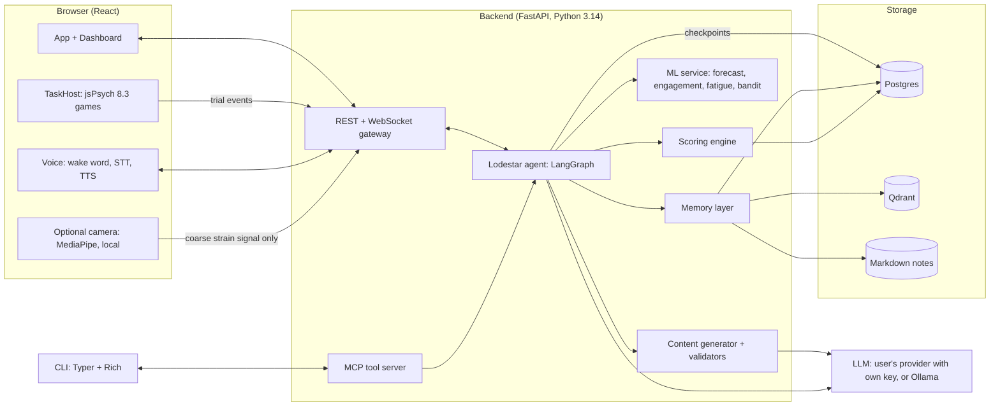

# 02 · Architecture

## System map



Camera frames and raw audio never leave the browser. Only a coarse number ("possible strain: 0.4") and transcripts go to the server, and only if the user switched those on.

## Tech stack

| Layer | Choice | Why |
|---|---|---|
| Frontend | React 19 + Vite 8 + TypeScript 6.0, Tailwind 4 | Fast to build with agents, modern UX |
| Games | jsPsych 8.3.0 (MIT), mounted in a `<TaskHost>` component; our own plugins | Accurate timing; plain DOM we can fully style |
| Charts | ECharts (`echarts-for-react`) for radar, heatmap, bands; visx/D3 for the night sky | ECharts covers all required charts out of the box |
| Backend | FastAPI, Pydantic v2, Uvicorn | Same language as ML and the simulator |
| Agent | LangGraph 1.2.x (verified: `StateGraph`, `Send`, `Command`, `interrupt`, `RetryPolicy`, `CachePolicy`, `BaseCheckpointSaver`, `BaseStore`) | Explicit state, pauses, checkpoints, subgraphs |
| Database | **PostgreSQL 18**, `psycopg` 3.3 + `psycopg-pool`, SQLAlchemy 2.1 Core, Alembic migrations | Transactions, constraints, locks, easy SQL for the dashboard |
| Checkpoints | `langgraph-checkpoint-postgres` 3.2 (`AsyncPostgresSaver`) on the same pool | Official, maintained; durable pauses and time travel |
| Long-term memory | Qdrant 1.19 server (Docker), `qdrant-client` 1.19; custom LangGraph `BaseStore` backed by Qdrant | Hybrid search, filters, time decay |
| Embeddings | FastEmbed 0.9 (local CPU): `BAAI/bge-small-en-v1.5` (dense, 384 dims) + `Qdrant/bm25` (sparse) | Local, free, no data sent out |
| LLM | One interface, many backends. Hosted, with the user's own key: Anthropic, OpenAI, Google Gemini, DeepSeek, xAI Grok, Mistral, Groq, OpenRouter (LangChain chat-model integrations). Local: Ollama with a small open model (privacy/offline mode). A stub for tests | The user picks and pays for their own AI; the switch itself is a robustness and ethics argument (see `03`) |
| ML | scikit-learn, LightGBM (quantile), custom split-conformal | Honest prediction ranges |
| Voice | Web Speech API or Whisper for STT; Kokoro-js (Apache-2.0) or browser SpeechSynthesis for TTS; Porcupine Web for the wake word | See `12` |
| CLI | Typer + Rich, talking to the MCP tool server | One set of tools for web and CLI |
| Realtime | WebSocket streaming of graph events and coach tokens | The live "agent timeline" panel |
| Infra | Docker Compose: `frontend`, `backend`, `postgres`, `qdrant`, optional `ollama` | One command to run everything |

## Pinned versions (checked against npm, PyPI and release tags on 20 Oct 2026)

Pin these exactly (`==` in Python, exact versions in `package.json`, image tags in Compose). Upgrades go through a dedicated work package.

**Runtimes and services**

| Piece | Version | Note |
|---|---|---|
| Python | **3.14.x** | 3.15.0 is out, but `onnxruntime` (needed by FastEmbed) and `ctranslate2` (faster-whisper) have no 3.15 wheels yet |
| Node.js | **24 LTS** | Node 26 is current and should become LTS soon; switch then |
| PostgreSQL | **18.x** (latest 18.6) | Native `uuidv7()`; 19 is still in beta |
| Qdrant server | **1.19.2** | Matches `qdrant-client` 1.19 |
| Ollama | **0.40.6** | |

**Backend (PyPI)**

| Package | Version | | Package | Version |
|---|---|---|---|---|
| fastapi | 0.156.2 | | langgraph | 1.2.16 |
| pydantic | 2.14.1 | | langgraph-checkpoint | 4.3.0 |
| uvicorn | 0.54.0 | | langgraph-checkpoint-postgres | 3.2.0 |
| psycopg (+ binary) | 3.3.6 | | langchain-core | 1.6.12 |
| psycopg-pool | 3.3.3 | | qdrant-client | 1.19.1 |
| sqlalchemy | 2.1.5 | | fastembed | 0.9.0 |
| alembic | 1.20.0 | | mcp | 2.3.0 |
| lightgbm | 4.7.0 | | ollama | 0.6.3 |
| scikit-learn | 1.9.1 | | faster-whisper | 1.2.1 (last release Oct 2025; optional server STT) |
| mapie | 1.6.0 | | typer | 0.27.3 |
| numpy | 2.5.4 | | rich | 15.0.0 |
| pandas | 3.0.6 | | pytest | 9.1.1 |
| ruff | 0.17.1 | | mypy | 2.4.0 |
| cryptography | 50.0.2 | | | |

**LLM provider integrations (PyPI, checked 20 Oct 2026)**

| Package | Version | | Package | Version |
|---|---|---|---|---|
| langchain-anthropic | 1.7.6 | | langchain-xai | 1.3.0 |
| langchain-openai | 1.7.2 (also OpenRouter via `base_url`) | | langchain-mistralai | 1.1.6 |
| langchain-google-genai | 4.4.2 | | langchain-groq | 1.1.3 |
| langchain-deepseek | 1.1.1 | | langchain-ollama | 1.1.0 |

**Frontend (npm)**

| Package | Version | | Package | Version |
|---|---|---|---|---|
| react, react-dom | 19.3.1 | | jspsych | 8.3.0 |
| vite | 8.3.4 | | @jspsych/plugin-* | exact 2.x versions pinned in `package.json` at WP0.1 (latest seen: 2.2.0; need jspsych ≥ 7.1) |
| @vitejs/plugin-react | 6.1.2 | | echarts | 6.1.0 |
| typescript | **6.0.3** | | echarts-for-react | 3.0.6 (supports ECharts 6) |
| tailwindcss, @tailwindcss/vite | 4.3.3 | | @visx/visx | 4.0.0 (supports React 19) |
| eslint | 10.13.0 | | d3 | 7.9.0 |
| typescript-eslint | 8.72.0 | | zod | 4.6.7 |
| prettier | 3.9.10 | | openapi-typescript | 7.13.0 |
| vitest | 5.0.5 | | @mediapipe/tasks-vision | 1.1.1 |
| @playwright/test | 1.64.1 | | @picovoice/porcupine-web | 4.0.1 |
| @huggingface/transformers | 4.3.1 | | kokoro-js | 1.2.1 |
| @fontsource-variable/bricolage-grotesque | 5.3.0 (display type, self-hosted) | | @fontsource-variable/inter | 5.3.0 (UI type) | | @fontsource-variable/geist-mono | 5.3.0 (labels, numbers) |

**Supporting packages and images (added in WP0.1, same pinning rule)**

| Piece | Version | | Piece | Version |
|---|---|---|---|---|
| pyyaml | 6.0.3 | | @types/react, @types/react-dom | 19.3.0 |
| jsonschema | 4.26.0 | | @types/node | 24.19.2 |
| pytest-asyncio | 1.4.0 | | @eslint/js | 10.0.1 |
| httpx (tests) | 0.28.1 | | eslint-plugin-react-hooks | 7.1.1 |
| types-pyyaml | 6.0.12.20260906 | | eslint-plugin-react-refresh | 0.5.7 |
| uv | 0.11.19 | | eslint-config-prettier | 10.1.8 |
| Node.js | 24.22.0 (`.nvmrc`) | | globals | 17.13.0 |
| Image `python` | 3.14.5-slim | | jsdom | 30.1.3 |
| Image `node` | 24.22.0-slim | | @testing-library/react | 16.3.3 |
| Image `postgres` | 18.6 | | @testing-library/jest-dom | 7.0.1 |

**Known version conflicts**

- **TypeScript 7.0 is out, but use 6.0.3.** `typescript-eslint` 8.72 only supports TypeScript below 6.1, so TS 7 would break linting.
- **kokoro-js 1.2.1** (May 2025, still the latest) depends on `@huggingface/transformers` ^3.5, while Whisper in the browser would use 4.3. Two copies would ship. Option: keep Kokoro on its own 3.x copy in a lazy-loaded chunk, or run Whisper on the server with faster-whisper.
- **openapi-typescript 7.13.0** declares a peer dependency on TypeScript 5. `frontend/package.json` overrides it to use our TypeScript 6.0.3; generation works and `make contracts` checks the output.
- **Tailwind 4** configures through CSS (`@theme`), not `tailwind.config.js`; agents trained on Tailwind 3 examples must follow the v4 docs.

## Repo layout

```
ai4brain/
├── AGENTS.md  README.md  LICENSE (MIT)  THIRD_PARTY.md  docker-compose.yml  Makefile
├── registry/                    # source of truth for skills, games and LLM providers
│   ├── dimensions.yaml
│   ├── llm_providers.yaml       # provider ids, base URLs, default models, capabilities
│   ├── batteries.yaml           # onboarding and check-up game sequences
│   └── games/<game-id>.yaml
├── frontend/
│   └── src/
│       ├── app/                 # routes, layout
│       ├── games/<game-id>/     # plugin.ts, config.yaml, README.md
│       ├── taskhost/            # jsPsych mounting, trial event streaming
│       ├── dashboard/           # night sky, radar, curves, heatmaps, ACS gauge
│       ├── coach/               # chat, why cards, persona picker
│       ├── voice/               # wake word, STT, TTS
│       └── affect/              # behaviour signals, optional camera
├── contracts/                   # generated: openapi.json, registry JSON Schemas (`make contracts`)
├── backend/
│   ├── api/                     # FastAPI routes, websocket
│   ├── contracts/               # Pydantic contract models shared by API, events and the graph
│   ├── registry/                # registry models and loader
│   ├── agent/                   # LangGraph: state.py, graph.py, nodes/, subgraphs/, tools/
│   ├── llm/                     # provider adapters, key vault, model factory, fallback ladder
│   ├── db/                      # SQLAlchemy tables, queries, Alembic migrations
│   ├── memory/                  # qdrant store, markdown notes, consolidation
│   ├── scoring/                 # kalman_elo.py, hshs.py, loadings.py, staircase.py
│   ├── generation/              # content schemas, validators, solvers, block engine
│   ├── coach/                   # facts packets, validator, language filter, personas
│   ├── ml/                      # training notebooks, models/, serving
│   ├── acs/                     # collaboration score
│   ├── mcp_server/              # MCP tools for CLI
│   └── ethics/                  # consent, retention jobs, export, delete
├── cli/                         # lodestar CLI
├── simulator/                   # simulated users + experiments (see 15)
├── memory/                      # Lodestar's Markdown notes per user (gitignored, see 04)
├── models/                      # trained model files (gitignored; registry in Postgres)
├── docs/                        # plan/ (this plan), dimension docs, model cards, figures
└── design/reference.png         # dashboard reference image
```

## Main data flow for one game round

1. The agent decides on a game and difficulty, builds an exercise spec, and **pauses** (LangGraph `interrupt`) with the spec as payload.
2. The browser receives the spec over the WebSocket, `TaskHost` runs the jsPsych timeline, and each trial streams to `POST /events` (inserted into `twin.events` and `twin.trials`).
3. When the game ends, the browser resumes the graph with `Command(resume=results)`.
4. The agent scores and updates the Brain Twin in one Postgres transaction, writes memory, and coaches. All of it streams back live; a Postgres `NOTIFY` refreshes the dashboard.

Because the graph is paused and checkpointed in Postgres while the user plays, a refresh or a crash mid-game loses nothing.

## API sketch

| Method | Path | Purpose |
|---|---|---|
| POST | `/sessions` | Start a session (trigger: voice, ui, cli, schedule) |
| WS | `/sessions/{id}/stream` | Graph events, coach tokens, exercise specs |
| POST | `/sessions/{id}/resume` | Resume with game results or a user answer |
| POST | `/events` | Append trial events (batched) |
| GET | `/twin` | Current profile + history for the dashboard |
| POST | `/chat` | Talk to Lodestar or the Twin |
| GET/POST | `/consent` | Read or update consent switches |
| GET | `/llm/providers` | Supported providers and, for a saved key, its models |
| PUT/DELETE | `/llm/credentials/{provider}` | Save (after a test call) or remove the user's key; responses show only the last 4 characters |
| PUT | `/llm/selection` | Pick the active provider and model, or local mode |
| GET | `/export` | JSON export of everything we hold |
| DELETE | `/me` | Delete everything, return a receipt |
