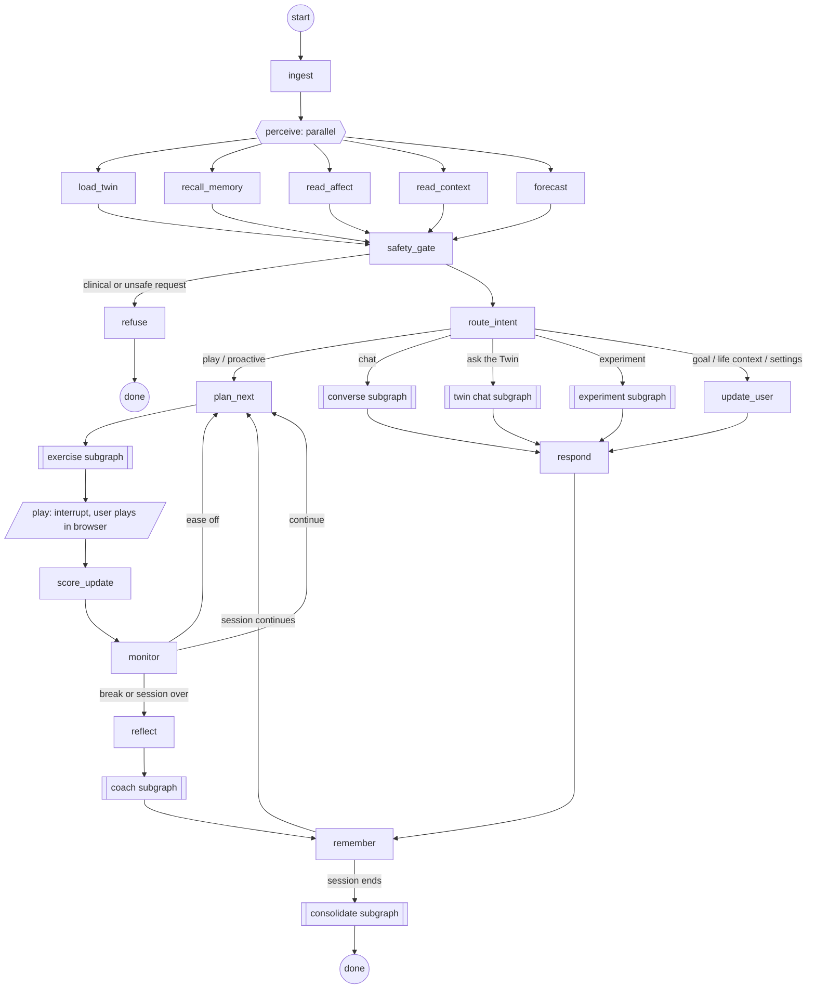

# 03 · The Najma agent loop (LangGraph)

This is the heart of the project and the part we show off. The goal is an agent loop that is **engineered**: every step is explicit, durable, explainable, testable and observable. It's not a chatbot with tools stapled on.

Verified against `langgraph` 1.2.16 and `langgraph-checkpoint` 4.3.0 (October 2026): `StateGraph`, `START`, `END`, `Send`, `Command`, `interrupt`, `RetryPolicy`, `CachePolicy`, durability modes, `get_stream_writer`, `get_store`, `BaseCheckpointSaver`, `BaseStore`.

## Design principles

1. **Code decides, the LLM talks.** Which skill to train, at what difficulty, and when to stop are decided by deterministic, tested code. The LLM writes content, understands free-form user input, and phrases coaching. The LLM can *propose* a plan change; code accepts it only if it passes rules.
2. **Every decision leaves a reason.** Each decision node writes a `Decision` record (inputs, candidates, scores, winner, reason in plain words). The UI shows these live, and the coach cites them.
3. **Durable by default.** The graph pauses while the user plays and survives refreshes, crashes and restarts. Checkpoints live in Postgres.
4. **Degrades gracefully.** The user's hosted provider → local Ollama → fixed templates. The app never dead-ends because an API is down.
5. **Testable without an LLM.** Every LLM node accepts a stub model, so the full loop runs in CI and in the simulator.

## The loop in one picture



Double-bracket boxes are subgraphs. `play` is the pause.

**As built (WP1.4):** every scored round gets an after-game coach message (UW2), so the play path runs `score_update → monitor → reflect → coach → remember`, and `remember` uses the monitor's verdict to go back to `plan_next` (continue, ease), on to `consolidate` (end, break), or end the run (chat turns). The perceive fan-out uses `Send`; the five nodes join at `safety_gate`.

## State

One Pydantic model, split into channels with reducers so parallel nodes can write safely.

```python
class NajmaState(BaseModel):
    # identity and trigger
    user_id: str
    session_id: str
    trigger: Literal["voice", "ui", "cli", "schedule", "proactive"]
    persona: Literal["zitouna", "barq", "hikma", "sahbi"]
    messages: Annotated[list[AnyMessage], add_messages] = []

    # perception (filled in parallel)
    twin: TwinSnapshot | None = None           # mu, sigma, n, last_practised per dimension
    memories: list[MemoryHit] = []            # from Qdrant
    affect: AffectReading | None = None       # frustration_p, fatigue_p, sources used
    context: list[LifeContextWindow] = []     # "exam week", "slept badly"
    forecast: dict[str, ForecastBand] = {}    # from the ML service

    # routing and planning
    intent: Intent | None = None
    decisions: Annotated[list[Decision], operator.add] = []   # append-only reason log
    plan: SessionPlan | None = None
    exercise: ExerciseSpec | None = None

    # results
    rounds: Annotated[list[RoundResult], operator.add] = []
    acs_events: Annotated[list[AcsEvent], operator.add] = []
    facts: FactsPacket | None = None
    reply: CoachReply | None = None

    # control
    budget: SessionBudget                      # max rounds, max minutes, fatigue point
    degraded: list[str] = []                   # e.g. ["llm:anthropic->ollama"]
```

`Decision` is the explainability backbone:

```python
class Decision(BaseModel):
    node: str
    at: datetime
    question: str                   # "Which skill next?"
    candidates: list[Candidate]     # each with a score breakdown
    chosen: str
    reason: str                     # plain words, shown in the UI
    evidence: list[str]             # event ids / fact ids
```

Run-scoped settings (LLM selection, seed, consent flags) travel in LangGraph's runtime `context`, not in state. The LLM selection holds a provider, a model and a credential id, never the key itself.

## Nodes

| Node | Kind | What it does | Reliability |
|---|---|---|---|
| `ingest` | code | Normalise input from voice transcript, UI, CLI or schedule. Load persona and consent | — |
| `perceive` fan-out | code | `Send` to five nodes that run in parallel | each has a timeout; failure = empty input, recorded |
| `load_twin` | code | Read `twin.dimension_state`, recent `twin.history` and `core.md` | — |
| `recall_memory` | code | Hybrid Qdrant search on the user's message or session goal (`04`) | `RetryPolicy(max_attempts=3)` |
| `read_affect` | code + model | Behaviour-based frustration and fatigue (`12`); folds in the optional camera signal at low weight | — |
| `read_context` | code | Active life-context windows | — |
| `forecast` | code | Calls the ML service for growth bands (`10`) | cached per day (`CachePolicy`) |
| `safety_gate` | rules + small LLM check | Detects requests for diagnosis, medical advice or crisis language; routes to `refuse` with a kind template and resources | — |
| `route_intent` | LLM (structured output) + rules | Classifies intent; returns `Command(goto=...)` | falls back to keyword rules |
| `plan_next` | **code (policy)** | Chooses the next skill and game with a scored utility (below) | — |
| exercise subgraph | code + LLM | Chooses difficulty, generates and validates content (`08`) | repair loop, pool fallback |
| `play` | `interrupt` | Sends the exercise spec to the browser and waits | `durability="sync"` before pausing |
| `score_update` | code | Kalman-Elo update, snapshot write, ACS events (`07`, `11`) | idempotent by round id |
| `monitor` | code + model | Checks frustration, fatigue point, budget; decides continue / ease / break / end | — |
| `reflect` | code | Builds the facts packet from this session's numbers (`09`) | — |
| coach subgraph | LLM + validator | Draft → verify → repair → stream (`09`) | template fallback |
| `remember` | code + LLM | Scores salience, writes Qdrant points and the journal (`04`) | async writes |
| consolidate subgraph | LLM + code | End-of-session "sleep": summarise, merge duplicates, update `core.md`, decay old memories | runs in background |

### How `plan_next` decides (the policy)

For each candidate skill *d*, a utility with visible parts:

```
U(d) = 0.35 · uncertainty(d)      # sigma_d / sigma_start: what we know least about
     + 0.20 · staleness(d)        # days since practised, capped
     + 0.20 · goal_weight(d)      # user's goals
     + 0.15 · plan_priority(d)    # weekly plan, experiments in progress
     + 0.10 · bandit_gain(d)      # expected improvement from the "best next game" bandit (10)
     - 0.25 · fatigue_penalty(d)  # if fatigue is rising, prefer short, easy, fun games
     - 0.15 · repetition(d)       # avoid the same game twice in a row
```

Mode decides the success target: **Assess** aims at 60–70% (more informative), **Train** at 75–85% (better for learning), and the user can pick Chill, Balanced or Push. The top three candidates and their score breakdown go into a `Decision`, so Najma can say: "I picked memory because it's the skill I'm least sure about (uncertainty 0.31) and you last practised it 9 days ago."

The LLM can suggest overrides ("the user said they want reasoning today"). These enter as `goal_weight` changes, never as direct picks, so the policy stays in charge.

**As built (WP2.3).** A named game or skill ("play Echo", "a memory game") is honoured for one pick. A new user first plays the onboarding battery (`registry/batteries.yaml`, Quick Draw first) in Assess mode. After 14 or more days away the first three picks are in Assess mode with a "welcome back" reason (UW15). Active goals set `goal_weight`. `bandit_gain` and `plan_priority` are 0 until WP3.3 and WP3.2, and still appear in every breakdown. Only games whose browser plugin exists (`available: true`) are offered.

### The pause: how a game is played

```python
def play(state: NajmaState) -> dict:
    results = interrupt({"type": "exercise", "spec": state.exercise.model_dump()})
    return {"rounds": [RoundResult.model_validate(results)]}
```

The browser resumes with `graph.invoke(Command(resume=results), config)`. Inside a game, the browser enforces small safety rules on its own (for example, after 4 mistakes in a row it offers "easier?"). If the user quits early, the browser resumes with `{"status": "stopped", "reason": "user" | "frustration"}`, and `monitor` handles it kindly.

### `monitor` routing

| Condition | Route | Example reason shown |
|---|---|---|
| frustration_p > 0.7 or 2 stopped games | `plan_next` in ease mode (Chill target), or a break after two stopped games | "That one looked tough. Let's do something lighter." |
| answers slowing (late RT z > 1.5 vs the session's start) with more errors | end | "Your answers are slowing down compared with the start. Good place to stop." |
| minutes > fatigue point from the ML model | `reflect` | "Your speed usually drops after about 14 minutes. Good place to stop." |
| rounds ≥ budget | `reflect` | — |
| otherwise | `plan_next` | — |

## Subgraphs

**Exercise subgraph.** `pick_level` (choose difficulty so predicted success hits the target) → `generate_content` (LLM, strict JSON) → `validate` (schema, solver, banned words, novelty check against the exercise collection in Qdrant) → up to 2 repairs → else take a pre-generated item from the pool. Generation uses `CachePolicy`, and pools are refilled in the background.

**Coach subgraph.** `draft` (LLM with persona, facts packet, memories) → `verify` (every number and claim must map to a fact id; clinical filter) → `repair` (send violations back, max 2) → `fallback_template` if still failing. Streams tokens only after verification passes, sentence by sentence.

**Converse subgraph.** Free chat with tool calling. Tools (typed, validated, also exposed over MCP for the CLI):
`read_profile(dim?)`, `get_history(dim, range)`, `search_memory(query)`, `start_game(game_id?)`, `set_goal(...)`, `log_life_context(note, start, end)`, `explain(decision_id)`, `update_settings(...)`, `start_experiment(hypothesis)`.
Tools that change data ask for confirmation through an `interrupt` before writing.

**As built (WP2.11).** `route_intent` runs keyword rules first (`backend/agent/intents.py`) and asks the model only when the rules aren't sure; one structured call returns the intent and, for a chat, the tool. On the 100 labelled utterances the rules get 100/100; on 30 held-out phrasings they get 22/30 alone and 25/30 with the local model, and only 1 of 30 is routed wrongly without asking. `safety_gate` works the same way: rules first, and a model check only when a message touches on health; the model can add a refusal, never lift one. Goal, life-context and settings turns use the converse tools (`set_goal`, `log_life_context`, `update_settings`), so the plan's `update_user` node is gone. The subgraph is four nodes, `converse → [confirm] → use_tool → answer`, so a pause or crash never repeats a model call or a write; writes are idempotent by the tool call id. A question asked while a game is waiting comes back to that game afterwards; only a new pick from `plan_next` abandons it. Declined skills stay out for the rest of the session, "something quick" means a game of 60 s or less, and after a skill is turned down in 3 sessions in a row Najma asks once whether to pause it (`app.skill_pauses`). Answers cite their facts; a `[D1]` citation carries the decision id, and the UI opens the decision card from `GET /decisions/{id}`.

**As built (WP3.6): the MCP tool server.** `backend/mcp_server` exposes the converse tools over MCP (Streamable HTTP at `/mcp` on the API), plus `chat`, `confirm`, `finish_round`, `start_game` and `goals`. `chat` runs the same LangGraph session through the web app's `SessionRunner`; the read and write tools are the functions in `backend/agent/tools.py`. Calls sign in with the web app's bearer token. Write tools keep the "ask before writing" rule: the first call returns an MCP input request (the 2026-07-28 multi-round flow; older clients get an elicitation) with Najma's question and the facts behind its numbers, and nothing is written until the answer is yes. A goal asked for more narrowly than the range can get is widened, and Najma says so from a fact. The `najma` CLI (`cli/`, Typer + Rich, `bin/najma`) is one client of this server.

**Twin chat subgraph.** The Twin speaks in first person ("I'm sharper in the morning"), but only from a facts packet built for the question, plus memories. Same verifier as the coach.

**Experiment subgraph.** Multi-session personal experiments (for example morning vs evening focus). Steps: propose → consent (`interrupt`) → schedule sessions → collect over days → Bayesian comparison of the two conditions → report with confidence. Experiment state lives in the `agent.experiments` table and is picked up by `plan_next` through `plan_priority`.

**Consolidate subgraph.** Runs when a session ends: writes the journal entry, merges near-duplicate memories, updates `core.md`, applies memory decay. See `04`.

## LLM providers (bring your own key)

Users paste an API key for the provider they want, or stay on the local model. Nodes never pick a provider; they ask the factory for a model with the capabilities they need.

| Provider | Integration | Notes |
|---|---|---|
| Anthropic | `langchain-anthropic` | |
| OpenAI | `langchain-openai` | |
| Google Gemini | `langchain-google-genai` | |
| DeepSeek | `langchain-deepseek` | China-hosted; the consent screen says so |
| xAI Grok | `langchain-xai` | |
| Mistral | `langchain-mistralai` | EU-hosted option |
| Groq | `langchain-groq` | Low latency; good for voice replies |
| OpenRouter | `langchain-openai` with OpenRouter's `base_url` | One key, many models |
| Ollama (local) | `langchain-ollama` | No key; privacy and offline mode |
| Stub | ours | Tests and the simulator |

- **Registry:** `registry/llm_providers.yaml` lists each provider's id, base URL, default model and capabilities (structured output, tool calling, streaming). Adding a provider is a YAML entry, plus one adapter if it isn't covered by an existing integration.
- **Models:** when a key is saved, the backend makes one cheap test call and lists the provider's models; the user picks one or keeps the registry default. Nodes never hard-code model ids.
- **Factory:** `llm.get_model(role, ctx)` (role = `content`, `coach`, `router`, `safety`, `memory`) resolves the user's selection, decrypts the key in memory, and returns a LangChain chat model wrapped with timeout, retry and the fallback ladder. Keys never enter state, runtime context, checkpoints, traces or logs (`AGENTS.md` rule 9); a redaction filter on every logger is the second line of defence.
- **Time limit:** every interactive call has 30 seconds; a slower rung falls to the next one. On this team's CPU-only laptops the local model (qwen3.5:4b, thinking off) takes 10-25 s for a coach message.
- **Capabilities:** a node that needs structured output or tool calling gets a model that supports it, or falls back to Ollama, then templates. Every fallback is recorded in `degraded`.
- **Background jobs** (the content pool filler) have no user, so they use the operator's provider from `.env` if one is set, else Ollama; if neither is available, pools hold code-generated content only.
- **Same rules for every provider:** facts packets, the verifier and the language filter don't change, so switching provider can't change facts or decisions (UW20, UW22).

## Persistence: Postgres checkpointer

We use the official `AsyncPostgresSaver` from `langgraph-checkpoint-postgres` 3.2, on the same `psycopg` connection pool as the rest of the backend.

```python
async with AsyncPostgresSaver.from_conn_string(DB_URL) as saver:
    await saver.setup()                      # run once, from our migration step
    graph = builder.compile(checkpointer=saver, store=QdrantStore(...))
```

- Thread id = `session_id`, so each session's whole history can be listed with `graph.aget_state_history(config)`.
- Nodes that pause (`play`, consent prompts) run with `durability="sync"`, so the checkpoint is committed before the browser gets the exercise.
- `adelete_thread` is called by the user's "Delete my data" action.
- **Time travel:** we can replay any session from any checkpoint. Useful for debugging and for a "rewind this session" view in the trace viewer.

Long-term memory goes through LangGraph's store interface with our own `QdrantStore(BaseStore)` (implements `batch`/`abatch` for get, put, search and list-namespaces). Nodes call `get_store()` and never touch Qdrant directly. Namespaces: `("users", user_id, "episodic" | "facts" | "exercises")`.

## Streaming and the "agent timeline"

We stream with modes `updates` and `custom` (the runner turns them into UI events). Raw `messages` tokens are not forwarded: user-facing text is streamed as `say` events only after the verifier has passed it, sentence by sentence. Nodes use `get_stream_writer()` to emit:

```json
{"kind": "decision", "node": "plan_next", "chosen": "working_memory", "reason": "Least certain skill, 9 days since practice"}
{"kind": "node", "node": "recall_memory", "status": "done", "ms": 42}
{"kind": "degraded", "what": "llm", "from": "anthropic", "to": "ollama"}
```

The UI shows a live timeline of Najma's steps and a small graph diagram (exported with `graph.get_graph().draw_mermaid()`) with the current node lit up. That makes the agent's work visible instead of hidden behind a chat box.

## Reliability ladder

| Failure | Response |
|---|---|
| Hosted LLM slow, down, out of credit, or key rejected | Retry with backoff (`RetryPolicy`) on transient errors only, then switch to Ollama, then templates; recorded in `degraded`. A rejected key or exhausted credit also shows a short notice in settings |
| LLM returns invalid JSON | Repair loop, then content pool |
| Coach draft fails verification | Repair loop, then a template built only from facts |
| Qdrant down | Memory steps return empty and are recorded; the session continues |
| Postgres connection drops | Pool reconnects; a failed scoring transaction rolls back and is retried by round id |
| Browser closes mid-game | Graph stays paused at `play`; resumes next time |
| Duplicate resume | `score_update` is idempotent by round id |

## Testing

- **Node tests** with a stub chat model and fixed seeds.
- **Graph tests**: golden paths (first visit, normal session, frustrated user, clinical request refused, Qdrant down, LLM down).
- **Invariant tests** run after every step: no biometric write path to the profile, every coach number is in the facts packet, every decision has a reason, success-rate target respected.
- **Simulator runs** drive the real graph headlessly with simulated users (`15`).

## Observability

Every node writes to `agent.traces` (start/end, latency, tokens, degradations), and every decision to `agent.decisions`. A trace viewer page in the dashboard reads them. No external tracing service is needed; LangSmith or Langfuse can be added later.

## Why this architecture

- A free-roaming agent is hard to test and explain. A deterministic policy with LLM edges is cheap, predictable and explainable, which hits Explainability (15%) and Safety (10%).
- LangGraph gives explicit state, parallel steps, pauses for human input, checkpoints and subgraphs, which are exactly the features this loop needs.
- Postgres (transactions, checkpoints, an append-only event log) + Qdrant memory keep data consistent, inspectable and fully deletable with one cascade, which supports the ethics requirements.
- The degradation ladder and simulator-tested invariants target Robustness (25%) and Generalisation (25%) in the final.
