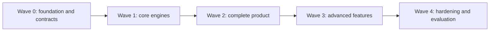

# 16 · Build plan for coding agents

The code is written by coding agents. This file splits the build into **work packages (WPs)** ordered by dependency, not by calendar. Packages in the same wave that don't depend on each other run **in parallel**, each by its own agent.

## How to run a work package

1. Give the agent: `AGENTS.md`, the spec files listed under **Read**, and the package text.
2. The agent works on its own branch (or git worktree) named `wp/<id>`.
3. The agent is done only when every **Done when** check passes locally.
4. An integrator agent merges finished packages into `main` and runs the **wave gate**.
5. If a package needs to change a shared contract (from WP0.2), it stops and the integrator updates the contract first, so parallel agents never disagree on interfaces.

### Prompt template

```
You are building work package <ID> of the AI4Brain project.
Follow AGENTS.md strictly. Read: <spec files>.
Build: <Build list>.
Do not change files outside: <paths>, except to add tests.
You are done when these pass: <Done when commands>.
Report: what you built, files changed, anything you could not do.
```

## Dependency graph



---

## Wave 0: foundation and contracts (sequential, one agent)

Everything else builds on these, so they go first and stay stable.

| ID | Read | Build | Done when |
|---|---|---|---|
| **WP0.1 Repo and infra** | `02`, `AGENTS.md` | Monorepo layout from `02`; Docker Compose (frontend, backend, Postgres 18, Qdrant 1.19, Ollama) with the versions pinned in `02`; Makefile (`up`, `test`, `lint`, `sim`, `e2e`, `lint-language`); CI running lint + tests; MIT licence, `THIRD_PARTY.md` | `make up` starts all services healthy; `make lint test` pass on the empty skeleton |
| **WP0.2 Contracts** | `03`, `04`, `05`, `06`, `07`, `09`, `11` | Pydantic models: event types, `ExerciseSpec`, `RoundResult`, `TrialEvent`, `TwinSnapshot`, `Decision`, `FactsPacket`, `AcsEvent`, `AffectReading`, `NajmaState`; OpenAPI schema; generated TypeScript types; registry YAML for all 16 dimensions, all games in `06` and the LLM providers (`03`), with a JSON Schema validator for the YAML | `make contracts` regenerates TS types with no diff; registry validates; contract tests pass |
| **WP0.3 Database** | `04` | Alembic migration with every table in `04`, monthly partitions for `twin.events`, the append-only trigger, roles; DB access layer (SQLAlchemy Core); `AsyncPostgresSaver.setup()` in the migration step; seed script | `alembic upgrade head` on an empty DB works; tests insert and read each table; updating `twin.events` fails |

**Wave 0 gate:** `make up && make test` green; contracts frozen.

---

## Wave 1: core engines (parallel, 6 agents)

| ID | Depends | Read | Build | Done when |
|---|---|---|---|---|
| **WP1.1 Scoring engine** | 0.2 | `07` | `backend/scoring/`: Kalman-Elo predict/update/drift, HSHS, loadings from registry, level ↔ knobs, target selection, staircases, norms interface, data-quality trust | Property tests: σ never grows from an answer; μ moves toward S; drift capped; targeting hits p* ± 0.05 on synthetic data |
| **WP1.2 Simulator v1** | 0.2, 1.1 | `15` | `simulator/`: user generator (correlated skills, learning, forgetting, RT, nuisance types); runs the scoring engine directly (not the graph yet); experiments 1–3 from `15` with plots | `make sim N=200` passes recovery r > 0.8 after 3 sessions, coverage 75–85%, success 80 ± 5% |
| **WP1.3 TaskHost and first games** | 0.2 | `06`, `13` | React app shell; `<TaskHost>` mounting jsPsych 8.3 imperatively; shared game frame; trial event batching to the API; 3 reference games: Quick Draw, Ink Clash, Echo | Vitest unit tests; Playwright plays each game with scripted input and the API receives correct trial events |
| **WP1.4 Agent skeleton** | 0.2, 0.3 | `03` | LangGraph graph with every node from `03` as a stub; parallel perceive fan-out with `Send`; `interrupt` in `play` and resume with `Command`; Postgres checkpointer; streaming (`updates`, `messages`, `custom`); WebSocket and session endpoints; LLM layer (`03`, LLM providers): provider registry, the eight hosted adapters, Ollama and stub, encrypted key vault, `/llm` endpoints, fallback ladder, log redaction | Graph test: start → play (pause) → resume → coach → remember completes with the stub LLM; a killed server resumes a paused session after restart; each hosted adapter passes a recorded-response contract test; a canary key never appears in logs, traces, checkpoints or events |
| **WP1.5 Memory layer** | 0.2, 0.3 | `04` | Qdrant collections and payload indexes; `memory.search` with enforced `user_id` filter; hybrid retrieval (prefetch, RRF, decay formula, MMR); `QdrantStore(BaseStore)`; Markdown notes (`core.md`, journal) with atomic writes; consolidation subgraph (summarise, dedupe, promote facts, decay) | Tests: a search without user id is impossible; retrieval ranks a recent relevant memory over an old one; dedupe merges near-duplicates |
| **WP1.6 Event ingestion and scored rounds** | 0.3, 1.1 | `04`, `07` | `POST /events`; the scored-round transaction (events, trials, rounds, dimension state, history) with advisory lock and idempotency; `NOTIFY twin_updated`; `rebuild-twin` | Concurrency test with 2 parallel writers; replaying the same round twice changes nothing; rebuild gives identical projections |

**Wave 1 gate:** e2e test: open the app, start a session, play Quick Draw, see `twin.dimension_state` change, receive a stub coach reply over the WebSocket. Simulator thresholds pass in CI.

---

## Wave 2: complete product (parallel, up to 11 agents)

| ID | Depends | Read | Build | Done when |
|---|---|---|---|---|
| **WP2.1 Core games** | 1.3 | `06` | The remaining 12 P1 games (Arrow Storm, Odd One Out, Hold It, Light Path, Market List, Souk Rush, Symbol Code, Switch, Pattern Gap, Spot the AI's Mistake, Turn It, Number Line), each with YAML, `level_map`, README with paradigm source | Each game: Playwright scripted play; metrics computed match a hand-calculated fixture |
| **WP2.2 Content generation** | 1.4 | `08` | Schemas, structured LLM calls, validators (schema, content rules, language, solvers, novelty via Qdrant), repair loop, pool filler job, matrices generator, Spot-the-Mistake pipeline | Fuzz test: 500 generations with the stub and Ollama backends, zero invalid items served; solver confirms every puzzle |
| **WP2.3 Policy and monitor** | 1.1, 1.4 | `03`, `07` | Real `plan_next` utility with decisions written to `agent.decisions`; mode selection (Assess, Chill, Balanced, Push); `monitor` routing (frustration, fatigue, budget); onboarding battery | Graph tests for each `monitor` route; simulator run through the graph keeps success 80 ± 5% |
| **WP2.4 Coach** | 1.4, 1.6 | `09` | Facts packet builder; coach subgraph (draft, verify, repair, template fallback); persona style blocks; language filter and red-team list; refusal templates for diagnosis and crisis | Verifier tests: injected wrong numbers and uncited claims are caught; `make lint-language` passes on 200 red-team outputs; final pass rate 100% |
| **WP2.5 Dashboard** | 1.3, 1.6 | `13` (+ `design/reference.png`) | Home, after-game, Brain Twin night sky (brightness = μ, blur = σ), radar with uncertainty ring, curves with bands and forecast, heatmaps, goals, agent timeline with live graph, why cards, Memory & data screen | Visual tests on seeded data; every chart shows its range; live update on `twin_updated` |
| **WP2.6 AI Collaboration Score** | 1.6, 2.1 | `11` | ACS events from games and agent; hint ladder component; Beta posteriors, weights, Monte Carlo range; dashboard gauge data endpoint | Unit tests on the formula; weight redistribution when data is thin |
| **WP2.7 ML: forecast and norms** | 0.2 | `10` | Lumosity download script, growth forecast (power-law baseline, LightGBM quantile, split-conformal), NCPT norms, model cards, `ml_models` registry, `predict()` service | Held-out coverage within 77–83% for nominal 80%; model cards generated; forecast endpoint returns bands |
| **WP2.8 Ethics and data rights** | 0.3, 1.5 | `14` | Consent screens and API, layered switches, AI provider screen (pick provider, paste key, pick model, remove key), export (generated on request), delete job with receipt, retention job, 18+ gate, de-identified facts packets for cloud LLM | Delete test proves zero rows, points, notes and checkpoints remain for that user; turning a switch off stops that processing |
| **WP2.9 Behaviour-based affect** | 1.3, 1.4 | `12` | Browser signals (error streaks, RT z-scores, rapid taps, quits), mood check, "Was I right?" button, rule-based `frustration_p` and `fatigue_p` | Simulator frustration-prone users trigger easing; test that no affect value reaches the profile |
| **WP2.10 Voice basics** | 1.4 | `12` | Tap-to-talk orb, Web Speech API STT, browser TTS with per-persona voice and rate, captions | Voice round-trip test with recorded audio fixture |
| **WP2.11 Conversation** | 1.4, 1.5 | `03`, `09` | `ingest`, `safety_gate`, `route_intent`, converse subgraph with typed tools and confirm-before-write interrupts | Intent tests on 100 labelled utterances; tools that write always pause for confirmation |

**Wave 2 gate:** full e2e session: consent → onboarding → 3 games → coach with why cards → dashboard updates → export → delete. Simulator through the real graph passes all thresholds in `15`.

---

## Wave 3: advanced features (parallel)

| ID | Depends | Read | Build | Done when |
|---|---|---|---|---|
| **WP3.1 P2 games** | 2.1, 2.6 | `06`, `11` | Brake, Look Here, Night Guard, Control Tower, Digits Back, Seen It?, Callback, Twins, Connect, Secret Rules, Zigzag, Tower, Guide the Robot, Logic Lock, Word Burst, Scramble, Teach Me, Which Jar?, Quick Maths, Balloon Pump, "How sure are you?" | Same checks as WP2.1; ACS hooks fire in Guide the Robot and Teach Me |
| **WP3.2 Twin chat and experiments** | 2.4, 2.11 | `09`, `03` | Twin chat subgraph (first person, grounded); experiment subgraph (propose, consent, schedule, Bayesian comparison, result card) | Simulated users with a hidden time-of-day effect: the experiment detects it with the reported confidence |
| **WP3.3 More ML** | 2.7, 2.9 | `10` | OULAD engagement-risk model; fatigue changepoint model; Thompson-sampling bandit feeding `bandit_gain` | Engagement AUC and calibration reported; bandit beats random game choice on the simulator |
| **WP3.4 Advanced voice** | 2.10 | `12` | "Hey Najma" wake word (Porcupine Web), Kokoro-js TTS voices, Whisper private mode, voice-guided games | Wake-word false-trigger test on 30 minutes of background audio; tap-to-talk fallback always works |
| **WP3.5 Camera strain cues** | 2.9 | `12`, `14` | MediaPipe Face Landmarker blendshapes in the browser; coarse `strain_cue`; fusion with weight ≤ 0.3; indicator; separate consent | Network test proves no frames leave the browser; the no-profile-write test still passes |
| **WP3.6 MCP server and CLI** | 2.11 | `02`, `03` | MCP tool server exposing the converse tools; `najma` CLI (Typer + Rich): chat, start game (text-mode games where possible), profile view | CLI e2e: chat, view profile, set goal |
| **WP3.7 Custom games from blocks** | 2.2 | `08` | Block engine as jsPsych timelines; recipe schema and validator; reliability weighting | 50 LLM-generated recipes: all valid ones run, all invalid ones rejected |
| **WP3.8 Detective story mode** | 3.1 | `06` | Story wrapper chaining games into chapters | Playwright completes one story |
| **WP3.9 Voice tone and spoken games** | 2.9, 2.10 | `12`, `14` | `AudioWorklet` feature extractor (speech rate, pause ratio, pitch variability, loudness, hesitation words); per-user baseline; `voice_strain_cue`; fusion with the camera cue at ≤ 0.3; separate consent switch and indicator; spoken modes for Word Burst, Digits Back, Teach Me | Feature tests on recorded fixtures (fast, slow, hesitant speech); network test proves no audio or features leave the browser except the coarse cue; no-profile-write test still passes |
| **WP3.10 Late games** | 3.1 | `06`, `11` | The L games: Two Screens, Sum & Keep, Name Tags, Maze Escape, Fold & Punch, Card Gamble, Unusual Uses (creativity: LLM-rated, experimental) | Same checks as WP2.1; Unusual Uses never enters an overall score |

---

## Wave 4: hardening and evaluation

| ID | Depends | Read | Build | Done when |
|---|---|---|---|---|
| **WP4.1 Robustness** | all | `15`, `03` | Degradation ladder tests (LLM down, Qdrant down, Postgres reconnect, refresh mid-game); cheat and noise detection; device-latency calibration; row-level security | Every item in the robustness checklist in `15` passes in CI |
| **WP4.2 Evaluation suite** | all | `15`, `10`, `11` | All 11 experiments in `15` as `make eval`, plots to `docs/figures/` | `make eval` produces every figure and a summary table |
| **WP4.3 Docs from code** | all | `05`, `11`, `14` | Generate the 16 dimension pages from the registry, ACS formula page, data policy page, model cards index | Docs build with no missing fields |
| **WP4.4 Extensibility drill** | all | `05`, `06` | An agent adds a brand-new dimension and game from scratch using only YAML + one plugin | New dimension appears in the Twin, gets scored and picked by the policy; simulator passes |

---

## Rules for the integrator

- Merge a package only when its checks pass on top of current `main`.
- After every merge: `make lint test`; after each wave: the wave gate, `make sim`, and the user-workflow tests listed for that wave in `18`.
- Contract changes go through WP0.2's files and regenerate TS types before dependent packages continue.
- Keep `main` always runnable with `make up`.
